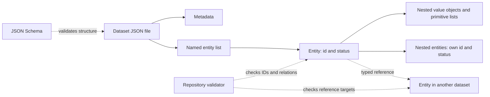

# Aion Logix — data model principles

This document records the agreed starting principles and proposes refinements for review. Proposed conventions below are not yet approved. The domain model, dataset inventory, schemas, and migration will be designed separately before building the HTML/JS application.

## Author clarifications adopted for schema version 0.1.0

- Pending confirmation is a temporary review state. A completed baseline scope has no pending or speculative records and no unresolved reconciliation issues. Structural validity alone does not establish completeness.
- Agreement identity and clauses live in separate datasets, each independently confirmable. The earlier illustrative nested-clause proposal is superseded.
- Phase 1 confirms historical ownership shares and commitments. Cost/economic decisions remain for their later phases; legacy financial wording is preserved as evidence, not silently approved.
- The world story runs linearly from 1 January 1972. Time travel explains the protagonist’s advantage; no jump log or personal experience timeline is modelled. Earlier/future background can remain in premise descriptions.
- Migration must recover indirectly mentioned entities and reconcile scattered or conflicting statements with source-level provenance.

See `docs/data-model/SCHEMA_DESIGN.md` for the current schemas and explicit limits.

## Approved extensions — schema version 0.2.0

On 27 October 2026 the author approved optional campaign presentation stages and booth areas, a premise-owned equipment inventory, and an event reference on process steps. These are installed in the strict schemas; nested value objects inherit their owning record’s status. Approval files and import decisions are archived under `docs/review/history/2026-10-27/`.

## Assessment

The hierarchical–relational approach fits a JSON-based narrative knowledge base: nested objects describe an entity's internal details, while references connect independently identifiable entities. Separate datasets support incremental migration and validation without requiring a database server.

The main risks are duplicated facts, unstable identifiers, ambiguous nested-record status, broken references, and predictions becoming stale after baseline changes. The refinements below address these risks while retaining the proposed structure.

## Starting principles

1. The model combines hierarchical data with relations between records.
2. Each dataset lives in a separate JSON file. The file contains a list named after the dataset and a `metadata` object. For example, `actor.json` contains `actor` and `metadata`. Metadata includes `description`, `used_by_pages`, and `used_by_calculations`.
3. A record can contain nested objects and lists. These are JSON structures, not filesystem directories.
4. Every entity record starts with an `id` of the form `<list name>.<further text>`.
5. Records may reference records in other datasets.
6. Each entity record has one of these exact `status` values:

| Status | Meaning |
| --- | --- |
| `pending confirmation` | Data proposed by the assistant through analysis or extrapolation, awaiting the author's confirmation. |
| `confirmed` | A baseline record explicitly confirmed by the author. It is authoritative within the alternative story, including where it contradicts real history. |
| `speculation` | A prediction that must be reassessed whenever baseline records are added or changed. |

Real-world historical evidence does not automatically establish story canon. The assistant must not promote a record to `confirmed` without the author's decision.

## Proposed refinements

### 1. Distinguish entities from value objects

An entity has its own identity and lifecycle, can be referenced, and requires `id` and `status`. A value object, such as a date interval or a measurement, belongs to its parent and has no separate identity or status. Primitive list entries also do not require IDs.

Embed a value when it belongs exclusively to one parent. Use a reference when the target is shared, independently maintained, or queried as an entity. Avoid copying a shared entity into several records. Promote relationships to separate entities when they need their own dates, evidence, status, or other attributes.

If a nested list contains entities, each entity follows the same ID and status rules. Its prefix is its declared list/entity type. Entity-type names must have a consistent meaning across the model. Keep JSON nesting practical rather than imposing an arbitrary depth limit.

### 2. Use stable, globally unique identifiers

Use singular `snake_case` dataset names and filenames, for example `actor.json` and `actor`. A proposed ID pattern is `<entity_type>.<stable_key>`, such as `actor.time_traveler`.

IDs are unique throughout the repository, including nested entities. Do not derive them from array position, display name, mutable dates, or a parent's current location. Do not reuse deleted IDs. Renames and moves must preserve identity; unavoidable ID changes require an explicit migration and reference updates.

Write `id` first and `status` second for readability. JSON object order has no semantic meaning, and consumers must not depend on it.

### 3. Make references explicit and verifiable

Use fields ending in `_id` for a single reference and `_ids` for a list of references. Each schema declares the allowed target entity type or types and cardinality. Resolve a reference through a global ID index, not by guessing a file path from the ID.

Validate that every reference resolves, has the expected target type, and respects cardinality. General relations may form cycles; parent–child containment must not. Other cycle restrictions should be defined per relation.

### 4. Define the dataset envelope

Require exactly the named dataset list and `metadata`, with any future envelope fields introduced through schema versioning. Proposed metadata fields:

| Field | Type | Purpose |
| --- | --- | --- |
| `description` | string | Dataset purpose and inclusion boundaries. |
| `schema_version` | string | Version of the structural contract used by this file. |
| `used_by_pages` | string array | Stable identifiers of consuming pages; empty before pages exist. |
| `used_by_calculations` | string array | Stable identifiers of consuming calculations; empty if none exist. |

Usage lists are documentation, not runtime dependency declarations. Generate or audit them against actual consumers once application code exists. Specify required fields, optional fields, and empty-list behavior in each dataset schema.

### 5. Keep status separate from evidence and review state

Status describes a record's role in the story, not the quality of a source or whether a calculation is current. Add provenance where relevant: source references, original migration location, reasoning, and confirmation evidence. A migrated record must not silently become `confirmed`; preserve known author decisions and flag unknown status for review.

Confirmed data should not contain speculative claims disguised as ordinary fields. If a claim needs a different status, model it as a separate entity with its own status. Value objects inherit their owning entity's status; nested entities carry their own explicit status.

Allowed transitions must reflect author decisions: confirmation requires explicit approval; downgrading or revising confirmed canon also requires an explicit author decision. Keep a decision history rather than silently rewriting the basis for confirmation.

### 6. Track speculation dependencies and reassessment

For speculative records, propose `depends_on_ids`, the baseline revision used for analysis, and a separate review state such as `current` or `needs reassessment`. Dependency edges explain the prediction; they do not weaken the requirement to reassess all speculation after a baseline change.

On adding, editing, removing, or changing the status of a confirmed record, mark all speculation for reassessment. Use explicit and transitive dependencies to prioritize review. Reassessment may retain, revise, or withdraw a prediction and must record its outcome before clearing the review flag. Do not automatically promote predictions to facts.

A baseline revision should identify baseline content deterministically or use a controlled revision marker. Define its computation before implementing this workflow. Git history alone is insufficient unless a specific baseline revision is explicitly associated with each assessment.

### 7. Represent time, quantities, and unknowns consistently

Separate story dates from editorial timestamps. Support known precision: a year such as `1974` must not silently become `1974-01-01`. Design a shared date/interval value object for partial dates, ranges, and uncertainty. Use ISO 8601 UTC timestamps for editorial events.

Define units for quantities and currencies for money, including the reference year when relevant. Distinguish an unknown value from zero, an empty collection, and a value that does not apply. Define omission and `null` per field rather than using them interchangeably.

Keep historical sources distinguishable from alternative-story claims. The representation of timelines and historical counterparts remains a domain-design decision; do not assume multiple timelines are needed.

### 8. Validate structure and semantics separately

Use JSON Schema Draft 2020-12 for field types, required fields, status enums, identifier syntax, and reusable value objects. Prefer strict schemas that reject misspelled fields, with deliberate versioned extensions.

Add repository-wide validation for global ID uniqueness, reference integrity, relationship rules, baseline revisions, and reassessment obligations. JSON Schema alone cannot enforce these cross-file rules. Domain-specific chronological checks should allow intentional time-travel exceptions rather than rejecting them by default.

Migration should be repeatable and produce a report of source coverage, transformed records, duplicates, unresolved references, conflicts, and missing decisions. Preserve source locations; never silently discard or invent information to satisfy the new schema.

## Illustrative envelope

This is a structural example, not an approved story fact or a final actor schema. It shows the original status spelling and the proposed metadata fields.

```json
{
  "actor": [
    {
      "id": "actor.example_person",
      "status": "pending confirmation",
      "name": "Example person"
    }
  ],
  "metadata": {
    "description": "People participating in the alternative story.",
    "schema_version": "0.1.0",
    "used_by_pages": [],
    "used_by_calculations": []
  }
}
```

## Recommended documentation and visualization

Use **JSON Schema as the structural source of truth, Markdown for meaning and decisions, and Mermaid for diagrams**. All three are text-based, versionable, and reviewable alongside the data. No application UI is required for this design phase.

Proposed layout, to create once the model is agreed:

```text
DATA_MODEL_PRINCIPLES.md
data/                         One JSON file per dataset
schemas/                      Dataset schemas and shared definitions
docs/data-model/overview.md    Dataset catalog and overall relationship diagram
docs/data-model/datasets/      Meaning, field dictionary, rules, examples per dataset
docs/data-model/decisions/     Dated decisions and their rationale
docs/data-model/examples/      Small valid examples and intentional invalid cases
migration/                    Migration tooling and mapping specifications
```

Maintain two complementary views:

1. **Relationship diagram:** dataset/entity types, reference names, and cardinalities. Use Mermaid ER diagrams for relations and separate containment diagrams for nested structures.
2. **Record shape:** a field tree or representative JSON example for each dataset, showing nested objects, lists, IDs, status boundaries, and references. Show required/optional fields and types in a schema-derived field dictionary.

Add a speculation dependency graph when prediction rules are designed. A chronological view of story events can follow once temporal semantics are agreed; it is a different view from the schema diagram.

Generate field dictionaries and, where practical, reference diagrams from schemas using explicitly documented reference annotations. Keep descriptions and decision rationale authored in Markdown. Validate examples against schemas and check generated documentation for drift.

The following diagram illustrates the architectural layers only, not the future domain model:



## Next design steps

1. Inspect `venwry/vs_edu1` and inventory datasets, embedded entities, references, duplicate facts, and historical versus alternative-story assertions.
2. Review the proposed refinements in this document, especially entity boundaries, nested statuses, identifiers, and baseline revision handling.
3. Design a small connected set of entity types using representative source records; document unresolved decisions.
4. Review diagrams and sample JSON together before finalizing schemas.
5. Implement validation and a pilot migration, inspect its coverage and conflict report, then expand to the agreed baseline datasets.
6. Begin HTML/JS application design after the data contract and baseline migration are accepted.
