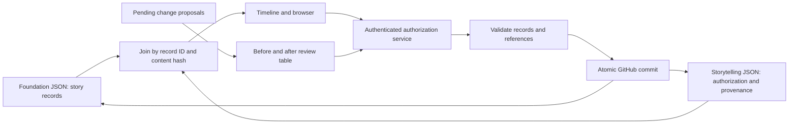

# Aion Logix — data model principles

## Current agreement: separation of story and authoring data

Version 0.3.0 implements the author's October 2026 instruction to separate modelled story content from its development and authorization process.

1. The model combines hierarchical value objects and relational entity references. Each entity has a stable `id` beginning with its dataset name.
2. `data_foundation/` contains only story records, in envelopes such as `{ "actor": [...] }`. It has no status, confirmation, provenance or application metadata fields.
3. `data_storytelling/` contains authorization, decisions, proposals, provenance, migration mappings, editorial issues and the model manifest. Previous review evidence remains immutable in its original form.
4. `data_calculation/` is reserved for calculation inputs/results. Its domain schemas will be designed with the relevant phases.
5. Foundation records use explicit typed references. Owned value objects remain nested; independently maintained entities have their own IDs.
6. Events' occurrence, projects' completion, agreement lifecycle and clause assertion mode describe the world and remain in the foundation. They are distinct from author authorization.
7. The world timeline is linear from 1 January 1972. Dates preserve year/month/day precision; editorial date basis and original qualifiers are retained in the external pre-separation context snapshots.
8. Pending confirmation and speculation have one current review meaning: **Unauthorized**. Their old labels survive only in historical evidence.
9. **Authorized** means an author decision covers the exact current foundation content hash. Missing or mismatched authorization is always Unauthorized; an absent queue entry never implies approval.
10. Approval of a proposed revision applies and authorizes its explicitly listed resulting records as one transaction. Related clauses are not implicitly authorized. Independent records require independent or explicitly grouped decisions.
11. New authorization decisions preserve before/after snapshots and content hashes. Sources and historical decisions remain outside the story. Structural validity alone does not establish authorization.
12. JSON Schemas reject undeclared foundation fields. Schema extensions require author approval; this separation was authorized in the conversation. Foundation fields and editorial schemas are documented separately.
13. The application joins foundation records and external authorization by ID and verifies content hashes before showing Authorized. It does not write computed UI status back into the foundation.
14. The authenticated backend validates current content and references before saving to GitHub. Multi-file changes use one Git commit and a non-forced branch update. Stale edits never silently overwrite newer content.

The original phase-one schema versions are archived under `schemas/archive/0.2.0/`; original logs are retained under `docs/review/history/`. See [SEPARATION.md](docs/data-model/SEPARATION.md) for the current file mapping and [RENDER_SETUP.md](docs/RENDER_SETUP.md) for direct saving.

