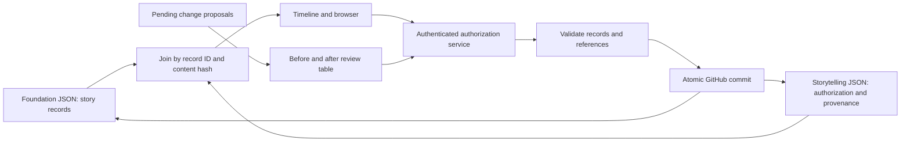

# Aion Logix — data model principles

## Current agreement: separation of story and authoring data

Version 0.4.0 retains the author's October 2026 instruction to separate modelled story content from its development and authorization process.

1. The model combines hierarchical value objects and relational entity references. Each entity has a stable `id` beginning with its dataset name.
2. `data_foundation/` contains only story records, in envelopes such as `{ "actor": [...] }`. It has no status, confirmation, provenance or application metadata fields.
3. `data_storytelling/` contains current authorization, direct-save decisions, proposals, the source catalogue, unresolved editorial issues and the model manifest. Completed migration mappings, former models and historical review snapshots are preserved unchanged in `archived_no_longer_valid/`.
4. `data_calculation/` is reserved for calculation inputs/results. Its domain schemas will be designed with the relevant phases.
5. Foundation records use explicit typed references. Owned value objects remain nested; independently maintained entities have their own IDs.
6. Authorization of the entire record is the sole distinction for candidate results. Do not add occurrence, completion-state or intended/achieved flags. Independently reviewed commitments and outcomes require separate records.
7. The world timeline is linear from 1 January 1972. Only events and processes own structured story dates. An event has one year/month/day date; a process has start/end boundaries, each a calendar date, event reference (`precision: "event"`) or explicitly unknown boundary. Other records reference these carriers. Preserve source precision and store editorial qualifications externally.
8. Pending confirmation and speculation have one current review meaning: **Unauthorized**. Their old labels survive only in historical evidence.
9. **Authorized** means the author agrees with the **entire record**, including every nested input, outcome and other owned value, and the decision covers its exact current foundation content hash. There is no partial or item-level authorization. If a record is too complex to authorize in one step, decompose coherent parts into independently identified records in appropriate dataset files and reference them. References do not propagate authorization. Missing or mismatched authorization is always Unauthorized; an absent queue entry never implies approval.
10. Approval of a proposed revision applies and authorizes its explicitly listed resulting records as one transaction. Related clauses are not implicitly authorized. Independent records require independent or explicitly grouped decisions.
11. New authorization decisions preserve before/after snapshots and content hashes. Sources and historical decisions remain outside the story. Structural validity alone does not establish authorization.
12. JSON Schemas reject undeclared foundation fields. Schema extensions require author approval; this separation was authorized in the conversation. Foundation fields and editorial schemas are documented separately.
13. The application joins foundation records and external authorization by ID and verifies content hashes before showing Authorized. It does not write computed UI status back into the foundation.
14. The authenticated backend validates current content and references before saving to GitHub. Multi-file changes use one Git commit and a non-forced branch update. Stale edits never silently overwrite newer content.

The original phase-one schema versions are archived under `archived_no_longer_valid/schemas/archive/0.2.0/`; original logs are retained under `archived_no_longer_valid/docs/review/history/`. See [the repository map](docs/REPOSITORY_MAP.md) for the current file mapping and [RENDER_SETUP.md](docs/RENDER_SETUP.md) for direct saving.

## Phase 1B structure

Events and processes have numbered, typed inputs and outcomes. Team actions are process `steps`; a step may reference an event milestone or a sub-process. Programmes are processes; narrative-period groupings are retired. Campaigns own marketing objectives, audiences, messages, presentation and booth content, and reference an execution process. They do not duplicate activities or dates.

Product and technology identities, manufacturing capabilities and qualitative market responses connect the story. Product composition, quantitative yields, costs and ROI remain for later phases. Maturity transitions are outcomes on dated carriers. See the [current model guide](docs/data-model/MODEL_GUIDE.md) and [generated schema reference](docs/data-model/FOUNDATION_SPECIFICATION.md).
