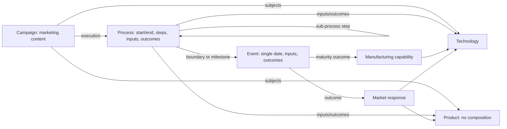

# Phase 1B — implementation and migration, model 0.4.0

Implemented on `feature/phase-1b-foundation`, from repository baseline `52dc739`, using `vs_edu1` source commit `dac733770d8e622d5619bd84bc9d21db6c7ec7ab`. This installs the agreed structure; it does not authorize the imported or revised story.

## Structure

The [foundation specification](FOUNDATION_SPECIFICATION.md) contains the complete hierarchical schema diagram and reference catalogue. The smaller diagram below explains the main relationships.

Only events and processes own structured calendar dates. A process boundary can reference an event with `{ "value": "event.id", "precision": "event" }`, preserving that event's precision. Missing boundaries use `{ "value": null, "precision": "unknown" }`; the timeline does not invent a duration. Definitively reversed ranges and unresolved references fail validation.

Team actions are numbered process `steps`. A step may link an event or sub-process; it does not need its own event. Inputs and outcomes contain `number`, `type` and `description`, with typed references where relevant. Process completion state and event occurrence flags are removed. Candidate outcomes are distinguished solely by whole-record authorization.

Campaigns require an execution process. Objectives, audiences, messages, presentation stages and booth content remain in the campaign. Operational activities move into process steps. Programme deliverables become outcomes, and acceptance criteria become inputs. Relationships between coordinating processes are preserved without inventing parent/child ownership.

## Migrated inventory

| Dataset | Records |
| --- | ---: |
| actor | 48 |
| actor_relationship | 7 |
| location | 11 |
| assumption | 33 |
| agreement | 20 |
| clause | 109 |
| event | 145 |
| process | 54 |
| campaign | 11 |
| product | 145 |
| technology | 33 |
| manufacturing_capability | 10 |
| market_response | 27 |
| **Total** | **653** |

The 13 programmes are mapped into processes, including merges with existing execution records. Three duration-based events become processes: Aurelia campaign preparation, NCC 1978 sessions/media, and NCC 1982 case studies. All nine narrative periods are archived: their mixed chronology did not justify converting each whole grouping into a thematic process.

Products include offerings, technical editions, services, devices and course identities. Exact-name software offering/edition matches are consolidated with both source identities retained in mappings. Composition, component BOMs, yield curves, detailed costs and quantitative demand forecasts are excluded. Manufacturing capabilities cover four AION logic-node scopes and six DRAM recipe scopes. Qualitative market responses are connected to dated event outcomes; importing them does not establish commercial success as authorized fact.

## Authorization and evidence

**54 existing authorizations remain valid. 599 current records are pending authorization.** There are 431 new or structurally changed records; seven previously authorized records changed and therefore require renewed review. Unchanged pending records remain pending. References never propagate authorization.

Each authorization covers the complete current content hash, including nested steps, inputs and outcomes. Previous approval evidence is retained unchanged. The app continues to support selecting records and saving their authorizations in one Git commit; no item-level approval is introduced.

New authoring evidence:

| File/path | Purpose, internal structure and references |
| --- | --- |
| `data_storytelling/phase1b_migration.json` | One migration record with baseline/source commits, ID and product mappings, review entries, notes, source references and counts. Review entries connect record IDs with archived/current hashes and identify formerly authorized content. Editorial qualifications remain here. |
| `data_storytelling/history/phase1b-0.3.0/foundation/` | Exact pre-migration foundation envelopes, including retired programmes and narrative periods. Historical references resolve against this snapshot, not the current foundation. |
| `data_storytelling/history/phase1b-0.3.0/` | Original authorization, authorization decisions, manifest and change queue. Preserves the review state associated with the archived foundation. |
| `schemas/archive/0.3.0/` | Schema contract for that historical snapshot. |
| `data_storytelling/manifest.json` | Current version 0.4.0 and 13 dataset names. `previous_metadata` remains historical evidence. |
| `data_storytelling/authorization.json` | Current whole-record hashes and authorization state for all 653 records. |

The active change queue remains empty: this authorized structural migration is applied on the feature branch, while the resulting story records await review in the browser. The migration report is the before/after audit index, not an approval log.

## Remaining review work and boundaries

- Review inferred subject links and qualitative response wording against the story; provenance is evidence, not authorization.
- Review event-anchored development boundaries and campaign bounds. Campaign bounds cover known linked activities, rather than claiming complete source coverage.
- Supply missing boundaries for undated processes where the story supports them; unknown dates are deliberately visible.
- Review fabrication scope and maturity independently from later quantitative yield/cost assumptions. Partner licence permission alone does not prove a qualified production capability.
- Decompose any record that is too complex to authorize in one decision. Do not add authorization flags inside its inputs or outcomes.
- Continue phases 2–5 and the separate recurring sales/market coverage/ROI assessment as described in the [multi-phase process](../MULTI_PHASE_PROCESS.md).

## Running and deployment

Run `npm ci`, `npm run build`, `npm run validate:data` and the test commands in the README. The timeline derives campaign dates from execution processes and resolves event-based process boundaries. The browser discovers all 13 datasets through the shared model contract.

For a writable preview, both the Render deployment branch and `AION_BRANCH` must target `feature/phase-1b-foundation`. Do not connect model 0.4.0 to a writer targeting the old main-branch model. The backend checks the manifest version. Production deployment and merging into main are separate actions; this migration does neither.

The one-shot migration sequence is `migration/migrate_phase1b.py`, `migration/build_phase1b_schemas.py`, then `node migration/finalize_phase1b.mjs`. It expects the original 0.3.0 baseline and pinned source checkout; do not rerun it over reviewed 0.4.0 data. The finalizer uses the application's JavaScript content hashing and refuses to silently rehash authorized content.
