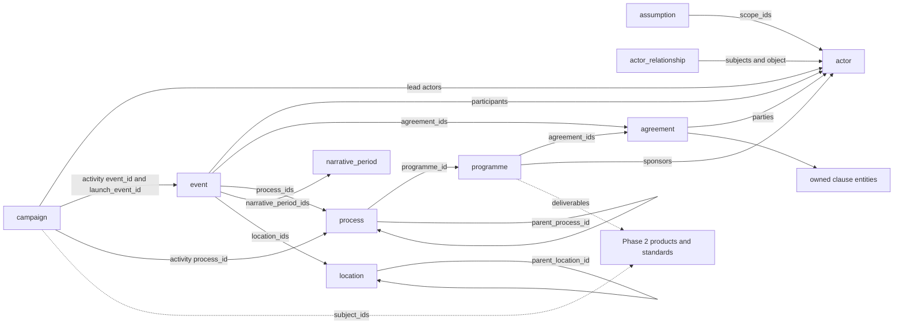
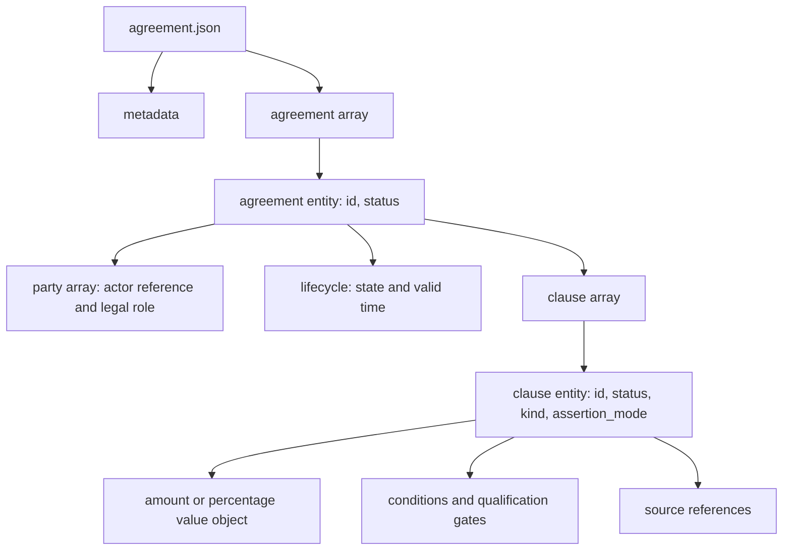
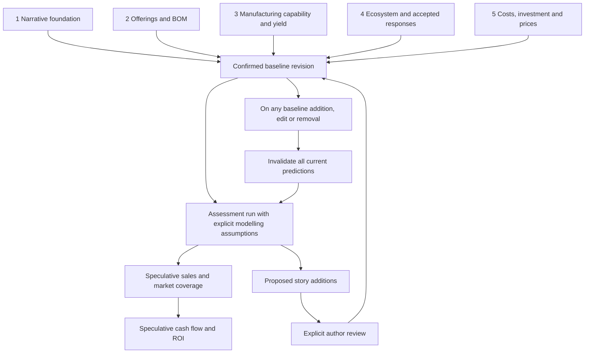

# Phase 1 — proposed narrative data model

**Historical proposal — superseded where amended by [SCHEMA_DESIGN.md](SCHEMA_DESIGN.md).** The author has clarified that pending is temporary, clauses belong in their own dataset, ownership percentages are phase-1 history, and the world timeline starts on 1972-01-01 without tracking personal jumps. Keep this document as the original source-analysis rationale; use the schema design for the current contract.

This proposal follows `DATA_MODEL_PRINCIPLES.md` and the author's five-stage plan. Source inspected: [venwry/vs_edu1 at dac7337](https://github.com/venwry/vs_edu1/tree/dac733770d8e622d5619bd84bc9d21db6c7ec7ab). Counts describe that exact checkout, not a future revision. No legacy data or financial outputs were changed, and no financial model was rerun.

## 1. Recommendation

Use a small set of typed datasets with nested owned details and explicit references between independently identifiable entities. The six requested subjects remain central. Add four supporting story entity types: **programme, actor relationship, location, and narrative period**. Maintain source and review records separately as editorial support.

The key distinction is between **what the author accepts as part of the story** and **what actually happened within the story**. A confirmed agreement to develop a chip is not confirmation that the chip qualified. A confirmed campaign budget is not actual expenditure. A confirmed target is not measured performance.

All five phases supply the author-confirmed foundation. Sales, market coverage, and ROI remain a separate reassessable prediction layer. Nothing in this analysis confirms legacy records on the author's behalf.

## 2. What the repository actually contains

The source has already undergone several migrations. It contains 21 immediate `data/*.json` files, while different documents still mention 21, 22, or 24. Count the files and inspect ownership rather than trusting a historical document's file count.

| Source | Observed content | Design consequence |
| --- | --- | --- |
| `data/world.json` | 30 `entities`, 16 `principles`, scenario and conventions | Separate actor identity, story assumptions, and editorial conventions. |
| `data/events.json` | 145 events; 16 have `agreement_ref`; none has the new `status` field | Preserve stable event IDs, but review assertions and event modality individually. |
| `data/contracts.json` | 16 event-keyed arrays of contractual terms | Create independently identified agreements; events become lifecycle milestones. |
| `data/campaigns.json` | 10 named campaign objects, already carrying `campaign.*` IDs | Normalize to one campaign array; retain specialised nested campaign content. |
| `data/timeline-structure.json` | 9 narrative phases; 15 top-level processes and 4 nested Harvard-year processes | Keep narrative grouping separate from activity duration and design-phase numbers. |
| `data/programmes.json` | 9 mixed domain sections | Extract programmes and policies; allocate costs and forecast inputs to their actual owners. |
| `data/standards.json` | 33 technology records | Mostly phase 2; phase 1 may refer to their subject without designing technical specifications yet. |
| Product/physical collections | 63 products, 60 devices, 452 components, 32 software editions, 15 services | Preserve cross-phase migration links; avoid importing technical definitions into campaign or event records. |
| `data/assemblies.json`, `data/retired_assemblies.json` | 0 active standalone assemblies; 21 archived assemblies | Archive is not current BOM truth. Do not reactivate archived definitions. |
| Manufacturing, investment, cost, ecosystem and demand inputs | Mixed decisions, estimates, engineering limits and forecast coefficients | Classify individual assertions rather than assigning a status to an entire old file. |
| `generated/models/` and `baselines/` | Saved calculations and frozen snapshots | Preserve as evidence of previous calculations; do not import them as confirmed story facts. |

See [SOURCE_INVENTORY.md](SOURCE_INVENTORY.md) for the complete file inventory.

### Concrete examples driving the design

1. **DRI founding:** `events.json#/events/4` records founding in `1974`, explicitly without a known month/day. `contracts.json#/event.dri_founding` records Gary and Dorothy's combined 60%, Adam's 30%, and a 10% employee reserve. The reserve is not an issued voting block, and the couple's internal split is unknown. A generic `owner_id + percentage` field would corrupt that meaning.
2. **Autodesk:** `event.autodesk_agreement` and `event.autodesk_incorporation` describe January agreement and April adoption. Terms also occur in `world.json` (`principle.autodesk_delivery_support`) and `programmes.json#/team_development_program/autodesk_sponsored_deployment`; there is no corresponding Autodesk entry in `contracts.json`. An agreement must survive across multiple events and need not already have a legacy contract key.
3. **SGS:** the transfer agreement combines an accepted framework, a 60/40 funding split, negotiable 3–5% royalties, conditional qualification, and a 25–35% target sourcing share. These cannot all inherit the same meaning from a single free-text status. A target sourcing share is not a shipment forecast.
4. **NCC 1982:** `campaigns.json#/ncc_1982_campaign` embeds packages with `product.*` IDs, device references, budget rows and a $253,000 planning total. Product composition belongs to phase 2; financial provisions to phase 5. The campaign retains its message, audience, activities and claim restrictions, referencing those owners.
5. **Harvard studies:** one process contains four year processes; dates include provisional inferred opening days. `HARVARD_ACADEMIC_DATES.md` is referenced but absent at the repository root in this revision. Record the missing source instead of treating the citation as verified evidence.
6. **Time travel:** `event.power` takes place in 2025 while `event.identity` describes arrival in 1972. Calendar sorting is not personal experience order or causal order.
7. **Conditional competitor behaviour:** `event.ibm_alternative_launch` describes a conditional central-scenario date despite its definitive title. The title alone cannot establish a confirmed occurrence. Phase 4 must decide which responses become canon.
8. **Feedback risk:** `BUILD_PIPELINE.md` describes a forecast stage that updates timeline records, followed by another financial pass. The new system should output proposed story additions without silently writing predictions into confirmed canon.

## 3. Dataset catalog for phase 1

Every file follows `{ "<dataset>": [...], "metadata": {...} }`. Use singular dataset names and matching ID prefixes. Tables list proposed payload fields in addition to the common record fields. Field names are proposals, not final schema commitments.

| File / ID prefix | Responsibility | Main payload and references | Why separate? |
| --- | --- | --- | --- |
| `assumption.json` / `assumption.*` | World premises, strategic policies, constraints and author-selected baseline conditions | `kind`, `statement`, `scope_ids`, `valid_time`, `exception_ids` | Rules can constrain many events without being duplicated. Distinguish premise, policy, target and quantitative assumption. |
| `actor.json` / `actor.*` | People, organisations and explicitly defined groups | `kind`, `name`, `aliases`, `description` | Identity remains stable while affiliations and roles change. |
| `actor_relationship.json` / `actor_relationship.*` | Dated employment, control, operating roles and non-contractual affiliations | `kind`, `subject_actor_ids`, `object_actor_id`, `valid_time`, `established_by_event_id` | Relationships have their own duration and confirmation scope. Contract-owned rights are derived from clauses rather than copied here. |
| `event.json` / `event.*` | A milestone or bounded occurrence | `kind`, `occurrence`, `time`, `participant`, `action`, `outcome`, `agreement_ids`, `process_ids`, `narrative_period_ids`, `location_ids`, `subject_ids` | One occurrence can relate to several agreements, campaigns, processes or products. |
| `campaign.json` / `campaign.*` | A coordinated communication/marketing effort | `objective`, `audience`, `message`, `activity`, `claim_policy`, `lead_actor_ids`, `launch_event_id`, `subject_ids`, later `financial_plan_ids` | Communications are distinct from technical products, sales outcomes and spending. |
| `agreement.json` / `agreement.*` | One agreement across negotiation, signing, adoption, amendment and termination | `kind`, `party`, `clause`, `lifecycle`, `supersedes_agreement_id` | An agreement is not the event at which it was signed. Includes offers and nonbinding cooperation frameworks through explicit legal state. |
| `process.json` / `process.*` | A sustained activity with steps and readiness gates | `kind`, `period`, `participant`, `step`, `milestone_event_ids`, `programme_id`, `parent_process_id`, `completion_state` | Supports study, recruitment, development, transfer and qualification without equating them with fabrication recipes. |
| `programme.json` / `programme.*` | A coordinated initiative containing several processes and deliverables | `objective`, `sponsor_actor_ids`, `agreement_ids`, `deliverable`, `acceptance_gate`, `subject_ids` | Autodesk development support and international clone preparation cross contracts, engineering, marketing and finance. |
| `location.json` / `location.*` | Countries, cities, venues and facilities | `kind`, `name`, `parent_location_id` | Reusable geographic scope; secret facility, organisation and fabrication capability are different things. Create only locations actually needed. |
| `narrative_period.json` / `narrative_period.*` | Author-facing chapters or time bands | `title`, `period`, `display_order` | Retains the nine legacy phases without confusing them with the five design phases or asserting activity completion. |

**Not separate datasets initially:** every message, campaign channel, participant role, date, amount, task and event outcome. These usually belong to their parent. Promote one only when it needs external identity, independent confirmation, or reuse.

**Market segments are not actors.** Review legacy `actor.customers` for a later `market_segment` mapping; retain `actor.others` only if its group meaning is useful and explicit. Do not silently turn an unspecified group into named competitors. Geographic location and commercial market segment remain distinct.

### Editorial support datasets

- `source.json`: repository snapshots, historical documents, author messages/decisions and calculation runs as evidence. Include repository URL, commit and JSON Pointer for migrated assertions. Source existence does not mean the assertion is true.
- `review_decision.json`: explicit author decisions, exact target IDs and content hashes, decision and rationale. A later edit invalidates the applicability of an earlier confirmation to the changed content.
- `migration_map.json`: old path/pointer/ID to zero, one or many target IDs, disposition and unresolved issues. Splits and merges need explicit mappings; this is not another copy of source data.

These support records also receive `id` and `status` under the original record rule. Their technical workflow states use separate fields. A generated evidence entry starts pending; it does not acquire confirmed status merely because a script generated it. They are not story facts and do not enter financial inputs. Their content hashes exclude circular bookkeeping fields and their own confirmation pointers.

## 4. Relationship view

Arrows show stored references. Reverse lists are derived. For example, an event can be found from a campaign activity without also persisting a second campaign membership list on the event.



Cardinality rules:

- Event → participants: zero or more; each participant value object has exactly one `actor_id` and a role. An unknown participant is not an invented actor.
- Agreement → parties: one or more for a draft/unilateral commitment; executed multiparty contracts need the parties required by their agreement kind. Each party has a role and an explicit actor or a documented unresolved identity.
- Agreement → clauses: zero or more during drafting; each clause entity has exactly one owning agreement and can be reviewed independently.
- Process → parent: zero or one; the process hierarchy must be acyclic. Programme membership is initially zero or one; revisit if the source needs shared ownership.
- Campaign activity → event or process: zero or one primary target, expressed as a discriminated union. Unscheduled creative work need not invent an event.
- Event → agreement, process, narrative period, location: zero or more; schema rules can narrow this per event kind.
- Location → parent: zero or one, acyclic. No geographic coordinates are required just to model a facility.
- `subject_ids` and `scope_ids` are typed unions with an explicit allowed-target registry, not arbitrary unchecked strings.

## 5. Hierarchy inside records



A clause needs independent identity because, for example, an accepted SGS funding split and a still-negotiable royalty have different confirmation boundaries. Nested list name `clause` matches `clause.*` IDs; IDs remain globally unique even when nested. If clauses later need reuse or independent version ownership, move them to `clause.json` while retaining IDs and migration history.

A participant, date, amount or alias is a value object, not an entity. It has no separate `id` or `status`. If one of these values is disputed while its parent is confirmed, narrow the parent or extract the disputed assertion as a separate entity; do not hide unconfirmed details inside confirmed canon.

Processes are stored once in `process.json`, using `parent_process_id` for substantive sub-processes such as Harvard years. Small workflow steps remain nested. This deliberately uses relations for independently reviewed activities and hierarchy for owned details, rather than requiring all relationships to be physically nested.

## 6. Common contract and time

Required entity fields: `id`, `status`, plus its type's required payload. Recommended shared fields: `title` or `name`, `description`, `source_refs`, `confirmation_decision_id` when confirmed, and `depends_on_ids` for derived assertions. Avoid mandatory empty arrays for fields that do not apply.

Dataset metadata requires `description`, `schema_version`, `used_by_pages`, `used_by_calculations`. A schema registry maps dataset names to JSON Schemas; `$schema` need not become an extra root field. Usage lists are tooling metadata, not canon.

### Confirmation versus story meaning

| Dimension | Examples | Meaning |
| --- | --- | --- |
| `status` | `pending confirmation`, `confirmed`, `speculation` | Exactly the author's three values. |
| `assertion_mode` on a claim/clause | `premise`, `commitment`, `target`, `estimate`, `observed_outcome` | What is being asserted. Entity-specific schemas limit allowed values. |
| `occurrence` on an event | `proposed`, `planned`, `occurred`, `cancelled`, `unknown` | State of the occurrence inside the story. |
| `lifecycle.state` on an agreement | `offer`, `negotiating`, `executed`, `terminated`, `unknown` | Legal/operational state, independent of author approval. |
| Review freshness on an assessment | `current`, `needs reassessment`, `blocked`, `failed` | Whether the prediction is usable for the current baseline. |

Illustration: `status: confirmed` plus `assertion_mode: target` means the author confirms that the target exists, not that it was achieved. `occurrence: occurred` remains a proposed claim until the author confirms the record.

A confirmed agreement shell confirms identity and existence; it does **not** recursively confirm its nested clauses. The UI and any baseline extractor must display and respect each entity's own status. Confirmed dependent claims cannot rely on pending details as if they were facts.

### Dates and ordering

Use discriminated time value objects:

- Milestone: `{ "kind": "instant", "value": "1974", "precision": "year", "qualifier": "late year", "basis": "legacy scenario" }`.
- Duration: `{ "kind": "interval", "start": { "value": "1978-07", "precision": "month" }, "end": { "value": "1979-10", "precision": "month" }, "basis": "legacy scenario" }`.
- Relative/unknown dates: represent a named milestone reference and relation, or an explicit unknown reason; never substitute January 1.

Allow separate basis/uncertainty on each interval endpoint when necessary. Preserve legacy precision and selected scenario days. Exact-looking inferred dates are not historically verified dates.

World calendar time, causal dependencies and personal experience order are separate. Add optional `experienced_after_event_id` within an actor-specific event participation context when time travel needs it. Neither a narrative period boundary nor an array index supplies a date. Do not require cause timestamps to be earlier than effects across time travel.

## 7. Worked example: DRI agreement

This illustrates a **partial proposed record**, not a migration result or confirmed baseline. Referenced actors are existing legacy identities proposed for preservation. A complete sample fixture will include their actor records and the source record before schema validation.

```json
{
  "agreement": [
    {
      "id": "agreement.dri_founding",
      "status": "pending confirmation",
      "title": "DRI founding and capital agreement",
      "kind": "founding",
      "party": [
        { "actor_id": "actor.adam", "role": "founder" },
        { "actor_id": "actor.kildall", "role": "founder" },
        { "actor_id": "actor.dorothy", "role": "founder" }
      ],
      "lifecycle": { "state": "executed" },
      "clause": [
        {
          "id": "clause.dri_joint_founder_equity",
          "status": "pending confirmation",
          "kind": "equity_allocation",
          "assertion_mode": "commitment",
          "beneficiary_actor_ids": ["actor.kildall", "actor.dorothy"],
          "company_actor_id": "actor.dri",
          "share": { "value": 60, "unit": "percent", "basis": "fully diluted", "allocation": "joint; internal split unspecified" }
        },
        {
          "id": "clause.dri_adam_capital",
          "status": "pending confirmation",
          "kind": "funding",
          "assertion_mode": "commitment",
          "payer_actor_id": "actor.adam",
          "recipient_actor_id": "actor.dri",
          "amount": { "value": 250000, "currency": "USD", "price_basis": "nominal", "reference_year": 1974 },
          "payment_schedule": [
            { "trigger": "formation", "amount": 150000 },
            { "trigger": "scheduled installments within two years", "amount": 100000 }
          ],
          "source_refs": [
            { "source_id": "source.vs_edu1_dac7337", "path": "data/contracts.json", "pointer": "/event.dri_founding/4" }
          ]
        }
      ]
    }
  ],
  "metadata": {
    "description": "Illustrative partial agreement: not all legacy clauses are shown.",
    "schema_version": "0.1.0",
    "used_by_pages": [],
    "used_by_calculations": []
  }
}
```

Currency for the nested schedule is explicitly inherited from its enclosing amount; the schema must enforce that convention. A confirmed funding commitment is not proof of cash payment. Later phase-5 cash-flow entries reference `clause.dri_adam_capital` and payment events rather than re-entering a second contractual total.

`event.dri_founding` keeps its original ID, participant details and year-precision date, and changes its link to `agreement_ids: ["agreement.dri_founding"]`. Creating an agreement ID does not rename or merge the event. DRI's employee reserve and remaining clauses must also migrate with their original semantics; the example intentionally omits them for readability.

## 8. Phase ownership and future boundaries

The five phases describe **design and confirmation work**, not five isolated universes of data. Shared actors, events and sources keep one identity throughout.

| Phase | Author-confirmed foundation | Proposed later entities, not final schemas |
| --- | --- | --- |
| 1 | Premises, actors, commitments, events, campaigns, activities and programme intent | The ten story datasets above |
| 2 | Offerings, specifications, configurations, BOM versions, software editions and underlying parts | `product`, `device`, `component`, `software_edition`, `standard`, composition/version entities |
| 3 | Fabrication capabilities, recipe parameters, qualification conditions, selected yield/cost assumptions | `manufacturing_process`, `facility_capability`, `qualification`, engineering parameter records |
| 4 | Explicitly accepted third-party products, compatibility, partnerships and competitor responses | `external_product`, `compatibility`, `market_segment`; shared actor/event/agreement records |
| 5 | Accepted manufacturing-cost basis, investments, budgets and retail-price policies | `financial_plan`, `investment`, `cost_basis`, `price_schedule`; realised transactions only where explicitly established |

Phase-1 `process` describes work over time; phase-3 `manufacturing_process` describes a fabrication method or recipe. A transfer programme can reference both without conflating them.

A value inferred by a calculation is not automatically confirmed because it belongs to phases 3 or 5. It remains pending or speculative until the author accepts the specific value and its basis. Acceptance may establish a planning assumption, not an observed historical fact. Similarly, phase-4 market responses are initially proposals; only explicitly accepted responses join the foundation.

Cross-phase references stay in migration mappings until real targets are created. A phase-1 pilot must validate its actual graph without fabricated confirmed product stubs. Preserve unresolved legacy references in provenance/migration records rather than pretending that a missing target resolves.

## 9. Prediction and reassessment layer



Propose `baseline_revision.json`, `assessment_run.json` and `forecast.json` later, using the same dataset envelopes. An assessment records the exact baseline content hash, model version, forecast assumptions, scope, horizon, currency basis, population/market denominator and accounting perimeter. Forecast records always have `status: speculation`; a successful run does not change that.

A baseline revision selects confirmed assertions across **all five phases**. Hash canonical semantic content, including nested entities according to their own status. Exclude page usage metadata and purely presentational formatting. Keep hashes of forecast inputs/model versions too: forecasts can become stale even if canon did not change.

On any addition or change to the main confirmed story, invalidate **all** existing predictions immediately. Dependency lists prioritize diagnosis but are not an exemption from reassessment. Draft edits may produce provisional sandbox assessments; they cannot replace assessments of the confirmed baseline. Reassessment can report unchanged results with justification, but it must explicitly reference the new baseline.

Recalculation and review are distinct: if required input is unresolved, mark the assessment blocked. Keep the previous results labelled stale and preserve their provenance. Publish a new current set only after the required chain completes successfully. No invented figures, silent zero values or mixing results from different baseline revisions.

Required future financial distinctions include:

- Manufacturer shipments versus retail sell-through versus installed base.
- Logix-branded sales versus partner-system sales versus upstream chip/software revenue.
- Aion Tech UK distribution versus incremental UK manufacturing or consolidated revenue; ownership remains unspecified in the legacy data.
- BPI operational independence versus ownership and consolidation; neither implies the other.
- Paid Team Edition licences versus sponsored Autodesk development installations.
- Contractual funding, budget provision, actual expenditure and reusable demo equipment.
- Fixed/capacity commitments accepted in phase 5 versus volume-dependent cost projections derived from forecast sales.

These distinctions prevent double counting without pre-deciding numerical assumptions or a particular ROI formula.

## 10. Migration strategy and validation

1. Freeze the source commit and inventory every root/list. Read source JSON, its schemas, related prose, and consumer logic where meaning is ambiguous; filenames alone are insufficient.
2. Build record-level mappings. Preserve compatible `actor.*`, `event.*`, `campaign.*` and `process.*` IDs. Explicitly map `principle.*` → `assumption.*` and `phase.*` → `narrative_period.*`; retain aliases for traceability. Legacy `part.*` renaming belongs to phase 2.
3. Do not infer confirmation from words such as “accepted” in legacy free text. Preserve that evidence and propose review batches. Explicit author confirmation can approve a precisely identified batch; otherwise imported assertions remain pending.
4. Split mixed-status assertions before confirming them. Keep planned dates, estimates, rights, commitments and conditional outcomes distinguishable. Preserve unknown values and qualification caveats.
5. Extract a pilot: world premises, relevant actors, DRI founding event and agreement. Next test SGS qualification/royalties, Autodesk agreement lifecycle, NCC 1982 campaign, and Harvard process hierarchy. These cases exercise different structural risks.
6. Validate complete pilot fixtures against JSON Schema and semantic checks before expanding migration. Report every unmapped, merged, split, deferred or disputed source item.
7. Preserve archive/generated models unchanged as provenance. Do not run legacy numerical rebuilds during structural design or migration.

Proposed semantic checks: globally unique IDs including nested entities; all active references resolve to allowed types; no containment cycles; typed time precision and unknown handling; confirmation decisions match current content; no automatic nested confirmation; terms and financial values have a single owner; no prediction becomes canon without review; revisions and forecast freshness agree. Specialised constraints include ownership basis, joint allocations, reserves, currencies and time-travel ordering.

This analysis is a structural/source inspection, not certification that every existing legacy validation test passes. The source validators and financial models were not executed. The new diagrams are presentation aids, not executable schemas.

## 11. Iterative decisions to make next

Recommended first iteration: agree the ten entity boundaries, then design only `assumption`, `actor`, `event`, and `agreement` around DRI.

The highest-value questions for that iteration are:

1. **Confirmation scope:** accept independent status for nested clauses and the rule that confirming an agreement shell does not confirm all its details?
2. **Canon versus plans:** accept separate status, occurrence and assertion mode, so confirmed plans can remain unfinished?
3. **Identity:** preserve legacy IDs where their prefixes fit; explicitly remap `principle.*` and narrative `phase.*`?
4. **Process grouping:** accept independent processes with parent links and programmes for coordinated work?
5. **Legacy acceptance:** review records in explicit batches, retaining legacy “accepted” wording as evidence rather than automatic confirmation?

No answer is assumed by this proposal. After these decisions, produce small complete JSON examples and matching schemas, review their diagrams together, then migrate the first approved batch. Product, chip and financial schemas remain open until their respective phases.
