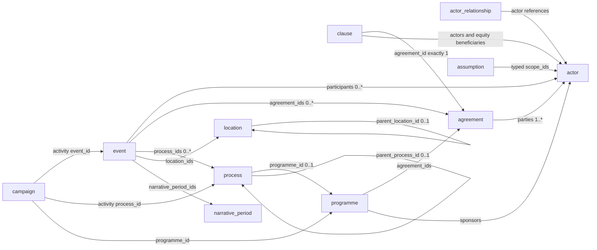
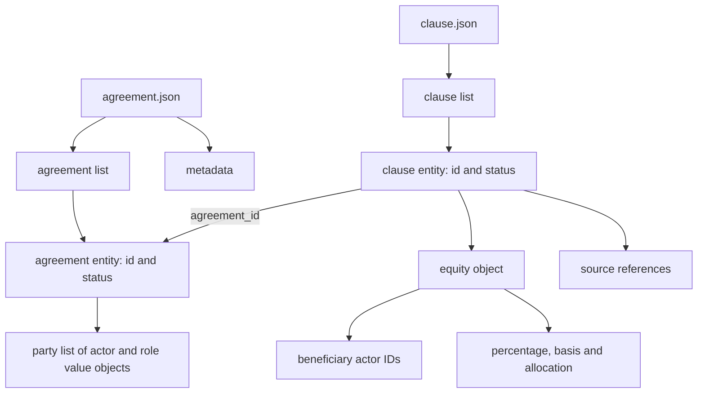

# Phase 1 schema design — version 0.1.0

> Historical design/snapshot: the current model is **0.4.0**. See [implementation, migration and current inventory](PHASE_1B_IMPLEMENTATION.md) and [current schemas](FOUNDATION_SPECIFICATION.md). Counts and proposed alternatives below describe the earlier snapshot.

**Earlier model: 0.3.0.** Story and editorial data are separated. See [SEPARATION.md](SEPARATION.md) and [FIELD_REFERENCE.md](FIELD_REFERENCE.md). The discussion below is historical design context for versions 0.1/0.2 and does not prescribe embedded statuses or current foundation envelopes.


Current extension version: **0.2.0**, adopted from the author’s 27 October 2026 approval log. Added optional `campaign.presentation`, `campaign.booth`, `assumption.equipment` and `process.step[].event_id` exactly as approved. Parent-owned value objects inherit the parent status; actor/event references resolve through the existing validator. Metadata version 0.1.0 remains accepted for historical fixtures. Active data uses 0.2.0. The original design discussion below describes the 0.1.0 foundation.


This is an implemented **design contract**, not a completed story migration. It incorporates the author's clarifications of 26 October 2026 and supersedes conflicting choices in PHASE_1_PROPOSAL.md. The existing source analysis remains useful evidence.

## Decisions incorporated

1. `pending confirmation` is temporary. A structurally valid draft is not complete. Before declaring a baseline scope complete, its records must be confirmed and its reconciliation issues resolved. `speculation` remains permitted for predictions, but does not pass baseline completeness.
2. Agreements and clauses live in **separate files**. An agreement can be confirmed while its clauses are still being reviewed. This is an incomplete agreement package, not a completed baseline.
3. Phase 1 includes ownership percentages, actor roles, agreements and historical commitments. Technical costing, budgets and financial modelling are deferred to the later stages. A monetary commitment mentioned in legacy history is preserved verbatim pending a scope decision; no commitment becomes an approved expenditure or cost assumption automatically.
4. The narrative follows the world from **1972-01-01**. There is no time-jump ledger, personal experience order or alternate-clock ordering. Background about the protagonist's future knowledge belongs in assumptions. Partial dates remain partial.
5. Migration is semantic reconstruction: retrieve entities mentioned indirectly, collect their source fragments, and reconcile contradictions before claiming completeness.

## Physical organisation

```text
schemas/
  common.schema.json
  assumption.schema.json       actor.schema.json
  actor_relationship.schema.json
  event.schema.json            campaign.schema.json
  agreement.schema.json        clause.schema.json
  process.schema.json          programme.schema.json
  location.schema.json         narrative_period.schema.json
  source.schema.json           review_decision.schema.json
  migration_map.schema.json    reconciliation_issue.schema.json
examples/phase-1/               Linked design fixture, not production canon
  <dataset>.json
```

The future live data directory will contain the same dataset filenames. It is deliberately not populated by copying the fixture. Each dataset contains exactly two root keys: its singular name and `metadata`. Each record starts with `id` and `status`; key order remains a readability convention rather than a JSON semantic rule.

Schemas use JSON Schema Draft 2020-12 and reject unknown fields. Their `https://aion-logix.invalid/schemas/` identifiers are logical identifiers resolved locally by the validator, not network URLs to fetch.

Every reference field is annotated with `x-ref` target types. The validator resolves references across loaded datasets. Phase-2 product IDs are not accepted as phase-1 actors or ad-hoc strings: preserve them in source provenance and migration notes until their target schemas exist.

## Main relationship diagram

Arrows below indicate references, not physical containment. A line labelled `0..*` means the source can refer to multiple targets. Inverse lists are derived, avoiding duplicate ownership.



Actor relationships reference actors; actors do not persist a reverse relationship list. Event → agreement links record milestones such as signing or adoption; clauses carry the terms. Programme → agreement links record authorisation or funding, while process → programme links record execution ownership. Campaigns own their communication content and refer to events or processes for scheduled activities.

## Record structure and hierarchy



An entity has an independent identity and confirmation boundary. A value object belongs to its entity: participant roles, dates, amounts, campaign messages and workflow steps do not receive arbitrary IDs. If an owned detail needs separate confirmation, split it into an entity before confirming its parent.

Substantive child processes use `parent_process_id`; small steps remain nested value objects. Clauses use `supersedes_clause_id` for explicit amendments; agreements may likewise supersede earlier agreements. These links must be acyclic. General actor/event relationships may legitimately form cycles.

## Confirmation contract

All entity types retain the exact three statuses:

- `pending confirmation`: proposed or migrated assertion awaiting review.
- `confirmed`: content explicitly accepted by the author.
- `speculation`: a prediction outside completed foundational data.

Confirmed records require a `confirmation` object with an author-decision source ID and a SHA-256 fingerprint of the reviewed record. The fingerprint is computed from recursively key-sorted JSON, preserving array order and excluding the `confirmation` object itself. This detects content edits after approval. It is an editorial integrity mechanism, not cryptographic proof of authorship: the agent must still record genuine author decisions rather than inventing evidence.

`review_decision` supports batch decisions and rationale. The decision's target fingerprints identify exactly which content was reviewed. All editorial records also carry status; their approval confirms the accuracy of the editorial entry, not the truth of every assertion it references. A source record can therefore be confirmed as an accurate citation of an unconfirmed claim.

The verifier does not auto-confirm anything. To revise confirmed content, obtain author approval for the revision and refresh the confirmation fingerprint, or return the changed record to pending while it is reviewed. Do not update a fingerprint solely to make validation pass.

### Why keep occurrence and commitment semantics?

Temporary review status answers “has the author accepted this assertion?”. Other fields answer “what does it assert?”. A confirmed planned launch is a complete assertion about a plan; it is not a claim that the launch occurred. The same applies to a confirmed qualification target or conditional contract. An unresolved `unknown` operational state blocks the stricter completeness check, whereas an explicitly accepted `planned` state does not.

No calculations or speculation can alter confirmed records automatically. All five phases feed the confirmed foundation; sales, market coverage and ROI are recalculated against explicit baseline revisions after changes. Forecast/run schemas remain deferred to the forecasting stage.

## Equity and costs

An equity clause records:

- The company.
- Beneficiary actor IDs.
- The percentage and its basis (`fully_diluted`, `issued`, or `voting`).
- Allocation semantics: `individual`, `joint_unsplit`, or `unallocated_reserve`.

The DRI fixture preserves the 60% joint allocation to Gary and Dorothy, Adam's 30%, and the 10% employee reserve. The reserve has no beneficiary actor, and the joint allocation is not split into invented individual shares. These are proposed story facts for phase-1 confirmation.

Do not globally sum every equity clause: amendments, dates and different bases may overlap. Checking a complete cap table requires an explicitly selected effective snapshot; that accounting rule is not implemented yet.

The optional `commitment_amount` describes a historical monetary commitment with currency, year and basis, not a cost model. The fixture preserves the legacy $250,000 commitment in the original clause text and does not add a numeric cost record. No cost, yield, price, sales or ROI model has been introduced.

## Time contract

`event` has either a `time` milestone or a `period`, never both. A date has `value`, `precision` (`year`, `month`, `day`) and `basis`, with an optional qualifier. Values retain year/month precision and are checked for real calendar validity. The schema boundary is 1972; semantic validation enforces matching precision and interval ordering.

A range means elapsed world time. A year-only milestone means one occurrence at an unspecified point in that year. It does not mean an event lasting all year. Display order and narrative periods do not supply event dates. Earlier historical background may be cited or described, but is not inserted into this timeline as a dated event.

## Reconstructing scattered and indirect data

The migration workflow will inventory more than existing list records:

1. Traverse authoritative JSON recursively and inspect related explanatory documents. Record repository commit, path and JSON Pointer for each source fragment; prose citations use a path and descriptive locator note.
2. Extract candidate actors, events, clauses, processes and relationships from indirect mentions as well as explicit objects. Do not assume one source record maps to one target.
3. Match candidates by identity, participants, time and meaning; use names only as evidence, not as join keys.
4. Collect all supporting fragments on the candidate entity. A `migration_map` records mapped, split, merged, deferred or deliberately excluded source items.
5. For a contradiction, create a `reconciliation_issue` with at least two sourced candidate statements. For a missing citation or inferred entity, explain the uncertainty. Never silently choose one conflicting amount or date.
6. Resolve issues through an explicit review decision; update the candidate records and map every reviewed source fragment. Preserve original evidence.
7. Only declare a migrated scope complete after structural/reference checks, confirmation checks and a source-coverage audit pass. Passing validation on a small subset does not prove the whole repository migrated.

Concrete reconstruction tasks already identified:

| Source evidence | Candidate reconstruction | Required review |
| --- | --- | --- |
| Autodesk January event, April adoption event, world principle and sponsored deployment programme | One agreement; separate rights, funding and delivery clauses; two lifecycle events; development programme | January signatory capacity versus later corporate adoption; conditional delivery scope |
| SGS agreement and transfer programme | Agreement, separately reviewable clauses, qualification processes and milestone events | Royalty proposal versus settled term; sourcing target versus realised shipments |
| NCC campaign schedule and activity descriptions | Events/processes even when no explicit event record exists | Match existing milestones before creating IDs; preserve date precision |
| Harvard process and missing cited date document | Parent/child processes and a missing-source issue | Inferred dates must not become verified exact dates |
| Actor descriptions mentioning affiliations | Actor relationships or clauses establishing rights | Separate operating independence from ownership |

This delivery implements the schemas and a linked DRI example. It does **not** claim exhaustive extraction or reconciliation of the old repository.

## Validation and completeness

```mermaid
flowchart LR
    S[Source fragments and indirect mentions] --> D[Draft records]
    D --> V[Schema and relationship checks]
    V --> I[Reconcile issues]
    I --> R[Author review of each fact or explicit batch]
    R --> C[Confirmed records with fingerprints]
    C --> Q[Scoped completeness and source coverage audit]
    Q --> B[Completed foundational scope]
    B --> F[Reassess speculative sales and ROI]
```



Run from the repository root:

```sh
npm ci
npm run validate:model
npm run test:model
node tools/validate-model.js examples/phase-1 --complete
```

The last command **must fail for the supplied example**, because every example record is pending. This is intentional and demonstrates the distinction between structural validity and completed data.

Implemented checks include strict field shapes, typed reference resolution, global unique IDs, date precision/calendar validity, parent/supersession cycles, equity-allocation semantics, confirmation source kind and fingerprint, and scoped completeness. Resolved reconciliation issues require a resolution decision. Migration dispositions must have suitable target counts.

Limits: validators cannot establish author authenticity, recover all indirect mentions, verify external source truth, determine source-coverage completeness automatically, or decide domain contradictions. Full cap-table validation, manufacturing/financial rules and forecast invalidation are future phase work. Schema validity does not establish them.

The metadata field `schema_version` is currently fixed at `0.1.0`. Breaking field/meaning changes require an explicit version change and migration. There is no blanket acceptance of arbitrary extension fields.

## Next iteration

Review this structure and the DRI actors, founding event, agreement and six clauses. Confirm them individually or as a specifically identified batch after resolving any corrections. Then reconstruct Autodesk and SGS to test indirect extraction and clause granularity before migrating the rest of phase 1.

See FIELD_REFERENCE.md for the schema-derived field dictionary.
