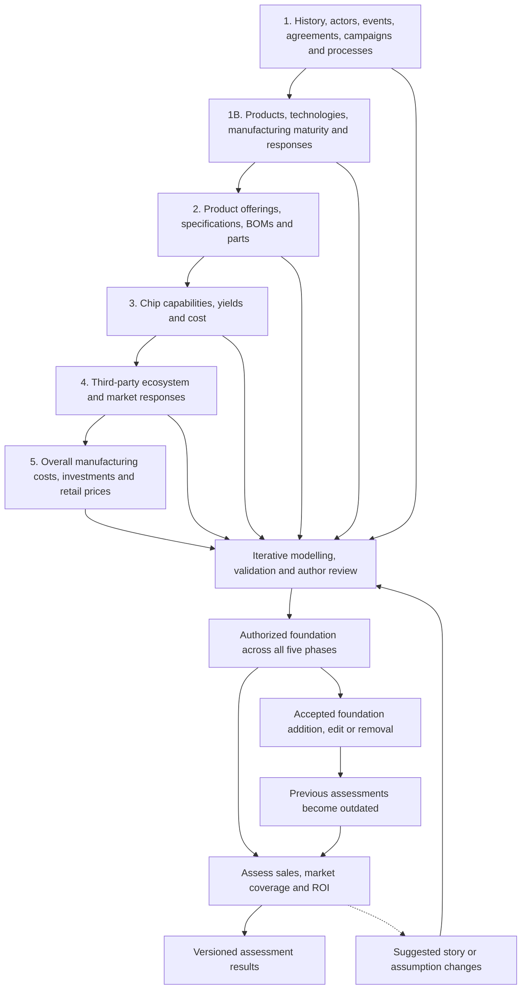

# Aion Logix — five foundational phases with phase 1B

Verified against the author's original five-phase plan and subsequent decisions, **29 October 2026**. Updated with the requested **phase 1B (1.5)**. Its detailed schema and migration design remains proposed for review in [PHASE_1B_DESIGN_REVIEW.md](data-model/PHASE_1B_DESIGN_REVIEW.md).

This document consolidates the agreed process. It describes the intended workflow separately from functionality already implemented. It does not authorize additional story records, introduce new dataset schemas, or claim that the later phases are complete.

## 1. Verified objective

Build a consistent alternative history in which a time traveller, starting on **1 January 1972**, develops a computer-industry empire. Follow the affected world's linear history through the end of the 1980s. The protagonist's future knowledge explains his advantage; tracking individual time jumps is outside the model.

The work has **five foundational phases and an intermediate phase 1B**, followed by a separate, repeatedly reassessed **sales, market coverage and ROI assessment**. All five phases contribute to the story accepted by the author. Forecasts are derived assessments of that story and do not automatically become story facts.

These are phases of our design and review work, not chronological periods in the fictional world. `narrative_period` records have a different purpose.

## 2. The five foundational phases

| Phase | Agreed scope | Expected result | Boundary |
| --- | --- | --- | --- |
| **1. History and its participants** | Overall assumptions; actors; events; campaigns; contracts/agreements; processes; supporting entities where needed | A consistent account of who acted, when, under what agreement, with what responsibilities and outcomes | Ownership percentages and commercial commitments belong here. Detailed product engineering and cost modelling are developed in later phases. |
| **1B / 1.5. Narrative subjects and connections** | Product and technology identities without composition; chip manufacturing technology, lithography advancement and maturity; qualitative market responses | Referenced subjects and results that make campaigns, agreements and development processes coherent | Bring identity and narrative meaning forward; retain BOMs, quantitative yields/costs and sales forecasts for their later work. Detailed schema changes await review. |
| **2. Product offerings and composition** | Product offering specifications, BOMs and underlying parts | Defined offerings and their technical composition, with references to their constituent parts | Establish what is offered and how it is composed. Do not silently establish sales volumes or financial success. |
| **3. Chip manufacturing** | Manufacturing capabilities, yields and cost | Accepted fabrication capability and chip-production assumptions, constraints and cost basis | Chip-level fabrication economics belong here; complete-system economics and investment plans are consolidated in phase 5. |
| **4. Third-party ecosystem and responses** | Deepen third-party products, participation and market responses begun in phase 1B | An accepted account of compatibility, participation, adoption and competitor/market reactions that form part of the story | Specific author-approved responses can become story facts. General estimates of achievable sales and market coverage remain in the assessment layer. |
| **5. Overall economics** | Overall manufacturing cost, investments and retail prices | An accepted cost, investment and pricing foundation for the businesses and offerings | A cost or price assumption is not proof of sales, profit or realized ROI. Those consequences must be assessed separately. |

### Phase 1 — history and its participants

The six originally listed subjects remain central. The implemented foundation also provides supporting identities and relationships through these **11 datasets**:

- `assumption`: premises, policies, constraints and targets.
- `actor`: people, organizations and groups.
- `actor_relationship`: roles, affiliations and other actor relationships.
- `event`: dated occurrences, decisions and milestones.
- `campaign`: marketing objectives, audiences, messages and activities.
- `agreement`: arrangements, parties and agreement lifecycle.
- `clause`: independently reviewable terms and commitments.
- `process`: work extending over time, steps and acceptance gates.
- `programme`: coordination across related activities.
- `location`: places and their hierarchy.
- `narrative_period`: named periods for organizing the story.

Migration must recover information mentioned indirectly, assemble scattered descriptions, preserve useful identities and identify inconsistencies. Moving a source JSON record verbatim is insufficient when its content mixes different entities or contradicts other material.

Agreements and clauses have separate identities. Authorization of an agreement does not implicitly authorize its clauses. Ownership percentages, beneficiaries, responsibilities, agreement scope and milestone outcomes are phase-one story decisions.

Commercial reasoning matters: proposed actions and terms should make sense for each party and remain compatible with other accepted story elements. Where a missing detail is reasonably inferable, propose it for review; where the choice needs the author's input, ask. Neither inference nor importing legacy wording constitutes authorization.

### Phase 1B (1.5) — complete phase-one narrative connections

Phase 1 cannot be completed coherently while campaigns name products only in prose, development work has no technology/product targets, and agreement consequences lack identifiable market responses. Phase 1B therefore proceeds iteratively alongside unfinished phase-one review.

Introduce product and technology identities without product composition, manufacturing technology/capability and scoped maturity milestones, and qualitative market-response assertions. Later phases extend these same identities instead of creating duplicates. Detailed yield/cost curves, BOM quantities and forecast sales effects remain deferred.

The author also requests temporal discipline and restructuring: only events/processes own story dates; events have one date object; processes have start/end boundaries that can reference events; remove process completion state; give events/processes numbered typed inputs/outcomes; merge programmes into processes and retire narrative periods after examining their themes. The linked design review evaluates actual data and proposes safe migrations. None of these breaking schema changes has been installed yet.

**Authorization is the only distinction for proposed results.** Candidate outcomes remain pending until accepted. No additional intended/achieved flag is to be added. Independent review of a process and its numbered outcomes requires an explicit extension of the present whole-record authorization contract, as proposed in the design review.

### Phase 2 — product offerings, BOMs and underlying parts

Define what each offering contains, its specification and the components or parts needed to provide it. Reuse the actors, events and agreements established in phase 1 rather than creating parallel identities inside product records.

The exact product/BOM/part datasets and schemas still require design and author approval. References to products in historical prose do not by themselves mean those product structures have been modelled or approved.

Separate a product's specification from its launch event, the campaign promoting it and an agreement permitting its manufacture or distribution. Connect these records through approved reference fields when their target schemas exist.

### Phase 3 — chip manufacturing capabilities, yields and cost

Establish what fabrication can deliver, at which dates, under which qualification conditions, and with what accepted yield and cost basis. Distinguish a development or qualification target from achieved manufacturing capability.

A phase-one `process` describes work over time. A fabrication recipe or manufacturing capability is a different technical concept; do not force it into that schema merely because both can be called a process.

Calculations can help propose yields or costs, but their outputs require author acceptance before they serve as foundational assumptions. Preserve what a number means: a planning assumption, an achieved result or a conditional target. Its authorization does not change that meaning.

### Phase 4 — ecosystem and market responses

Describe third-party software and hardware participation and reactions to the emerging platform: which actors participate, what they provide, and which responses the author establishes as part of the story.

The boundary with forecasting is the distinction between an **accepted story assertion** and an **estimated consequence**. For example, a specifically authorized vendor agreement or competitor launch can be part of the foundation. An estimated number of customers attracted by that event remains an assessment until separately proposed and authorized as a story assertion.

Do not treat a market-response prediction from the legacy repository as an accepted historical event simply because its description uses definitive wording.

### Phase 5 — manufacturing costs, investment and retail prices

Combine the earlier technical and commercial foundations into an accepted economic basis. Account for product composition, chip costs, other manufacturing costs, investment commitments and retail pricing without duplicating the same amounts across records.

Maintain distinctions between commitments, budget provisions and actual expenditure; between unit costs and fixed investments; and between contractual ownership and operating relationships. A phase-one agreement can establish a funding commitment while phase 5 develops its financial treatment.

Sales-dependent totals and realized returns require assessed demand and explicit accounting assumptions. If an economic calculation exposes a problem in an earlier phase, return to the relevant story or engineering assumptions for review rather than changing accepted inputs silently.

## 3. Iteration within and across phases

The numbered phases, including phase 1B, establish scope and a preferred working order, not a one-way migration that prevents revisions. We work iteratively within each phase and revisit earlier decisions when later work exposes a conflict.

For each manageable subject or batch:

1. **Analyse the inputs.** Read relevant legacy JSON, related references and existing accepted story content. Recover indirectly mentioned entities and record unresolved questions.
2. **Design or check the model.** Choose the owner of each fact, preserve hierarchical value objects, and use references between independently identified entities. Obtain approval before adding schema extensions.
3. **Visualize the structure.** Explain the entities, nesting and references so the author can review the design independently of individual records.
4. **Populate or propose revisions.** Create coherent candidate content and visible before/after comparisons where records change. Keep provenance and editorial discussion outside foundation records.
5. **Validate and reconcile.** Check the graph, identities, dates, commercial logic and agreement between related records. Do not declare unresolved ambiguity resolved merely because JSON validates.
6. **Authorize or reject.** The author reviews the exact content. Approval of a schema does not authorize its records. Rejected proposals do not become accepted story content; any resulting removal or replacement must preserve the review trail.
7. **Save and reassess.** Persist authorized changes and their evidence. Review effects on dependent story records and invalidate assessments based on the previous foundation.

A useful phase-completion check is that the agreed scope has been modelled, populated, validated and authorized, with material contradictions resolved and exclusions explicitly identified. This is a working review checklist, **not an existing automated phase-completion feature**. Later phases may still cause an earlier phase to be reopened.

Do not introduce fabricated placeholder entities just to make a reference resolve. Until a later-phase schema exists, retain unresolved legacy connections in authoring evidence and migration notes.

## 4. Foundation, authoring and assessment are different layers

| Layer | Purpose | Location / current position |
| --- | --- | --- |
| Foundation | Modelled story elements and author-approved assumptions across all five phases | `data_foundation/`; currently populated for phase 1. Pending candidate records may exist here, but are not yet part of the authorized baseline. |
| Authoring | Authorization, proposed changes, decisions, sources, migration evidence and reconciliation work | `data_storytelling/`; implemented separately from story content. |
| Assessment | Calculations and predictions derived from a specified authorized foundation | `data_calculation/` is reserved; later-phase calculation schemas and the assessment engine are not implemented. |

The author treats the old labels **pending confirmation** and **speculation** as the same review condition: something still awaiting acceptance or rejection. The current stored authorization states are `authorized` and `unauthorized`; the browser displays the latter as **Pending authorization**.

This simplification does not erase the difference between story content and a calculated forecast. An authorized foundation record belongs to the accepted story. A derived sales forecast remains an assessment of that story; running a calculation does not authorize it or insert it into the foundation.

Under the phase-1B clarification, authorization is the only distinguisher for proposed results. An accepted commitment or requirement is a separate assertion from its delivery outcome; accepting the former does not authorize the latter. Do not introduce intended/achieved flags. Story-facing prose describes the candidate historical account clearly; editorial uncertainty and review instructions belong in authoring data.

Authorization covers the exact current content hash. Editing an authorized record invalidates that authorization until the revised content is accepted. A pending edit or a new candidate does not silently inherit authorization from related records.

## 5. Sales, market coverage and ROI assessment

After the five phases establish the required foundation, assess potential sales, market coverage and ROI on top of it. This is a **separate recurring assessment**, not a sixth foundational phase or an automatic source of story facts.

The original instruction requires reassessment whenever something is added to the main story. Subsequent clarification also covers changes to baseline records. Removing or rejecting an input likewise makes any assessment that depended on it outdated.

The intended reassessment procedure is:

1. Identify the exact authorized baseline and the assessment's scope.
2. Identify the required model inputs and assumptions; report missing inputs instead of silently inventing them.
3. Assess sales potential and market coverage, then their financial consequences and ROI using an explicit accounting basis.
4. Associate the results with their baseline and model version.
5. When the accepted story changes, mark prior results as outdated and reassess the full sales/coverage/ROI chain. Dependency analysis can organize the work, but does not waive the requirement to reassess.
6. Preserve old results as history. A reassessment may conclude that the numbers remain unchanged, but should explain that conclusion against the new baseline.

A calculation may expose an implausible assumption or suggest a better story outcome. Bring that suggestion back as a proposal. It changes the foundation only after author review; the assessment must then be rerun against the revised foundation.

Before the full foundation is available, limited exploratory calculations can help design a phase. They must be identified as provisional and must not be presented as the completed assessment of all five phases.

Useful future assessment metadata includes baseline identity/hash, model version, assumptions, time horizon, market denominator, currency basis and business perimeter. These are **design requirements to address later**, not approved new JSON fields or existing datasets. Automated invalidation and reassessment still need implementation.

## 6. Process diagram

Sequential arrows show the preferred scope order. The shared review loop permits revisions to any phase. This diagram describes the agreed process, not an already implemented workflow engine.

## 7. What is implemented now

At this document's baseline (`29dcf5b`):

- Phase-one foundation schemas and migration exist: **11 datasets and 440 story records**. The authorization file contains **61 authorized and 379 unauthorized** entries. These are dated inventory figures, not a claim that phase 1 is complete.
- Story content and authoring evidence are separated. Existing historical snapshots preserve the earlier status and source representation.
- Timeline and browser pages display the story. The browser supports selecting pending records and saving their authorizations in one GitHub commit through the authenticated Render service.
- Changes confirm displays before/after comparisons and supports applying an authorized proposal. The active proposal queue is currently empty; that does **not** mean all story records are authorized or all issues resolved.
- The issue register currently contains 18 open entries and 5 resolved entries. It needs reconciliation: for example, the Autodesk signatory issue still appears open after the John Walker approval.
- Phases 2–5 have agreed scope, but their dedicated schemas, systematic migrations and completed author reviews have not been implemented in the current project.
- Sales/coverage/ROI calculations, versioned assessment storage and automatic reassessment are future work.

Existing HTML/JS pages support design and review. Their existence does not establish that the story or the later product/calculation application is complete. We continue to design and authorize each phase's data structures before relying on them for new application behavior.

## 8. Corrections to older descriptions

This consolidation preserves the original five-phase scope and applies the author's later clarifications:

- Keep phase 4's **accepted market responses** separate from the recurring **sales and market-coverage assessment**.
- Keep phase 3's **chip cost** separate from phase 5's **overall manufacturing economics**; neither phase absorbs the other's scope.
- Keep ownership percentages and agreement responsibilities in phase 1, even though detailed financial modelling follows later.
- Replace embedded pending/confirmed/speculation statuses with external authorization. Do not reintroduce those old fields into foundation or forecast schemas by copying historical examples.
- Preserve a linear world history from 1972; do not add a traveller-jump ledger.
- Obtain approval for model extensions before adding them. Authorization of content remains a separate decision.
- Treat old proposals for assessment dataset names and fields as design suggestions awaiting review, not implemented contracts.

## Related documents

- [Data model principles](../DATA_MODEL_PRINCIPLES.md)
- [Current foundation specification](data-model/FOUNDATION_SPECIFICATION.md)
- [Storytelling file reference](data-model/STORYTELLING_FILE_REFERENCE.md)
- [Foundation/authoring separation](data-model/SEPARATION.md) — original migration counts are historical
- [Original phase-one proposal](data-model/PHASE_1_PROPOSAL.md) — source-analysis rationale, with superseded details
- [Render saving setup](RENDER_SETUP.md)
