# Foundation dataset specification

This document describes the current foundation schema contract (version 0.3.0). It is generated from `schemas/*.schema.json` for every JSON dataset in `data_foundation/`. Shared schema definitions are expanded inside their owning entities. Authorization, sourcing, migration and proposed changes belong to `data_storytelling/` and are deliberately outside this diagram.

## Reading the diagram

- Each entity represents one dataset file, whose envelope is `{ "dataset_name": [record, ...] }`. The entity contains the hierarchical structure of one record, not a sample record.
- `*` means required within its immediate parent object; `?` means optional there. A required child does not make its optional parent required. Conditional requirements are specified below.
- Indentation shows owned objects and array items. `array<T>` contains zero or more values unless the schema says otherwise. Nested objects are not independent datasets.
- A solid arrow runs from the referencing dataset to the dataset containing the referenced `id`; labels give exact paths, with `[]` denoting array items. Several fields between the same pair share one line.
- Dashed arrows through `Any foundation record` represent polymorphic references: each value chooses one of the 11 target datasets by its ID prefix. They do not require a value from every target dataset. Self-references are included.
- These arrows describe permitted references, not SQL ownership or reverse cardinality. No inverse uniqueness is implied.

## Entity and reference diagram

The diagram is intentionally comprehensive. Use the per-entity trees and reference catalogue below when reading on a narrow screen.

```mermaid
%%{init: {"flowchart": {"htmlLabels": true, "wrappingWidth": 1200}}}%%
flowchart LR
  classDef schemaEntity font-family:monospace,text-align:left,white-space:pre;
  actor["<pre style='text-align:left;font-family:monospace;white-space:pre;margin:0'>actor.json<br/>id*: string<br/>kind*: string<br/>name*: string<br/>aliases?: array&lt;string&gt;<br/>description?: string</pre>"]:::schemaEntity
  actor_relationship["<pre style='text-align:left;font-family:monospace;white-space:pre;margin:0'>actor_relationship.json<br/>id*: string<br/>kind*: string<br/>subject_actor_ids*: array&lt;string&gt; → actor<br/>object_actor_id*: string → actor<br/>period?: object<br/>│  └─ start*: object<br/>│  │  └─ value*: string<br/>│  │  └─ precision*: string<br/>│  └─ end*: object<br/>│  │  └─ value*: string<br/>│  │  └─ precision*: string<br/>established_by_event_id?: string → event<br/>description*: string</pre>"]:::schemaEntity
  agreement["<pre style='text-align:left;font-family:monospace;white-space:pre;margin:0'>agreement.json<br/>id*: string<br/>title*: string<br/>kind*: string<br/>party*: array&lt;object&gt;<br/>│  └─ actor_id*: string → actor<br/>│  └─ role*: string<br/>state*: string<br/>valid_time?: object<br/>│  └─ start*: object<br/>│  │  └─ value*: string<br/>│  │  └─ precision*: string<br/>│  └─ end*: object<br/>│  │  └─ value*: string<br/>│  │  └─ precision*: string<br/>supersedes_agreement_id?: string → agreement<br/>description?: string</pre>"]:::schemaEntity
  assumption["<pre style='text-align:left;font-family:monospace;white-space:pre;margin:0'>assumption.json<br/>id*: string<br/>kind*: string<br/>statement*: string<br/>scope_ids?: array&lt;string&gt; → any foundation ID<br/>valid_time?: object<br/>│  └─ start*: object<br/>│  │  └─ value*: string<br/>│  │  └─ precision*: string<br/>│  └─ end*: object<br/>│  │  └─ value*: string<br/>│  │  └─ precision*: string<br/>exception_ids?: array&lt;string&gt; → assumption<br/>equipment?: array&lt;object&gt;<br/>│  └─ name*: string<br/>│  └─ components?: array&lt;string&gt;</pre>"]:::schemaEntity
  campaign["<pre style='text-align:left;font-family:monospace;white-space:pre;margin:0'>campaign.json<br/>id*: string<br/>title*: string<br/>objective*: string<br/>lead_actor_ids*: array&lt;string&gt; → actor<br/>audience?: array&lt;string&gt;<br/>message?: array&lt;string&gt;<br/>activity?: array&lt;object&gt;<br/>│  └─ description*: string<br/>│  └─ event_id?: string → event<br/>│  └─ process_id?: string → process<br/>claim_policy?: array&lt;string&gt;<br/>launch_event_id?: string → event<br/>programme_id?: string → programme<br/>subject_ids?: array&lt;string&gt; → any foundation ID<br/>presentation?: object<br/>│  └─ duration_minutes?: integer<br/>│  └─ stage*: array&lt;object&gt;<br/>│  │  └─ label*: string<br/>│  │  └─ duration_minutes?: integer<br/>│  │  └─ description*: string<br/>│  │  └─ actor_ids?: array&lt;string&gt; → actor<br/>booth?: array&lt;object&gt;<br/>│  └─ name*: string<br/>│  └─ description*: string<br/>│  └─ call_to_action?: string</pre>"]:::schemaEntity
  clause["<pre style='text-align:left;font-family:monospace;white-space:pre;margin:0'>clause.json<br/>id*: string<br/>agreement_id*: string → agreement<br/>kind*: string<br/>statement*: string<br/>assertion_mode*: string<br/>actor_ids?: array&lt;string&gt; → actor<br/>conditions?: array&lt;string&gt;<br/>effective_time?: object<br/>│  └─ value*: string<br/>│  └─ precision*: string<br/>supersedes_clause_id?: string → clause<br/>equity?: object<br/>│  └─ company_actor_id*: string → actor<br/>│  └─ beneficiary_actor_ids*: array&lt;string&gt; → actor<br/>│  └─ percentage*: number<br/>│  └─ basis*: string<br/>│  └─ allocation*: string<br/>commitment_amount?: object<br/>│  └─ value*: number<br/>│  └─ currency*: string<br/>│  └─ reference_year*: integer<br/>│  └─ basis*: string</pre>"]:::schemaEntity
  event["<pre style='text-align:left;font-family:monospace;white-space:pre;margin:0'>event.json<br/>id*: string<br/>kind*: string<br/>title*: string<br/>occurrence*: string<br/>time?: object<br/>│  └─ value*: string<br/>│  └─ precision*: string<br/>period?: object<br/>│  └─ start*: object<br/>│  │  └─ value*: string<br/>│  │  └─ precision*: string<br/>│  └─ end*: object<br/>│  │  └─ value*: string<br/>│  │  └─ precision*: string<br/>participant*: array&lt;object&gt;<br/>│  └─ actor_id*: string → actor<br/>│  └─ role*: string<br/>action?: array&lt;object&gt;<br/>│  └─ description*: string<br/>│  └─ actor_ids?: array&lt;string&gt; → actor<br/>outcome?: array&lt;object&gt;<br/>│  └─ description*: string<br/>agreement_ids?: array&lt;string&gt; → agreement<br/>process_ids?: array&lt;string&gt; → process<br/>narrative_period_ids?: array&lt;string&gt; → narrative_period<br/>location_ids?: array&lt;string&gt; → location<br/>subject_ids?: array&lt;string&gt; → any foundation ID<br/>conditions?: array&lt;string&gt;</pre>"]:::schemaEntity
  location["<pre style='text-align:left;font-family:monospace;white-space:pre;margin:0'>location.json<br/>id*: string<br/>name*: string<br/>kind*: string<br/>parent_location_id?: string → location<br/>description?: string</pre>"]:::schemaEntity
  narrative_period["<pre style='text-align:left;font-family:monospace;white-space:pre;margin:0'>narrative_period.json<br/>id*: string<br/>title*: string<br/>period*: object<br/>│  └─ start*: object<br/>│  │  └─ value*: string<br/>│  │  └─ precision*: string<br/>│  └─ end*: object<br/>│  │  └─ value*: string<br/>│  │  └─ precision*: string<br/>display_order*: integer</pre>"]:::schemaEntity
  process["<pre style='text-align:left;font-family:monospace;white-space:pre;margin:0'>process.json<br/>id*: string<br/>title*: string<br/>kind*: string<br/>period?: object<br/>│  └─ start*: object<br/>│  │  └─ value*: string<br/>│  │  └─ precision*: string<br/>│  └─ end*: object<br/>│  │  └─ value*: string<br/>│  │  └─ precision*: string<br/>participant*: array&lt;object&gt;<br/>│  └─ actor_id*: string → actor<br/>│  └─ role*: string<br/>parent_process_id?: string → process<br/>programme_id?: string → programme<br/>step?: array&lt;object&gt;<br/>│  └─ label*: string<br/>│  └─ description*: string<br/>│  └─ event_id?: string → event<br/>completion_state*: string<br/>acceptance_gate?: array&lt;object&gt;<br/>│  └─ description*: string<br/>│  └─ evidence_event_id?: string → event</pre>"]:::schemaEntity
  programme["<pre style='text-align:left;font-family:monospace;white-space:pre;margin:0'>programme.json<br/>id*: string<br/>title*: string<br/>objective*: string<br/>sponsor_actor_ids*: array&lt;string&gt; → actor<br/>agreement_ids?: array&lt;string&gt; → agreement<br/>deliverable?: array&lt;object&gt;<br/>│  └─ description*: string<br/>│  └─ subject_ids?: array&lt;string&gt; → any foundation ID<br/>acceptance_gate?: array&lt;object&gt;<br/>│  └─ description*: string<br/>│  └─ evidence_event_id?: string → event</pre>"]:::schemaEntity
  any_foundation{{"Any foundation record<br/>ID prefix selects one target"}}
  actor_relationship -- "subject_actor_ids[]<br/>object_actor_id" --> actor
  actor_relationship -- "established_by_event_id" --> event
  agreement -- "party[].actor_id" --> actor
  agreement -- "supersedes_agreement_id" --> agreement
  assumption -. "scope_ids[]" .-> any_foundation
  assumption -- "exception_ids[]" --> assumption
  campaign -- "lead_actor_ids[]<br/>presentation.stage[].actor_ids[]" --> actor
  campaign -- "activity[].event_id<br/>launch_event_id" --> event
  campaign -- "activity[].process_id" --> process
  campaign -- "programme_id" --> programme
  campaign -. "subject_ids[]" .-> any_foundation
  clause -- "agreement_id" --> agreement
  clause -- "actor_ids[]<br/>equity.company_actor_id<br/>equity.beneficiary_actor_ids[]" --> actor
  clause -- "supersedes_clause_id" --> clause
  event -- "participant[].actor_id<br/>action[].actor_ids[]" --> actor
  event -- "agreement_ids[]" --> agreement
  event -- "process_ids[]" --> process
  event -- "narrative_period_ids[]" --> narrative_period
  event -- "location_ids[]" --> location
  event -. "subject_ids[]" .-> any_foundation
  location -- "parent_location_id" --> location
  process -- "participant[].actor_id" --> actor
  process -- "parent_process_id" --> process
  process -- "programme_id" --> programme
  process -- "step[].event_id<br/>acceptance_gate[].evidence_event_id" --> event
  programme -- "sponsor_actor_ids[]" --> actor
  programme -- "agreement_ids[]" --> agreement
  programme -. "deliverable[].subject_ids[]" .-> any_foundation
  programme -- "acceptance_gate[].evidence_event_id" --> event
  any_foundation -.-> actor
  any_foundation -.-> actor_relationship
  any_foundation -.-> agreement
  any_foundation -.-> assumption
  any_foundation -.-> campaign
  any_foundation -.-> clause
  any_foundation -.-> event
  any_foundation -.-> location
  any_foundation -.-> narrative_period
  any_foundation -.-> process
  any_foundation -.-> programme
```



## Dataset specifications

### actor

People and organizations participating in the story.

File: [actor.json](../../data_foundation/actor.json) · Schema: [actor.schema.json](../../schemas/actor.schema.json)

```text
actor[]
id*: string
kind*: string
name*: string
aliases?: array<string>
description?: string
```

| Field path | Required in parent | Type | Constraints / allowed values |
| --- | --- | --- | --- |
| `id` | yes | `string` | pattern: "^actor\\.[a-z0-9][a-z0-9_.-]*$" |
| `kind` | yes | `string` | enum: ["person","organisation","group"] |
| `name` | yes | `string` | minLength: 1 |
| `aliases[]` | no | `array<string>` | minLength: 1; minItems: 0; uniqueItems: true |
| `description` | no | `string` | minLength: 1 |

### actor_relationship

Relationships between actors, including dated roles and links to agreements.

File: [actor_relationship.json](../../data_foundation/actor_relationship.json) · Schema: [actor_relationship.schema.json](../../schemas/actor_relationship.schema.json)

```text
actor_relationship[]
id*: string
kind*: string
subject_actor_ids*: array<string> → actor
object_actor_id*: string → actor
period?: object
│  └─ start*: object
│  │  └─ value*: string
│  │  └─ precision*: string
│  └─ end*: object
│  │  └─ value*: string
│  │  └─ precision*: string
established_by_event_id?: string → event
description*: string
```

| Field path | Required in parent | Type | Constraints / allowed values |
| --- | --- | --- | --- |
| `id` | yes | `string` | pattern: "^actor_relationship\\.[a-z0-9][a-z0-9_.-]*$" |
| `kind` | yes | `string` | enum: ["employment","operating_role","affiliation","control","identity_assumption"] |
| `subject_actor_ids[]` | yes | `array<string>` | pattern: "^(actor)\\.[a-z0-9][a-z0-9_.-]*$"; minItems: 1; uniqueItems: true |
| `object_actor_id` | yes | `string` | pattern: "^(actor)\\.[a-z0-9][a-z0-9_.-]*$" |
| `period` | no | `object` | — |
| `period.start` | yes | `object` | — |
| `period.start.value` | yes | `string` | pattern: "^(19[7-9][0-9]\|[2-9][0-9]{3})(-(0[1-9]\|1[0-2])(-(0[1-9]\|[12][0-9]\|3[01]))?)?$" |
| `period.start.precision` | yes | `string` | enum: ["year","month","day"] |
| `period.end` | yes | `object` | — |
| `period.end.value` | yes | `string` | pattern: "^(19[7-9][0-9]\|[2-9][0-9]{3})(-(0[1-9]\|1[0-2])(-(0[1-9]\|[12][0-9]\|3[01]))?)?$" |
| `period.end.precision` | yes | `string` | enum: ["year","month","day"] |
| `established_by_event_id` | no | `string` | pattern: "^(event)\\.[a-z0-9][a-z0-9_.-]*$" |
| `description` | yes | `string` | minLength: 1 |

### agreement

An arrangement with its own identity, parties and lifecycle. Independently reviewable terms are clause records.

File: [agreement.json](../../data_foundation/agreement.json) · Schema: [agreement.schema.json](../../schemas/agreement.schema.json)

```text
agreement[]
id*: string
title*: string
kind*: string
party*: array<object>
│  └─ actor_id*: string → actor
│  └─ role*: string
state*: string
valid_time?: object
│  └─ start*: object
│  │  └─ value*: string
│  │  └─ precision*: string
│  └─ end*: object
│  │  └─ value*: string
│  │  └─ precision*: string
supersedes_agreement_id?: string → agreement
description?: string
```

| Field path | Required in parent | Type | Constraints / allowed values |
| --- | --- | --- | --- |
| `id` | yes | `string` | pattern: "^agreement\\.[a-z0-9][a-z0-9_.-]*$" |
| `title` | yes | `string` | minLength: 1 |
| `kind` | yes | `string` | enum: ["founding","employment","licence","supply","distribution","development","cooperation","other"] |
| `party[]` | yes | `array<object>` | minItems: 1 |
| `party[].actor_id` | yes | `string` | pattern: "^(actor)\\.[a-z0-9][a-z0-9_.-]*$" |
| `party[].role` | yes | `string` | minLength: 1 |
| `state` | yes | `string` | enum: ["offer","negotiating","executed","terminated","unknown"] |
| `valid_time` | no | `object` | — |
| `valid_time.start` | yes | `object` | — |
| `valid_time.start.value` | yes | `string` | pattern: "^(19[7-9][0-9]\|[2-9][0-9]{3})(-(0[1-9]\|1[0-2])(-(0[1-9]\|[12][0-9]\|3[01]))?)?$" |
| `valid_time.start.precision` | yes | `string` | enum: ["year","month","day"] |
| `valid_time.end` | yes | `object` | — |
| `valid_time.end.value` | yes | `string` | pattern: "^(19[7-9][0-9]\|[2-9][0-9]{3})(-(0[1-9]\|1[0-2])(-(0[1-9]\|[12][0-9]\|3[01]))?)?$" |
| `valid_time.end.precision` | yes | `string` | enum: ["year","month","day"] |
| `supersedes_agreement_id` | no | `string` | pattern: "^(agreement)\\.[a-z0-9][a-z0-9_.-]*$" |
| `description` | no | `string` | minLength: 1 |

### assumption

Explicit premises of the alternative world and their scope.

File: [assumption.json](../../data_foundation/assumption.json) · Schema: [assumption.schema.json](../../schemas/assumption.schema.json)

```text
assumption[]
id*: string
kind*: string
statement*: string
scope_ids?: array<string> → any foundation ID
valid_time?: object
│  └─ start*: object
│  │  └─ value*: string
│  │  └─ precision*: string
│  └─ end*: object
│  │  └─ value*: string
│  │  └─ precision*: string
exception_ids?: array<string> → assumption
equipment?: array<object>
│  └─ name*: string
│  └─ components?: array<string>
```

| Field path | Required in parent | Type | Constraints / allowed values |
| --- | --- | --- | --- |
| `id` | yes | `string` | pattern: "^assumption\\.[a-z0-9][a-z0-9_.-]*$" |
| `kind` | yes | `string` | enum: ["world_premise","policy","constraint","target","baseline_condition"] |
| `statement` | yes | `string` | minLength: 1 |
| `scope_ids[]` | no | `array<string>` | pattern: "^(assumption\|actor\|actor_relationship\|event\|campaign\|agreement\|clause\|process\|programme\|location\|narrative_period)\\.[a-z0-9][a-z0-9_.-]*$"; minItems: 0; uniqueItems: true |
| `valid_time` | no | `object` | — |
| `valid_time.start` | yes | `object` | — |
| `valid_time.start.value` | yes | `string` | pattern: "^(19[7-9][0-9]\|[2-9][0-9]{3})(-(0[1-9]\|1[0-2])(-(0[1-9]\|[12][0-9]\|3[01]))?)?$" |
| `valid_time.start.precision` | yes | `string` | enum: ["year","month","day"] |
| `valid_time.end` | yes | `object` | — |
| `valid_time.end.value` | yes | `string` | pattern: "^(19[7-9][0-9]\|[2-9][0-9]{3})(-(0[1-9]\|1[0-2])(-(0[1-9]\|[12][0-9]\|3[01]))?)?$" |
| `valid_time.end.precision` | yes | `string` | enum: ["year","month","day"] |
| `exception_ids[]` | no | `array<string>` | pattern: "^(assumption)\\.[a-z0-9][a-z0-9_.-]*$"; minItems: 0; uniqueItems: true |
| `equipment[]` | no | `array<object>` | — |
| `equipment[].name` | yes | `string` | minLength: 1 |
| `equipment[].components[]` | no | `array<string>` | minLength: 1 |

### campaign

Marketing activity with timing, participants, actions and intended or recorded effects.

File: [campaign.json](../../data_foundation/campaign.json) · Schema: [campaign.schema.json](../../schemas/campaign.schema.json)

```text
campaign[]
id*: string
title*: string
objective*: string
lead_actor_ids*: array<string> → actor
audience?: array<string>
message?: array<string>
activity?: array<object>
│  └─ description*: string
│  └─ event_id?: string → event
│  └─ process_id?: string → process
claim_policy?: array<string>
launch_event_id?: string → event
programme_id?: string → programme
subject_ids?: array<string> → any foundation ID
presentation?: object
│  └─ duration_minutes?: integer
│  └─ stage*: array<object>
│  │  └─ label*: string
│  │  └─ duration_minutes?: integer
│  │  └─ description*: string
│  │  └─ actor_ids?: array<string> → actor
booth?: array<object>
│  └─ name*: string
│  └─ description*: string
│  └─ call_to_action?: string
```

| Field path | Required in parent | Type | Constraints / allowed values |
| --- | --- | --- | --- |
| `id` | yes | `string` | pattern: "^campaign\\.[a-z0-9][a-z0-9_.-]*$" |
| `title` | yes | `string` | minLength: 1 |
| `objective` | yes | `string` | minLength: 1 |
| `lead_actor_ids[]` | yes | `array<string>` | pattern: "^(actor)\\.[a-z0-9][a-z0-9_.-]*$"; minItems: 1; uniqueItems: true |
| `audience[]` | no | `array<string>` | minLength: 1; minItems: 0 |
| `message[]` | no | `array<string>` | minLength: 1; minItems: 0 |
| `activity[]` | no | `array<object>` | minItems: 0 |
| `activity[].description` | yes | `string` | minLength: 1 |
| `activity[].event_id` | no | `string` | pattern: "^(event)\\.[a-z0-9][a-z0-9_.-]*$" |
| `activity[].process_id` | no | `string` | pattern: "^(process)\\.[a-z0-9][a-z0-9_.-]*$" |
| `claim_policy[]` | no | `array<string>` | minLength: 1; minItems: 0 |
| `launch_event_id` | no | `string` | pattern: "^(event)\\.[a-z0-9][a-z0-9_.-]*$" |
| `programme_id` | no | `string` | pattern: "^(programme)\\.[a-z0-9][a-z0-9_.-]*$" |
| `subject_ids[]` | no | `array<string>` | pattern: "^(assumption\|actor\|actor_relationship\|event\|campaign\|agreement\|clause\|process\|programme\|location\|narrative_period)\\.[a-z0-9][a-z0-9_.-]*$"; minItems: 0; uniqueItems: true |
| `presentation` | no | `object` | — |
| `presentation.duration_minutes` | no | `integer` | minimum: 1 |
| `presentation.stage[]` | yes | `array<object>` | — |
| `presentation.stage[].label` | yes | `string` | minLength: 1 |
| `presentation.stage[].duration_minutes` | no | `integer` | minimum: 1 |
| `presentation.stage[].description` | yes | `string` | minLength: 1 |
| `presentation.stage[].actor_ids[]` | no | `array<string>` | pattern: "^actor\\.[a-z0-9][a-z0-9_.-]*$"; uniqueItems: true |
| `booth[]` | no | `array<object>` | — |
| `booth[].name` | yes | `string` | minLength: 1 |
| `booth[].description` | yes | `string` | minLength: 1 |
| `booth[].call_to_action` | no | `string` | minLength: 1 |

### clause

An individual agreement term, including commitments, conditions and equity terms.

File: [clause.json](../../data_foundation/clause.json) · Schema: [clause.schema.json](../../schemas/clause.schema.json)

```text
clause[]
id*: string
agreement_id*: string → agreement
kind*: string
statement*: string
assertion_mode*: string
actor_ids?: array<string> → actor
conditions?: array<string>
effective_time?: object
│  └─ value*: string
│  └─ precision*: string
supersedes_clause_id?: string → clause
equity?: object
│  └─ company_actor_id*: string → actor
│  └─ beneficiary_actor_ids*: array<string> → actor
│  └─ percentage*: number
│  └─ basis*: string
│  └─ allocation*: string
commitment_amount?: object
│  └─ value*: number
│  └─ currency*: string
│  └─ reference_year*: integer
│  └─ basis*: string
```

| Field path | Required in parent | Type | Constraints / allowed values |
| --- | --- | --- | --- |
| `id` | yes | `string` | pattern: "^clause\\.[a-z0-9][a-z0-9_.-]*$" |
| `agreement_id` | yes | `string` | pattern: "^(agreement)\\.[a-z0-9][a-z0-9_.-]*$" |
| `kind` | yes | `string` | enum: ["equity","funding","rights","responsibility","qualification","term","other"] |
| `statement` | yes | `string` | minLength: 1 |
| `assertion_mode` | yes | `string` | enum: ["commitment","proposal","target","established_fact"] |
| `actor_ids[]` | no | `array<string>` | pattern: "^(actor)\\.[a-z0-9][a-z0-9_.-]*$"; minItems: 0; uniqueItems: true |
| `conditions[]` | no | `array<string>` | minLength: 1; minItems: 0 |
| `effective_time` | no | `object` | — |
| `effective_time.value` | yes | `string` | pattern: "^(19[7-9][0-9]\|[2-9][0-9]{3})(-(0[1-9]\|1[0-2])(-(0[1-9]\|[12][0-9]\|3[01]))?)?$" |
| `effective_time.precision` | yes | `string` | enum: ["year","month","day"] |
| `supersedes_clause_id` | no | `string` | pattern: "^(clause)\\.[a-z0-9][a-z0-9_.-]*$" |
| `equity` | no | `object` | — |
| `equity.company_actor_id` | yes | `string` | pattern: "^(actor)\\.[a-z0-9][a-z0-9_.-]*$" |
| `equity.beneficiary_actor_ids[]` | yes | `array<string>` | pattern: "^(actor)\\.[a-z0-9][a-z0-9_.-]*$"; minItems: 0; uniqueItems: true |
| `equity.percentage` | yes | `number` | minimum: 0; maximum: 100 |
| `equity.basis` | yes | `string` | enum: ["fully_diluted","issued","voting"] |
| `equity.allocation` | yes | `string` | enum: ["individual","joint_unsplit","unallocated_reserve"] |
| `commitment_amount` | no | `object` | — |
| `commitment_amount.value` | yes | `number` | minimum: 0 |
| `commitment_amount.currency` | yes | `string` | pattern: "^[A-Z]{3}$" |
| `commitment_amount.reference_year` | yes | `integer` | minimum: 1972 |
| `commitment_amount.basis` | yes | `string` | enum: ["nominal_commitment","planning_provision","actual_expenditure"] |

**Conditional rule:** `equity` is required exactly when `kind` is `equity`; it is forbidden for every other kind.

### event

An occurrence or planned occurrence at a date or over a period, with participants, actions and outcomes.

File: [event.json](../../data_foundation/event.json) · Schema: [event.schema.json](../../schemas/event.schema.json)

```text
event[]
id*: string
kind*: string
title*: string
occurrence*: string
time?: object
│  └─ value*: string
│  └─ precision*: string
period?: object
│  └─ start*: object
│  │  └─ value*: string
│  │  └─ precision*: string
│  └─ end*: object
│  │  └─ value*: string
│  │  └─ precision*: string
participant*: array<object>
│  └─ actor_id*: string → actor
│  └─ role*: string
action?: array<object>
│  └─ description*: string
│  └─ actor_ids?: array<string> → actor
outcome?: array<object>
│  └─ description*: string
agreement_ids?: array<string> → agreement
process_ids?: array<string> → process
narrative_period_ids?: array<string> → narrative_period
location_ids?: array<string> → location
subject_ids?: array<string> → any foundation ID
conditions?: array<string>
```

| Field path | Required in parent | Type | Constraints / allowed values |
| --- | --- | --- | --- |
| `id` | yes | `string` | pattern: "^event\\.[a-z0-9][a-z0-9_.-]*$" |
| `kind` | yes | `string` | enum: ["founding","agreement_milestone","recruitment","launch","qualification","decision","arrival","activity","other"] |
| `title` | yes | `string` | minLength: 1 |
| `occurrence` | yes | `string` | enum: ["planned","occurred","cancelled","unknown"] |
| `time` | no | `object` | — |
| `time.value` | yes | `string` | pattern: "^(19[7-9][0-9]\|[2-9][0-9]{3})(-(0[1-9]\|1[0-2])(-(0[1-9]\|[12][0-9]\|3[01]))?)?$" |
| `time.precision` | yes | `string` | enum: ["year","month","day"] |
| `period` | no | `object` | — |
| `period.start` | yes | `object` | — |
| `period.start.value` | yes | `string` | pattern: "^(19[7-9][0-9]\|[2-9][0-9]{3})(-(0[1-9]\|1[0-2])(-(0[1-9]\|[12][0-9]\|3[01]))?)?$" |
| `period.start.precision` | yes | `string` | enum: ["year","month","day"] |
| `period.end` | yes | `object` | — |
| `period.end.value` | yes | `string` | pattern: "^(19[7-9][0-9]\|[2-9][0-9]{3})(-(0[1-9]\|1[0-2])(-(0[1-9]\|[12][0-9]\|3[01]))?)?$" |
| `period.end.precision` | yes | `string` | enum: ["year","month","day"] |
| `participant[]` | yes | `array<object>` | minItems: 0 |
| `participant[].actor_id` | yes | `string` | pattern: "^(actor)\\.[a-z0-9][a-z0-9_.-]*$" |
| `participant[].role` | yes | `string` | minLength: 1 |
| `action[]` | no | `array<object>` | minItems: 0 |
| `action[].description` | yes | `string` | minLength: 1 |
| `action[].actor_ids[]` | no | `array<string>` | pattern: "^(actor)\\.[a-z0-9][a-z0-9_.-]*$"; minItems: 0; uniqueItems: true |
| `outcome[]` | no | `array<object>` | minItems: 0 |
| `outcome[].description` | yes | `string` | minLength: 1 |
| `agreement_ids[]` | no | `array<string>` | pattern: "^(agreement)\\.[a-z0-9][a-z0-9_.-]*$"; minItems: 0; uniqueItems: true |
| `process_ids[]` | no | `array<string>` | pattern: "^(process)\\.[a-z0-9][a-z0-9_.-]*$"; minItems: 0; uniqueItems: true |
| `narrative_period_ids[]` | no | `array<string>` | pattern: "^(narrative_period)\\.[a-z0-9][a-z0-9_.-]*$"; minItems: 0; uniqueItems: true |
| `location_ids[]` | no | `array<string>` | pattern: "^(location)\\.[a-z0-9][a-z0-9_.-]*$"; minItems: 0; uniqueItems: true |
| `subject_ids[]` | no | `array<string>` | pattern: "^(assumption\|actor\|actor_relationship\|event\|campaign\|agreement\|clause\|process\|programme\|location\|narrative_period)\\.[a-z0-9][a-z0-9_.-]*$"; minItems: 0; uniqueItems: true |
| `conditions[]` | no | `array<string>` | minLength: 1; minItems: 0 |

**Conditional rule:** exactly one of `time` or `period` must be present.

### location

Named places, including hierarchical containment through a parent location.

File: [location.json](../../data_foundation/location.json) · Schema: [location.schema.json](../../schemas/location.schema.json)

```text
location[]
id*: string
name*: string
kind*: string
parent_location_id?: string → location
description?: string
```

| Field path | Required in parent | Type | Constraints / allowed values |
| --- | --- | --- | --- |
| `id` | yes | `string` | pattern: "^location\\.[a-z0-9][a-z0-9_.-]*$" |
| `name` | yes | `string` | minLength: 1 |
| `kind` | yes | `string` | enum: ["country","region","city","venue","facility"] |
| `parent_location_id` | no | `string` | pattern: "^(location)\\.[a-z0-9][a-z0-9_.-]*$" |
| `description` | no | `string` | minLength: 1 |

### narrative_period

Named intervals used to organize the story.

File: [narrative_period.json](../../data_foundation/narrative_period.json) · Schema: [narrative_period.schema.json](../../schemas/narrative_period.schema.json)

```text
narrative_period[]
id*: string
title*: string
period*: object
│  └─ start*: object
│  │  └─ value*: string
│  │  └─ precision*: string
│  └─ end*: object
│  │  └─ value*: string
│  │  └─ precision*: string
display_order*: integer
```

| Field path | Required in parent | Type | Constraints / allowed values |
| --- | --- | --- | --- |
| `id` | yes | `string` | pattern: "^narrative_period\\.[a-z0-9][a-z0-9_.-]*$" |
| `title` | yes | `string` | minLength: 1 |
| `period` | yes | `object` | — |
| `period.start` | yes | `object` | — |
| `period.start.value` | yes | `string` | pattern: "^(19[7-9][0-9]\|[2-9][0-9]{3})(-(0[1-9]\|1[0-2])(-(0[1-9]\|[12][0-9]\|3[01]))?)?$" |
| `period.start.precision` | yes | `string` | enum: ["year","month","day"] |
| `period.end` | yes | `object` | — |
| `period.end.value` | yes | `string` | pattern: "^(19[7-9][0-9]\|[2-9][0-9]{3})(-(0[1-9]\|1[0-2])(-(0[1-9]\|[12][0-9]\|3[01]))?)?$" |
| `period.end.precision` | yes | `string` | enum: ["year","month","day"] |
| `display_order` | yes | `integer` | minimum: 0 |

### process

An activity extending through time, with participants and milestones.

File: [process.json](../../data_foundation/process.json) · Schema: [process.schema.json](../../schemas/process.schema.json)

```text
process[]
id*: string
title*: string
kind*: string
period?: object
│  └─ start*: object
│  │  └─ value*: string
│  │  └─ precision*: string
│  └─ end*: object
│  │  └─ value*: string
│  │  └─ precision*: string
participant*: array<object>
│  └─ actor_id*: string → actor
│  └─ role*: string
parent_process_id?: string → process
programme_id?: string → programme
step?: array<object>
│  └─ label*: string
│  └─ description*: string
│  └─ event_id?: string → event
completion_state*: string
acceptance_gate?: array<object>
│  └─ description*: string
│  └─ evidence_event_id?: string → event
```

| Field path | Required in parent | Type | Constraints / allowed values |
| --- | --- | --- | --- |
| `id` | yes | `string` | pattern: "^process\\.[a-z0-9][a-z0-9_.-]*$" |
| `title` | yes | `string` | minLength: 1 |
| `kind` | yes | `string` | enum: ["study","development","recruitment","transfer","qualification","preparation","other"] |
| `period` | no | `object` | — |
| `period.start` | yes | `object` | — |
| `period.start.value` | yes | `string` | pattern: "^(19[7-9][0-9]\|[2-9][0-9]{3})(-(0[1-9]\|1[0-2])(-(0[1-9]\|[12][0-9]\|3[01]))?)?$" |
| `period.start.precision` | yes | `string` | enum: ["year","month","day"] |
| `period.end` | yes | `object` | — |
| `period.end.value` | yes | `string` | pattern: "^(19[7-9][0-9]\|[2-9][0-9]{3})(-(0[1-9]\|1[0-2])(-(0[1-9]\|[12][0-9]\|3[01]))?)?$" |
| `period.end.precision` | yes | `string` | enum: ["year","month","day"] |
| `participant[]` | yes | `array<object>` | minItems: 0 |
| `participant[].actor_id` | yes | `string` | pattern: "^(actor)\\.[a-z0-9][a-z0-9_.-]*$" |
| `participant[].role` | yes | `string` | minLength: 1 |
| `parent_process_id` | no | `string` | pattern: "^(process)\\.[a-z0-9][a-z0-9_.-]*$" |
| `programme_id` | no | `string` | pattern: "^(programme)\\.[a-z0-9][a-z0-9_.-]*$" |
| `step[]` | no | `array<object>` | minItems: 0 |
| `step[].label` | yes | `string` | minLength: 1 |
| `step[].description` | yes | `string` | minLength: 1 |
| `step[].event_id` | no | `string` | pattern: "^event\\.[a-z0-9][a-z0-9_.-]*$" |
| `completion_state` | yes | `string` | enum: ["planned","in_progress","completed","cancelled","unknown"] |
| `acceptance_gate[]` | no | `array<object>` | minItems: 0 |
| `acceptance_gate[].description` | yes | `string` | minLength: 1 |
| `acceptance_gate[].evidence_event_id` | no | `string` | pattern: "^(event)\\.[a-z0-9][a-z0-9_.-]*$" |

### programme

An umbrella programme connecting related story activities.

File: [programme.json](../../data_foundation/programme.json) · Schema: [programme.schema.json](../../schemas/programme.schema.json)

```text
programme[]
id*: string
title*: string
objective*: string
sponsor_actor_ids*: array<string> → actor
agreement_ids?: array<string> → agreement
deliverable?: array<object>
│  └─ description*: string
│  └─ subject_ids?: array<string> → any foundation ID
acceptance_gate?: array<object>
│  └─ description*: string
│  └─ evidence_event_id?: string → event
```

| Field path | Required in parent | Type | Constraints / allowed values |
| --- | --- | --- | --- |
| `id` | yes | `string` | pattern: "^programme\\.[a-z0-9][a-z0-9_.-]*$" |
| `title` | yes | `string` | minLength: 1 |
| `objective` | yes | `string` | minLength: 1 |
| `sponsor_actor_ids[]` | yes | `array<string>` | pattern: "^(actor)\\.[a-z0-9][a-z0-9_.-]*$"; minItems: 1; uniqueItems: true |
| `agreement_ids[]` | no | `array<string>` | pattern: "^(agreement)\\.[a-z0-9][a-z0-9_.-]*$"; minItems: 0; uniqueItems: true |
| `deliverable[]` | no | `array<object>` | minItems: 0 |
| `deliverable[].description` | yes | `string` | minLength: 1 |
| `deliverable[].subject_ids[]` | no | `array<string>` | pattern: "^(assumption\|actor\|actor_relationship\|event\|campaign\|agreement\|clause\|process\|programme\|location\|narrative_period)\\.[a-z0-9][a-z0-9_.-]*$"; minItems: 0; uniqueItems: true |
| `acceptance_gate[]` | no | `array<object>` | minItems: 0 |
| `acceptance_gate[].description` | yes | `string` | minLength: 1 |
| `acceptance_gate[].evidence_event_id` | no | `string` | pattern: "^(event)\\.[a-z0-9][a-z0-9_.-]*$" |

## Reference catalogue

Every schema attribute marked `x-ref` appears here, including references inside shared and nested objects. Each target resolves to the target record’s `id`. Polymorphic alternatives are allowed targets, not simultaneous requirements.

| Source dataset | Attribute path | Permitted target datasets |
| --- | --- | --- |
| actor_relationship | `subject_actor_ids[]` | `actor` |
| actor_relationship | `object_actor_id` | `actor` |
| actor_relationship | `established_by_event_id` | `event` |
| agreement | `party[].actor_id` | `actor` |
| agreement | `supersedes_agreement_id` | `agreement` |
| assumption | `scope_ids[]` | `assumption`, `actor`, `actor_relationship`, `event`, `campaign`, `agreement`, `clause`, `process`, `programme`, `location`, `narrative_period` |
| assumption | `exception_ids[]` | `assumption` |
| campaign | `lead_actor_ids[]` | `actor` |
| campaign | `activity[].event_id` | `event` |
| campaign | `activity[].process_id` | `process` |
| campaign | `launch_event_id` | `event` |
| campaign | `programme_id` | `programme` |
| campaign | `subject_ids[]` | `assumption`, `actor`, `actor_relationship`, `event`, `campaign`, `agreement`, `clause`, `process`, `programme`, `location`, `narrative_period` |
| campaign | `presentation.stage[].actor_ids[]` | `actor` |
| clause | `agreement_id` | `agreement` |
| clause | `actor_ids[]` | `actor` |
| clause | `supersedes_clause_id` | `clause` |
| clause | `equity.company_actor_id` | `actor` |
| clause | `equity.beneficiary_actor_ids[]` | `actor` |
| event | `participant[].actor_id` | `actor` |
| event | `action[].actor_ids[]` | `actor` |
| event | `agreement_ids[]` | `agreement` |
| event | `process_ids[]` | `process` |
| event | `narrative_period_ids[]` | `narrative_period` |
| event | `location_ids[]` | `location` |
| event | `subject_ids[]` | `assumption`, `actor`, `actor_relationship`, `event`, `campaign`, `agreement`, `clause`, `process`, `programme`, `location`, `narrative_period` |
| location | `parent_location_id` | `location` |
| process | `participant[].actor_id` | `actor` |
| process | `parent_process_id` | `process` |
| process | `programme_id` | `programme` |
| process | `step[].event_id` | `event` |
| process | `acceptance_gate[].evidence_event_id` | `event` |
| programme | `sponsor_actor_ids[]` | `actor` |
| programme | `agreement_ids[]` | `agreement` |
| programme | `deliverable[].subject_ids[]` | `assumption`, `actor`, `actor_relationship`, `event`, `campaign`, `agreement`, `clause`, `process`, `programme`, `location`, `narrative_period` |
| programme | `acceptance_gate[].evidence_event_id` | `event` |

## Contract notes

All foundation envelopes and record/value objects reject undeclared properties. IDs are prefixed by their dataset name. Shared dates preserve year, month or day precision; the validator also checks real dates, precision consistency, period ordering and reference existence. Money `basis` describes the story’s financial meaning and is not an editorial authorization status.

The schema files and `tools/validate-model.js` remain authoritative for machine validation. This specification documents existing structures; it does not introduce new fields, approve records or alter story content.

Regenerate this document after approved schema changes with `node tools/generate-foundation-spec.js` from the repository root.
