# Foundation dataset specification

This document describes the current foundation schema contract (version 0.4.0). It is generated from `schemas/*.schema.json` for every JSON dataset in `data_foundation/`. Shared schema definitions are expanded inside their owning entities. Current authorization, sources and proposed changes belong to `data_storytelling/`; completed migration evidence is preserved in `archived_no_longer_valid/`. Both are deliberately outside this diagram.

## Reading the diagram

- Each entity represents one dataset file, whose envelope is `{ "dataset_name": [record, ...] }`. The entity contains the hierarchical structure of one record, not a sample record.
- `*` means required within its immediate parent object; `?` means optional there. A required child does not make its optional parent required. Conditional requirements are specified below.
- Indentation shows owned objects and array items. `array<T>` contains zero or more values unless the schema says otherwise. Nested objects are not independent datasets.
- A solid arrow runs from the referencing dataset to the dataset containing the referenced `id`; labels give exact paths, with `[]` denoting array items. Several fields between the same pair share one line.
- Dashed arrows through `Any foundation record` represent polymorphic references: each value chooses one of the 13 target datasets by its ID prefix. They do not require a value from every target dataset. Self-references are included.
- Process boundary `value` references an event only when `precision` is `event`; calendar and unknown variants are not references.
- These arrows describe permitted references, not SQL ownership or reverse cardinality. No inverse uniqueness is implied.

## Entity and reference diagram

The diagram is intentionally comprehensive. Use the per-entity trees and reference catalogue below when reading on a narrow screen.

```mermaid
%%{init: {"flowchart": {"htmlLabels": true, "wrappingWidth": 1200}}}%%
flowchart LR
  classDef schemaEntity font-family:monospace,text-align:left,white-space:pre;
  actor["<pre style='text-align:left;font-family:monospace;white-space:pre;margin:0'>actor.json<br/>id*: string<br/>kind*: string<br/>name*: string<br/>aliases?: array&lt;string&gt;<br/>description?: string</pre>"]:::schemaEntity
  actor_relationship["<pre style='text-align:left;font-family:monospace;white-space:pre;margin:0'>actor_relationship.json<br/>id*: string<br/>kind*: string<br/>subject_actor_ids*: array&lt;string&gt; → actor<br/>object_actor_id*: string → actor<br/>established_by_event_id?: string → event<br/>description*: string<br/>process_id?: string → process</pre>"]:::schemaEntity
  agreement["<pre style='text-align:left;font-family:monospace;white-space:pre;margin:0'>agreement.json<br/>id*: string<br/>title*: string<br/>kind*: string<br/>party*: array&lt;object&gt;<br/>│  └─ actor_id*: string → actor<br/>│  └─ role*: string<br/>state*: string<br/>supersedes_agreement_id?: string → agreement<br/>description?: string<br/>effective_event_id?: string → event<br/>termination_event_id?: string → event<br/>process_id?: string → process</pre>"]:::schemaEntity
  assumption["<pre style='text-align:left;font-family:monospace;white-space:pre;margin:0'>assumption.json<br/>id*: string<br/>kind*: string<br/>statement*: string<br/>scope_ids?: array&lt;string&gt; → any foundation ID<br/>exception_ids?: array&lt;string&gt; → assumption<br/>equipment?: array&lt;object&gt;<br/>│  └─ name*: string<br/>│  └─ components?: array&lt;string&gt;<br/>process_id?: string → process</pre>"]:::schemaEntity
  campaign["<pre style='text-align:left;font-family:monospace;white-space:pre;margin:0'>campaign.json<br/>id*: string<br/>title*: string<br/>objective*: string<br/>lead_actor_ids*: array&lt;string&gt; → actor<br/>audience?: array&lt;string&gt;<br/>message?: array&lt;string&gt;<br/>claim_policy?: array&lt;string&gt;<br/>launch_event_id?: string → event<br/>subject_ids?: array&lt;string&gt; → product / technology / manufacturing_capability / actor / agreement / market_response<br/>presentation?: object<br/>│  └─ duration_minutes?: integer<br/>│  └─ stage*: array&lt;object&gt;<br/>│  │  └─ label*: string<br/>│  │  └─ duration_minutes?: integer<br/>│  │  └─ description*: string<br/>│  │  └─ actor_ids?: array&lt;string&gt; → actor<br/>booth?: array&lt;object&gt;<br/>│  └─ name*: string<br/>│  └─ description*: string<br/>│  └─ call_to_action?: string<br/>process_id*: string → process<br/>marketing_content?: array&lt;object&gt;<br/>│  └─ number*: integer<br/>│  └─ type*: string<br/>│  └─ description*: string</pre>"]:::schemaEntity
  clause["<pre style='text-align:left;font-family:monospace;white-space:pre;margin:0'>clause.json<br/>id*: string<br/>agreement_id*: string → agreement<br/>kind*: string<br/>statement*: string<br/>assertion_mode*: string<br/>actor_ids?: array&lt;string&gt; → actor<br/>conditions?: array&lt;string&gt;<br/>supersedes_clause_id?: string → clause<br/>equity?: object<br/>│  └─ company_actor_id*: string → actor<br/>│  └─ beneficiary_actor_ids*: array&lt;string&gt; → actor<br/>│  └─ percentage*: number<br/>│  └─ basis*: string<br/>│  └─ allocation*: string<br/>commitment_amount?: object<br/>│  └─ value*: number<br/>│  └─ currency*: string<br/>│  └─ reference_year*: integer<br/>│  └─ basis*: string<br/>effective_event_id?: string → event</pre>"]:::schemaEntity
  event["<pre style='text-align:left;font-family:monospace;white-space:pre;margin:0'>event.json<br/>id*: string<br/>title*: string<br/>kind*: string<br/>description*: string<br/>participant*: array&lt;object&gt;<br/>│  └─ actor_id*: string → actor<br/>│  └─ role*: string<br/>subject_ids?: array&lt;string&gt; → any foundation ID<br/>inputs*: array&lt;object&gt;<br/>│  └─ number*: integer<br/>│  └─ type*: string<br/>│  └─ description*: string<br/>│  └─ subject_ids?: array&lt;string&gt; → any foundation ID<br/>│  └─ event_id?: string → event<br/>│  └─ process_id?: string → process<br/>│  └─ maturity?: object<br/>│  │  └─ capability_id*: string → manufacturing_capability<br/>│  │  └─ stage*: undefined<br/>outcomes*: array&lt;object&gt;<br/>│  └─ number*: integer<br/>│  └─ type*: string<br/>│  └─ description*: string<br/>│  └─ subject_ids?: array&lt;string&gt; → any foundation ID<br/>│  └─ event_id?: string → event<br/>│  └─ process_id?: string → process<br/>│  └─ maturity?: object<br/>│  │  └─ capability_id*: string → manufacturing_capability<br/>│  │  └─ stage*: undefined<br/>agreement_ids?: array&lt;string&gt; → agreement<br/>time*: object<br/>│  └─ value*: string<br/>│  └─ precision*: string<br/>process_ids?: array&lt;string&gt; → process<br/>location_ids?: array&lt;string&gt; → location</pre>"]:::schemaEntity
  location["<pre style='text-align:left;font-family:monospace;white-space:pre;margin:0'>location.json<br/>id*: string<br/>name*: string<br/>kind*: string<br/>parent_location_id?: string → location<br/>description?: string</pre>"]:::schemaEntity
  manufacturing_capability["<pre style='text-align:left;font-family:monospace;white-space:pre;margin:0'>manufacturing_capability.json<br/>id*: string<br/>name*: string<br/>actor_id*: string → actor<br/>location_id?: string → location<br/>technology_id*: string → technology<br/>recipe_kind*: undefined<br/>product_ids*: array&lt;string&gt; → product<br/>description*: string<br/>qualification_requirements*: array&lt;object&gt;<br/>│  └─ number*: integer<br/>│  └─ type*: string<br/>│  └─ description*: string<br/>│  └─ subject_ids?: array&lt;string&gt; → any foundation ID<br/>│  └─ event_id?: string → event<br/>│  └─ process_id?: string → process<br/>│  └─ maturity?: object<br/>│  │  └─ capability_id*: string → manufacturing_capability<br/>│  │  └─ stage*: undefined</pre>"]:::schemaEntity
  market_response["<pre style='text-align:left;font-family:monospace;white-space:pre;margin:0'>market_response.json<br/>id*: string<br/>title*: string<br/>kind*: undefined<br/>respondent_actor_ids*: array&lt;string&gt; → actor<br/>subject_ids*: array&lt;string&gt; → any foundation ID<br/>trigger_ids*: array&lt;string&gt; → event / process / campaign / agreement<br/>description*: string</pre>"]:::schemaEntity
  process["<pre style='text-align:left;font-family:monospace;white-space:pre;margin:0'>process.json<br/>id*: string<br/>title*: string<br/>kind*: string<br/>description*: string<br/>participant*: array&lt;object&gt;<br/>│  └─ actor_id*: string → actor<br/>│  └─ role*: string<br/>subject_ids?: array&lt;string&gt; → any foundation ID<br/>inputs*: array&lt;object&gt;<br/>│  └─ number*: integer<br/>│  └─ type*: string<br/>│  └─ description*: string<br/>│  └─ subject_ids?: array&lt;string&gt; → any foundation ID<br/>│  └─ event_id?: string → event<br/>│  └─ process_id?: string → process<br/>│  └─ maturity?: object<br/>│  │  └─ capability_id*: string → manufacturing_capability<br/>│  │  └─ stage*: undefined<br/>outcomes*: array&lt;object&gt;<br/>│  └─ number*: integer<br/>│  └─ type*: string<br/>│  └─ description*: string<br/>│  └─ subject_ids?: array&lt;string&gt; → any foundation ID<br/>│  └─ event_id?: string → event<br/>│  └─ process_id?: string → process<br/>│  └─ maturity?: object<br/>│  │  └─ capability_id*: string → manufacturing_capability<br/>│  │  └─ stage*: undefined<br/>agreement_ids?: array&lt;string&gt; → agreement<br/>period*: object<br/>│  └─ start*: object<br/>│  │  └─ value*: string | null → event<br/>│  │  └─ precision*: string<br/>│  └─ end*: object<br/>│  │  └─ value*: string | null → event<br/>│  │  └─ precision*: string<br/>steps*: array&lt;object&gt;<br/>│  └─ number*: integer<br/>│  └─ type*: string<br/>│  └─ description*: string<br/>│  └─ subject_ids?: array&lt;string&gt; → any foundation ID<br/>│  └─ event_id?: string → event<br/>│  └─ process_id?: string → process<br/>│  └─ maturity?: object<br/>│  │  └─ capability_id*: string → manufacturing_capability<br/>│  │  └─ stage*: undefined<br/>parent_process_id?: string → process<br/>related_process_ids?: array&lt;string&gt; → process</pre>"]:::schemaEntity
  product["<pre style='text-align:left;font-family:monospace;white-space:pre;margin:0'>product.json<br/>id*: string<br/>name*: string<br/>kind*: undefined<br/>description*: string<br/>provider_actor_ids*: array&lt;string&gt; → actor<br/>family_product_id?: string → product<br/>version?: string<br/>technology_ids*: array&lt;string&gt; → technology<br/>specification*: array&lt;object&gt;<br/>│  └─ number*: integer<br/>│  └─ type*: string<br/>│  └─ description*: string<br/>│  └─ value?: string,number,boolean<br/>│  └─ unit?: string</pre>"]:::schemaEntity
  technology["<pre style='text-align:left;font-family:monospace;white-space:pre;margin:0'>technology.json<br/>id*: string<br/>name*: string<br/>kind*: undefined<br/>description*: string<br/>owner_actor_ids*: array&lt;string&gt; → actor<br/>related_technology_ids*: array&lt;string&gt; → technology<br/>specification*: array&lt;object&gt;<br/>│  └─ number*: integer<br/>│  └─ type*: string<br/>│  └─ description*: string<br/>│  └─ value?: string,number,boolean<br/>│  └─ unit?: string<br/>fabrication?: object<br/>│  └─ feature_size_um*: number<br/>│  └─ wafer_diameter_mm?: number<br/>│  └─ lithography_method*: string</pre>"]:::schemaEntity
  any_foundation{{"Any foundation record<br/>ID prefix selects one target"}}
  actor_relationship -- "subject_actor_ids[]<br/>object_actor_id" --> actor
  actor_relationship -- "established_by_event_id" --> event
  actor_relationship -- "process_id" --> process
  agreement -- "party[].actor_id" --> actor
  agreement -- "supersedes_agreement_id" --> agreement
  agreement -- "effective_event_id<br/>termination_event_id" --> event
  agreement -- "process_id" --> process
  assumption -. "scope_ids[]" .-> any_foundation
  assumption -- "exception_ids[]" --> assumption
  assumption -- "process_id" --> process
  campaign -- "lead_actor_ids[]<br/>subject_ids[]<br/>presentation.stage[].actor_ids[]" --> actor
  campaign -- "launch_event_id" --> event
  campaign -- "subject_ids[]" --> product
  campaign -- "subject_ids[]" --> technology
  campaign -- "subject_ids[]" --> manufacturing_capability
  campaign -- "subject_ids[]" --> agreement
  campaign -- "subject_ids[]" --> market_response
  campaign -- "process_id" --> process
  clause -- "agreement_id" --> agreement
  clause -- "actor_ids[]<br/>equity.company_actor_id<br/>equity.beneficiary_actor_ids[]" --> actor
  clause -- "supersedes_clause_id" --> clause
  clause -- "effective_event_id" --> event
  event -- "participant[].actor_id" --> actor
  event -. "subject_ids[]<br/>inputs[].subject_ids[]<br/>outcomes[].subject_ids[]" .-> any_foundation
  event -- "inputs[].event_id<br/>outcomes[].event_id" --> event
  event -- "inputs[].process_id<br/>outcomes[].process_id<br/>process_ids[]" --> process
  event -- "inputs[].maturity.capability_id<br/>outcomes[].maturity.capability_id" --> manufacturing_capability
  event -- "agreement_ids[]" --> agreement
  event -- "location_ids[]" --> location
  location -- "parent_location_id" --> location
  manufacturing_capability -- "actor_id" --> actor
  manufacturing_capability -- "location_id" --> location
  manufacturing_capability -- "technology_id" --> technology
  manufacturing_capability -- "product_ids[]" --> product
  manufacturing_capability -. "qualification_requirements[].subject_ids[]" .-> any_foundation
  manufacturing_capability -- "qualification_requirements[].event_id" --> event
  manufacturing_capability -- "qualification_requirements[].process_id" --> process
  manufacturing_capability -- "qualification_requirements[].maturity.capability_id" --> manufacturing_capability
  market_response -- "respondent_actor_ids[]" --> actor
  market_response -. "subject_ids[]" .-> any_foundation
  market_response -- "trigger_ids[]" --> event
  market_response -- "trigger_ids[]" --> process
  market_response -- "trigger_ids[]" --> campaign
  market_response -- "trigger_ids[]" --> agreement
  process -- "participant[].actor_id" --> actor
  process -. "subject_ids[]<br/>inputs[].subject_ids[]<br/>outcomes[].subject_ids[]<br/>steps[].subject_ids[]" .-> any_foundation
  process -- "inputs[].event_id<br/>outcomes[].event_id<br/>period.start.value<br/>period.end.value<br/>steps[].event_id" --> event
  process -- "inputs[].process_id<br/>outcomes[].process_id<br/>steps[].process_id<br/>parent_process_id<br/>related_process_ids[]" --> process
  process -- "inputs[].maturity.capability_id<br/>outcomes[].maturity.capability_id<br/>steps[].maturity.capability_id" --> manufacturing_capability
  process -- "agreement_ids[]" --> agreement
  product -- "provider_actor_ids[]" --> actor
  product -- "family_product_id" --> product
  product -- "technology_ids[]" --> technology
  technology -- "owner_actor_ids[]" --> actor
  technology -- "related_technology_ids[]" --> technology
  any_foundation -.-> actor
  any_foundation -.-> actor_relationship
  any_foundation -.-> agreement
  any_foundation -.-> assumption
  any_foundation -.-> campaign
  any_foundation -.-> clause
  any_foundation -.-> event
  any_foundation -.-> location
  any_foundation -.-> manufacturing_capability
  any_foundation -.-> market_response
  any_foundation -.-> process
  any_foundation -.-> product
  any_foundation -.-> technology
```



## Dataset specifications

### actor

People and organizations participating in the story.

File: [actor.json](../../data_foundation/actor.json) · Schema: [actor.schema.json](../../schemas/actor.schema.json)

```text
actor[]
id*: string
kind*: string
name*: string
aliases?: array<string>
description?: string
```

| Field path | Required in parent | Type | Constraints / allowed values |
| --- | --- | --- | --- |
| `id` | yes | `string` | pattern: "^actor\\.[a-z0-9][a-z0-9_.-]*$" |
| `kind` | yes | `string` | enum: ["person","organisation","group"] |
| `name` | yes | `string` | minLength: 1 |
| `aliases[]` | no | `array<string>` | minLength: 1; minItems: 0; uniqueItems: true |
| `description` | no | `string` | minLength: 1 |

### actor_relationship

Relationships between actors, including dated roles and links to agreements.

File: [actor_relationship.json](../../data_foundation/actor_relationship.json) · Schema: [actor_relationship.schema.json](../../schemas/actor_relationship.schema.json)

```text
actor_relationship[]
id*: string
kind*: string
subject_actor_ids*: array<string> → actor
object_actor_id*: string → actor
established_by_event_id?: string → event
description*: string
process_id?: string → process
```

| Field path | Required in parent | Type | Constraints / allowed values |
| --- | --- | --- | --- |
| `id` | yes | `string` | pattern: "^actor_relationship\\.[a-z0-9][a-z0-9_.-]*$" |
| `kind` | yes | `string` | enum: ["employment","operating_role","affiliation","control","identity_assumption"] |
| `subject_actor_ids[]` | yes | `array<string>` | pattern: "^(actor)\\.[a-z0-9][a-z0-9_.-]*$"; minItems: 1; uniqueItems: true |
| `object_actor_id` | yes | `string` | pattern: "^(actor)\\.[a-z0-9][a-z0-9_.-]*$" |
| `established_by_event_id` | no | `string` | pattern: "^(event)\\.[a-z0-9][a-z0-9_.-]*$" |
| `description` | yes | `string` | minLength: 1 |
| `process_id` | no | `string` | pattern: "^(process)\\.[a-z0-9][a-z0-9_.-]*$" |

### agreement

An arrangement with its own identity, parties and lifecycle. Independently reviewable terms are clause records.

File: [agreement.json](../../data_foundation/agreement.json) · Schema: [agreement.schema.json](../../schemas/agreement.schema.json)

```text
agreement[]
id*: string
title*: string
kind*: string
party*: array<object>
│  └─ actor_id*: string → actor
│  └─ role*: string
state*: string
supersedes_agreement_id?: string → agreement
description?: string
effective_event_id?: string → event
termination_event_id?: string → event
process_id?: string → process
```

| Field path | Required in parent | Type | Constraints / allowed values |
| --- | --- | --- | --- |
| `id` | yes | `string` | pattern: "^agreement\\.[a-z0-9][a-z0-9_.-]*$" |
| `title` | yes | `string` | minLength: 1 |
| `kind` | yes | `string` | enum: ["founding","employment","licence","supply","distribution","development","cooperation","other"] |
| `party[]` | yes | `array<object>` | minItems: 1 |
| `party[].actor_id` | yes | `string` | pattern: "^(actor)\\.[a-z0-9][a-z0-9_.-]*$" |
| `party[].role` | yes | `string` | minLength: 1 |
| `state` | yes | `string` | enum: ["offer","negotiating","executed","terminated","unknown"] |
| `supersedes_agreement_id` | no | `string` | pattern: "^(agreement)\\.[a-z0-9][a-z0-9_.-]*$" |
| `description` | no | `string` | minLength: 1 |
| `effective_event_id` | no | `string` | pattern: "^(event)\\.[a-z0-9][a-z0-9_.-]*$" |
| `termination_event_id` | no | `string` | pattern: "^(event)\\.[a-z0-9][a-z0-9_.-]*$" |
| `process_id` | no | `string` | pattern: "^(process)\\.[a-z0-9][a-z0-9_.-]*$" |

### assumption

Explicit premises of the alternative world and their scope.

File: [assumption.json](../../data_foundation/assumption.json) · Schema: [assumption.schema.json](../../schemas/assumption.schema.json)

```text
assumption[]
id*: string
kind*: string
statement*: string
scope_ids?: array<string> → any foundation ID
exception_ids?: array<string> → assumption
equipment?: array<object>
│  └─ name*: string
│  └─ components?: array<string>
process_id?: string → process
```

| Field path | Required in parent | Type | Constraints / allowed values |
| --- | --- | --- | --- |
| `id` | yes | `string` | pattern: "^assumption\\.[a-z0-9][a-z0-9_.-]*$" |
| `kind` | yes | `string` | enum: ["world_premise","policy","constraint","target","baseline_condition"] |
| `statement` | yes | `string` | minLength: 1 |
| `scope_ids[]` | no | `array<string>` | pattern: "^(actor\|actor_relationship\|agreement\|assumption\|campaign\|clause\|event\|location\|manufacturing_capability\|market_response\|process\|product\|technology)\\.[a-z0-9][a-z0-9_.-]*$"; minItems: 0; uniqueItems: true |
| `exception_ids[]` | no | `array<string>` | pattern: "^(assumption)\\.[a-z0-9][a-z0-9_.-]*$"; minItems: 0; uniqueItems: true |
| `equipment[]` | no | `array<object>` | — |
| `equipment[].name` | yes | `string` | minLength: 1 |
| `equipment[].components[]` | no | `array<string>` | minLength: 1 |
| `process_id` | no | `string` | pattern: "^(process)\\.[a-z0-9][a-z0-9_.-]*$" |

### campaign

Marketing activity with timing, participants, actions and intended or recorded effects.

File: [campaign.json](../../data_foundation/campaign.json) · Schema: [campaign.schema.json](../../schemas/campaign.schema.json)

```text
campaign[]
id*: string
title*: string
objective*: string
lead_actor_ids*: array<string> → actor
audience?: array<string>
message?: array<string>
claim_policy?: array<string>
launch_event_id?: string → event
subject_ids?: array<string> → product / technology / manufacturing_capability / actor / agreement / market_response
presentation?: object
│  └─ duration_minutes?: integer
│  └─ stage*: array<object>
│  │  └─ label*: string
│  │  └─ duration_minutes?: integer
│  │  └─ description*: string
│  │  └─ actor_ids?: array<string> → actor
booth?: array<object>
│  └─ name*: string
│  └─ description*: string
│  └─ call_to_action?: string
process_id*: string → process
marketing_content?: array<object>
│  └─ number*: integer
│  └─ type*: string
│  └─ description*: string
```

| Field path | Required in parent | Type | Constraints / allowed values |
| --- | --- | --- | --- |
| `id` | yes | `string` | pattern: "^campaign\\.[a-z0-9][a-z0-9_.-]*$" |
| `title` | yes | `string` | minLength: 1 |
| `objective` | yes | `string` | minLength: 1 |
| `lead_actor_ids[]` | yes | `array<string>` | pattern: "^(actor)\\.[a-z0-9][a-z0-9_.-]*$"; minItems: 1; uniqueItems: true |
| `audience[]` | no | `array<string>` | minLength: 1; minItems: 0 |
| `message[]` | no | `array<string>` | minLength: 1; minItems: 0 |
| `claim_policy[]` | no | `array<string>` | minLength: 1; minItems: 0 |
| `launch_event_id` | no | `string` | pattern: "^(event)\\.[a-z0-9][a-z0-9_.-]*$" |
| `subject_ids[]` | no | `array<string>` | pattern: "^(product\|technology\|manufacturing_capability\|actor\|agreement\|market_response)\\.[a-z0-9][a-z0-9_.-]*$"; minItems: 0; uniqueItems: true |
| `presentation` | no | `object` | — |
| `presentation.duration_minutes` | no | `integer` | minimum: 1 |
| `presentation.stage[]` | yes | `array<object>` | — |
| `presentation.stage[].label` | yes | `string` | minLength: 1 |
| `presentation.stage[].duration_minutes` | no | `integer` | minimum: 1 |
| `presentation.stage[].description` | yes | `string` | minLength: 1 |
| `presentation.stage[].actor_ids[]` | no | `array<string>` | pattern: "^actor\\.[a-z0-9][a-z0-9_.-]*$"; uniqueItems: true |
| `booth[]` | no | `array<object>` | — |
| `booth[].name` | yes | `string` | minLength: 1 |
| `booth[].description` | yes | `string` | minLength: 1 |
| `booth[].call_to_action` | no | `string` | minLength: 1 |
| `process_id` | yes | `string` | pattern: "^(process)\\.[a-z0-9][a-z0-9_.-]*$" |
| `marketing_content[]` | no | `array<object>` | minItems: 0 |
| `marketing_content[].number` | yes | `integer` | minimum: 1 |
| `marketing_content[].type` | yes | `string` | minLength: 1 |
| `marketing_content[].description` | yes | `string` | minLength: 1 |

### clause

An individual agreement term, including commitments, conditions and equity terms.

File: [clause.json](../../data_foundation/clause.json) · Schema: [clause.schema.json](../../schemas/clause.schema.json)

```text
clause[]
id*: string
agreement_id*: string → agreement
kind*: string
statement*: string
assertion_mode*: string
actor_ids?: array<string> → actor
conditions?: array<string>
supersedes_clause_id?: string → clause
equity?: object
│  └─ company_actor_id*: string → actor
│  └─ beneficiary_actor_ids*: array<string> → actor
│  └─ percentage*: number
│  └─ basis*: string
│  └─ allocation*: string
commitment_amount?: object
│  └─ value*: number
│  └─ currency*: string
│  └─ reference_year*: integer
│  └─ basis*: string
effective_event_id?: string → event
```

| Field path | Required in parent | Type | Constraints / allowed values |
| --- | --- | --- | --- |
| `id` | yes | `string` | pattern: "^clause\\.[a-z0-9][a-z0-9_.-]*$" |
| `agreement_id` | yes | `string` | pattern: "^(agreement)\\.[a-z0-9][a-z0-9_.-]*$" |
| `kind` | yes | `string` | enum: ["equity","funding","rights","responsibility","qualification","term","other"] |
| `statement` | yes | `string` | minLength: 1 |
| `assertion_mode` | yes | `string` | enum: ["commitment","proposal","target","established_fact"] |
| `actor_ids[]` | no | `array<string>` | pattern: "^(actor)\\.[a-z0-9][a-z0-9_.-]*$"; minItems: 0; uniqueItems: true |
| `conditions[]` | no | `array<string>` | minLength: 1; minItems: 0 |
| `supersedes_clause_id` | no | `string` | pattern: "^(clause)\\.[a-z0-9][a-z0-9_.-]*$" |
| `equity` | no | `object` | — |
| `equity.company_actor_id` | yes | `string` | pattern: "^(actor)\\.[a-z0-9][a-z0-9_.-]*$" |
| `equity.beneficiary_actor_ids[]` | yes | `array<string>` | pattern: "^(actor)\\.[a-z0-9][a-z0-9_.-]*$"; minItems: 0; uniqueItems: true |
| `equity.percentage` | yes | `number` | minimum: 0; maximum: 100 |
| `equity.basis` | yes | `string` | enum: ["fully_diluted","issued","voting"] |
| `equity.allocation` | yes | `string` | enum: ["individual","joint_unsplit","unallocated_reserve"] |
| `commitment_amount` | no | `object` | — |
| `commitment_amount.value` | yes | `number` | minimum: 0 |
| `commitment_amount.currency` | yes | `string` | pattern: "^[A-Z]{3}$" |
| `commitment_amount.reference_year` | yes | `integer` | minimum: 1972 |
| `commitment_amount.basis` | yes | `string` | enum: ["nominal_commitment","planning_provision","actual_expenditure"] |
| `effective_event_id` | no | `string` | pattern: "^(event)\\.[a-z0-9][a-z0-9_.-]*$" |

**Conditional rule:** `equity` is required exactly when `kind` is `equity`; it is forbidden for every other kind.

### event

An occurrence or planned occurrence at a date or over a period, with participants, actions and outcomes.

File: [event.json](../../data_foundation/event.json) · Schema: [event.schema.json](../../schemas/event.schema.json)

```text
event[]
id*: string
title*: string
kind*: string
description*: string
participant*: array<object>
│  └─ actor_id*: string → actor
│  └─ role*: string
subject_ids?: array<string> → any foundation ID
inputs*: array<object>
│  └─ number*: integer
│  └─ type*: string
│  └─ description*: string
│  └─ subject_ids?: array<string> → any foundation ID
│  └─ event_id?: string → event
│  └─ process_id?: string → process
│  └─ maturity?: object
│  │  └─ capability_id*: string → manufacturing_capability
│  │  └─ stage*: undefined
outcomes*: array<object>
│  └─ number*: integer
│  └─ type*: string
│  └─ description*: string
│  └─ subject_ids?: array<string> → any foundation ID
│  └─ event_id?: string → event
│  └─ process_id?: string → process
│  └─ maturity?: object
│  │  └─ capability_id*: string → manufacturing_capability
│  │  └─ stage*: undefined
agreement_ids?: array<string> → agreement
time*: object
│  └─ value*: string
│  └─ precision*: string
process_ids?: array<string> → process
location_ids?: array<string> → location
```

| Field path | Required in parent | Type | Constraints / allowed values |
| --- | --- | --- | --- |
| `id` | yes | `string` | pattern: "^event\\.[a-z0-9][a-z0-9_.-]*$" |
| `title` | yes | `string` | minLength: 1 |
| `kind` | yes | `string` | minLength: 1 |
| `description` | yes | `string` | minLength: 1 |
| `participant[]` | yes | `array<object>` | minItems: 0 |
| `participant[].actor_id` | yes | `string` | pattern: "^(actor)\\.[a-z0-9][a-z0-9_.-]*$" |
| `participant[].role` | yes | `string` | minLength: 1 |
| `subject_ids[]` | no | `array<string>` | pattern: "^(actor\|actor_relationship\|agreement\|assumption\|campaign\|clause\|event\|location\|manufacturing_capability\|market_response\|process\|product\|technology)\\.[a-z0-9][a-z0-9_.-]*$"; minItems: 0; uniqueItems: true |
| `inputs[]` | yes | `array<object>` | minItems: 0 |
| `inputs[].number` | yes | `integer` | minimum: 1 |
| `inputs[].type` | yes | `string` | enum: ["action","milestone","resource","requirement","acceptance_criterion","deliverable","result","decision","qualification","maturity_transition","market_response","agreement_basis"] |
| `inputs[].description` | yes | `string` | minLength: 1 |
| `inputs[].subject_ids[]` | no | `array<string>` | pattern: "^(actor\|actor_relationship\|agreement\|assumption\|campaign\|clause\|event\|location\|manufacturing_capability\|market_response\|process\|product\|technology)\\.[a-z0-9][a-z0-9_.-]*$"; minItems: 0; uniqueItems: true |
| `inputs[].event_id` | no | `string` | pattern: "^(event)\\.[a-z0-9][a-z0-9_.-]*$" |
| `inputs[].process_id` | no | `string` | pattern: "^(process)\\.[a-z0-9][a-z0-9_.-]*$" |
| `inputs[].maturity` | no | `object` | — |
| `inputs[].maturity.capability_id` | yes | `string` | pattern: "^(manufacturing_capability)\\.[a-z0-9][a-z0-9_.-]*$" |
| `inputs[].maturity.stage` | yes | `undefined` | enum: ["pilot","qualified","production_released","repeatable_production","suspended"] |
| `outcomes[]` | yes | `array<object>` | minItems: 0 |
| `outcomes[].number` | yes | `integer` | minimum: 1 |
| `outcomes[].type` | yes | `string` | enum: ["action","milestone","resource","requirement","acceptance_criterion","deliverable","result","decision","qualification","maturity_transition","market_response","agreement_basis"] |
| `outcomes[].description` | yes | `string` | minLength: 1 |
| `outcomes[].subject_ids[]` | no | `array<string>` | pattern: "^(actor\|actor_relationship\|agreement\|assumption\|campaign\|clause\|event\|location\|manufacturing_capability\|market_response\|process\|product\|technology)\\.[a-z0-9][a-z0-9_.-]*$"; minItems: 0; uniqueItems: true |
| `outcomes[].event_id` | no | `string` | pattern: "^(event)\\.[a-z0-9][a-z0-9_.-]*$" |
| `outcomes[].process_id` | no | `string` | pattern: "^(process)\\.[a-z0-9][a-z0-9_.-]*$" |
| `outcomes[].maturity` | no | `object` | — |
| `outcomes[].maturity.capability_id` | yes | `string` | pattern: "^(manufacturing_capability)\\.[a-z0-9][a-z0-9_.-]*$" |
| `outcomes[].maturity.stage` | yes | `undefined` | enum: ["pilot","qualified","production_released","repeatable_production","suspended"] |
| `agreement_ids[]` | no | `array<string>` | pattern: "^(agreement)\\.[a-z0-9][a-z0-9_.-]*$"; minItems: 0; uniqueItems: true |
| `time` | yes | `object` | — |
| `time.value` | yes | `string` | pattern: "^(19[7-9][0-9]\|[2-9][0-9]{3})(-(0[1-9]\|1[0-2])(-(0[1-9]\|[12][0-9]\|3[01]))?)?$" |
| `time.precision` | yes | `string` | enum: ["year","month","day"] |
| `process_ids[]` | no | `array<string>` | pattern: "^(process)\\.[a-z0-9][a-z0-9_.-]*$"; minItems: 0; uniqueItems: true |
| `location_ids[]` | no | `array<string>` | pattern: "^(location)\\.[a-z0-9][a-z0-9_.-]*$"; minItems: 0; uniqueItems: true |

### location

Named places, including hierarchical containment through a parent location.

File: [location.json](../../data_foundation/location.json) · Schema: [location.schema.json](../../schemas/location.schema.json)

```text
location[]
id*: string
name*: string
kind*: string
parent_location_id?: string → location
description?: string
```

| Field path | Required in parent | Type | Constraints / allowed values |
| --- | --- | --- | --- |
| `id` | yes | `string` | pattern: "^location\\.[a-z0-9][a-z0-9_.-]*$" |
| `name` | yes | `string` | minLength: 1 |
| `kind` | yes | `string` | enum: ["country","region","city","venue","facility"] |
| `parent_location_id` | no | `string` | pattern: "^(location)\\.[a-z0-9][a-z0-9_.-]*$" |
| `description` | no | `string` | minLength: 1 |

### manufacturing_capability

Manufacturer- and recipe-scoped capability; maturity transitions are event outcomes.

File: [manufacturing_capability.json](../../data_foundation/manufacturing_capability.json) · Schema: [manufacturing_capability.schema.json](../../schemas/manufacturing_capability.schema.json)

```text
manufacturing_capability[]
id*: string
name*: string
actor_id*: string → actor
location_id?: string → location
technology_id*: string → technology
recipe_kind*: undefined
product_ids*: array<string> → product
description*: string
qualification_requirements*: array<object>
│  └─ number*: integer
│  └─ type*: string
│  └─ description*: string
│  └─ subject_ids?: array<string> → any foundation ID
│  └─ event_id?: string → event
│  └─ process_id?: string → process
│  └─ maturity?: object
│  │  └─ capability_id*: string → manufacturing_capability
│  │  └─ stage*: undefined
```

| Field path | Required in parent | Type | Constraints / allowed values |
| --- | --- | --- | --- |
| `id` | yes | `string` | pattern: "^manufacturing_capability\\.[a-z0-9][a-z0-9_.-]*$" |
| `name` | yes | `string` | minLength: 1 |
| `actor_id` | yes | `string` | pattern: "^(actor)\\.[a-z0-9][a-z0-9_.-]*$" |
| `location_id` | no | `string` | pattern: "^(location)\\.[a-z0-9][a-z0-9_.-]*$" |
| `technology_id` | yes | `string` | pattern: "^(technology)\\.[a-z0-9][a-z0-9_.-]*$" |
| `recipe_kind` | yes | `undefined` | enum: ["logic","SRAM","DRAM","analogue"] |
| `product_ids[]` | yes | `array<string>` | pattern: "^(product)\\.[a-z0-9][a-z0-9_.-]*$"; minItems: 0; uniqueItems: true |
| `description` | yes | `string` | minLength: 1 |
| `qualification_requirements[]` | yes | `array<object>` | minItems: 0 |
| `qualification_requirements[].number` | yes | `integer` | minimum: 1 |
| `qualification_requirements[].type` | yes | `string` | enum: ["action","milestone","resource","requirement","acceptance_criterion","deliverable","result","decision","qualification","maturity_transition","market_response","agreement_basis"] |
| `qualification_requirements[].description` | yes | `string` | minLength: 1 |
| `qualification_requirements[].subject_ids[]` | no | `array<string>` | pattern: "^(actor\|actor_relationship\|agreement\|assumption\|campaign\|clause\|event\|location\|manufacturing_capability\|market_response\|process\|product\|technology)\\.[a-z0-9][a-z0-9_.-]*$"; minItems: 0; uniqueItems: true |
| `qualification_requirements[].event_id` | no | `string` | pattern: "^(event)\\.[a-z0-9][a-z0-9_.-]*$" |
| `qualification_requirements[].process_id` | no | `string` | pattern: "^(process)\\.[a-z0-9][a-z0-9_.-]*$" |
| `qualification_requirements[].maturity` | no | `object` | — |
| `qualification_requirements[].maturity.capability_id` | yes | `string` | pattern: "^(manufacturing_capability)\\.[a-z0-9][a-z0-9_.-]*$" |
| `qualification_requirements[].maturity.stage` | yes | `undefined` | enum: ["pilot","qualified","production_released","repeatable_production","suspended"] |

### market_response

Qualitative market reaction with timing supplied by its event/process carrier.

File: [market_response.json](../../data_foundation/market_response.json) · Schema: [market_response.schema.json](../../schemas/market_response.schema.json)

```text
market_response[]
id*: string
title*: string
kind*: undefined
respondent_actor_ids*: array<string> → actor
subject_ids*: array<string> → any foundation ID
trigger_ids*: array<string> → event / process / campaign / agreement
description*: string
```

| Field path | Required in parent | Type | Constraints / allowed values |
| --- | --- | --- | --- |
| `id` | yes | `string` | pattern: "^market_response\\.[a-z0-9][a-z0-9_.-]*$" |
| `title` | yes | `string` | minLength: 1 |
| `kind` | yes | `undefined` | enum: ["adoption","partnership","competing_offer","compatibility_response","purchasing_response","channel_response","market_response","other"] |
| `respondent_actor_ids[]` | yes | `array<string>` | pattern: "^(actor)\\.[a-z0-9][a-z0-9_.-]*$"; minItems: 0; uniqueItems: true |
| `subject_ids[]` | yes | `array<string>` | pattern: "^(actor\|actor_relationship\|agreement\|assumption\|campaign\|clause\|event\|location\|manufacturing_capability\|market_response\|process\|product\|technology)\\.[a-z0-9][a-z0-9_.-]*$"; minItems: 0; uniqueItems: true |
| `trigger_ids[]` | yes | `array<string>` | pattern: "^(event\|process\|campaign\|agreement)\\.[a-z0-9][a-z0-9_.-]*$"; minItems: 0; uniqueItems: true |
| `description` | yes | `string` | minLength: 1 |

### process

An activity extending through time, with participants and milestones.

File: [process.json](../../data_foundation/process.json) · Schema: [process.schema.json](../../schemas/process.schema.json)

```text
process[]
id*: string
title*: string
kind*: string
description*: string
participant*: array<object>
│  └─ actor_id*: string → actor
│  └─ role*: string
subject_ids?: array<string> → any foundation ID
inputs*: array<object>
│  └─ number*: integer
│  └─ type*: string
│  └─ description*: string
│  └─ subject_ids?: array<string> → any foundation ID
│  └─ event_id?: string → event
│  └─ process_id?: string → process
│  └─ maturity?: object
│  │  └─ capability_id*: string → manufacturing_capability
│  │  └─ stage*: undefined
outcomes*: array<object>
│  └─ number*: integer
│  └─ type*: string
│  └─ description*: string
│  └─ subject_ids?: array<string> → any foundation ID
│  └─ event_id?: string → event
│  └─ process_id?: string → process
│  └─ maturity?: object
│  │  └─ capability_id*: string → manufacturing_capability
│  │  └─ stage*: undefined
agreement_ids?: array<string> → agreement
period*: object
│  └─ start*: object
│  │  └─ value*: string | null → event
│  │  └─ precision*: string
│  └─ end*: object
│  │  └─ value*: string | null → event
│  │  └─ precision*: string
steps*: array<object>
│  └─ number*: integer
│  └─ type*: string
│  └─ description*: string
│  └─ subject_ids?: array<string> → any foundation ID
│  └─ event_id?: string → event
│  └─ process_id?: string → process
│  └─ maturity?: object
│  │  └─ capability_id*: string → manufacturing_capability
│  │  └─ stage*: undefined
parent_process_id?: string → process
related_process_ids?: array<string> → process
```

| Field path | Required in parent | Type | Constraints / allowed values |
| --- | --- | --- | --- |
| `id` | yes | `string` | pattern: "^process\\.[a-z0-9][a-z0-9_.-]*$" |
| `title` | yes | `string` | minLength: 1 |
| `kind` | yes | `string` | minLength: 1 |
| `description` | yes | `string` | minLength: 1 |
| `participant[]` | yes | `array<object>` | minItems: 0 |
| `participant[].actor_id` | yes | `string` | pattern: "^(actor)\\.[a-z0-9][a-z0-9_.-]*$" |
| `participant[].role` | yes | `string` | minLength: 1 |
| `subject_ids[]` | no | `array<string>` | pattern: "^(actor\|actor_relationship\|agreement\|assumption\|campaign\|clause\|event\|location\|manufacturing_capability\|market_response\|process\|product\|technology)\\.[a-z0-9][a-z0-9_.-]*$"; minItems: 0; uniqueItems: true |
| `inputs[]` | yes | `array<object>` | minItems: 0 |
| `inputs[].number` | yes | `integer` | minimum: 1 |
| `inputs[].type` | yes | `string` | enum: ["action","milestone","resource","requirement","acceptance_criterion","deliverable","result","decision","qualification","maturity_transition","market_response","agreement_basis"] |
| `inputs[].description` | yes | `string` | minLength: 1 |
| `inputs[].subject_ids[]` | no | `array<string>` | pattern: "^(actor\|actor_relationship\|agreement\|assumption\|campaign\|clause\|event\|location\|manufacturing_capability\|market_response\|process\|product\|technology)\\.[a-z0-9][a-z0-9_.-]*$"; minItems: 0; uniqueItems: true |
| `inputs[].event_id` | no | `string` | pattern: "^(event)\\.[a-z0-9][a-z0-9_.-]*$" |
| `inputs[].process_id` | no | `string` | pattern: "^(process)\\.[a-z0-9][a-z0-9_.-]*$" |
| `inputs[].maturity` | no | `object` | — |
| `inputs[].maturity.capability_id` | yes | `string` | pattern: "^(manufacturing_capability)\\.[a-z0-9][a-z0-9_.-]*$" |
| `inputs[].maturity.stage` | yes | `undefined` | enum: ["pilot","qualified","production_released","repeatable_production","suspended"] |
| `outcomes[]` | yes | `array<object>` | minItems: 0 |
| `outcomes[].number` | yes | `integer` | minimum: 1 |
| `outcomes[].type` | yes | `string` | enum: ["action","milestone","resource","requirement","acceptance_criterion","deliverable","result","decision","qualification","maturity_transition","market_response","agreement_basis"] |
| `outcomes[].description` | yes | `string` | minLength: 1 |
| `outcomes[].subject_ids[]` | no | `array<string>` | pattern: "^(actor\|actor_relationship\|agreement\|assumption\|campaign\|clause\|event\|location\|manufacturing_capability\|market_response\|process\|product\|technology)\\.[a-z0-9][a-z0-9_.-]*$"; minItems: 0; uniqueItems: true |
| `outcomes[].event_id` | no | `string` | pattern: "^(event)\\.[a-z0-9][a-z0-9_.-]*$" |
| `outcomes[].process_id` | no | `string` | pattern: "^(process)\\.[a-z0-9][a-z0-9_.-]*$" |
| `outcomes[].maturity` | no | `object` | — |
| `outcomes[].maturity.capability_id` | yes | `string` | pattern: "^(manufacturing_capability)\\.[a-z0-9][a-z0-9_.-]*$" |
| `outcomes[].maturity.stage` | yes | `undefined` | enum: ["pilot","qualified","production_released","repeatable_production","suspended"] |
| `agreement_ids[]` | no | `array<string>` | pattern: "^(agreement)\\.[a-z0-9][a-z0-9_.-]*$"; minItems: 0; uniqueItems: true |
| `period` | yes | `object` | — |
| `period.start` | yes | `object` | — |
| `period.start.value` | yes | `string | null` | — |
| `period.start.precision` | yes | `string` | enum: ["year","month","day","event","unknown"] |
| `period.end` | yes | `object` | — |
| `period.end.value` | yes | `string | null` | — |
| `period.end.precision` | yes | `string` | enum: ["year","month","day","event","unknown"] |
| `steps[]` | yes | `array<object>` | minItems: 0 |
| `steps[].number` | yes | `integer` | minimum: 1 |
| `steps[].type` | yes | `string` | enum: ["action","milestone","resource","requirement","acceptance_criterion","deliverable","result","decision","qualification","maturity_transition","market_response","agreement_basis"] |
| `steps[].description` | yes | `string` | minLength: 1 |
| `steps[].subject_ids[]` | no | `array<string>` | pattern: "^(actor\|actor_relationship\|agreement\|assumption\|campaign\|clause\|event\|location\|manufacturing_capability\|market_response\|process\|product\|technology)\\.[a-z0-9][a-z0-9_.-]*$"; minItems: 0; uniqueItems: true |
| `steps[].event_id` | no | `string` | pattern: "^(event)\\.[a-z0-9][a-z0-9_.-]*$" |
| `steps[].process_id` | no | `string` | pattern: "^(process)\\.[a-z0-9][a-z0-9_.-]*$" |
| `steps[].maturity` | no | `object` | — |
| `steps[].maturity.capability_id` | yes | `string` | pattern: "^(manufacturing_capability)\\.[a-z0-9][a-z0-9_.-]*$" |
| `steps[].maturity.stage` | yes | `undefined` | enum: ["pilot","qualified","production_released","repeatable_production","suspended"] |
| `parent_process_id` | no | `string` | pattern: "^(process)\\.[a-z0-9][a-z0-9_.-]*$" |
| `related_process_ids[]` | no | `array<string>` | pattern: "^(process)\\.[a-z0-9][a-z0-9_.-]*$"; minItems: 0; uniqueItems: true |

**Boundary union:** calendar value with year/month/day precision, event ID with `precision: event`, or null with `precision: unknown`. The diagram/catalogue value reference applies only to event anchors.

### product

Named product, service or software subject without composition.

File: [product.json](../../data_foundation/product.json) · Schema: [product.schema.json](../../schemas/product.schema.json)

```text
product[]
id*: string
name*: string
kind*: undefined
description*: string
provider_actor_ids*: array<string> → actor
family_product_id?: string → product
version?: string
technology_ids*: array<string> → technology
specification*: array<object>
│  └─ number*: integer
│  └─ type*: string
│  └─ description*: string
│  └─ value?: string,number,boolean
│  └─ unit?: string
```

| Field path | Required in parent | Type | Constraints / allowed values |
| --- | --- | --- | --- |
| `id` | yes | `string` | pattern: "^product\\.[a-z0-9][a-z0-9_.-]*$" |
| `name` | yes | `string` | minLength: 1 |
| `kind` | yes | `undefined` | enum: ["computer","hardware","software","software_edition","bundle","service","chip","family"] |
| `description` | yes | `string` | minLength: 1 |
| `provider_actor_ids[]` | yes | `array<string>` | pattern: "^(actor)\\.[a-z0-9][a-z0-9_.-]*$"; minItems: 0; uniqueItems: true |
| `family_product_id` | no | `string` | pattern: "^(product)\\.[a-z0-9][a-z0-9_.-]*$" |
| `version` | no | `string` | minLength: 1 |
| `technology_ids[]` | yes | `array<string>` | pattern: "^(technology)\\.[a-z0-9][a-z0-9_.-]*$"; minItems: 0; uniqueItems: true |
| `specification[]` | yes | `array<object>` | minItems: 0 |
| `specification[].number` | yes | `integer` | minimum: 1 |
| `specification[].type` | yes | `string` | minLength: 1 |
| `specification[].description` | yes | `string` | — |
| `specification[].value` | no | `string,number,boolean` | — |
| `specification[].unit` | no | `string` | minLength: 1 |

### technology

Technical concept or fabrication technology; dated changes belong to events/processes.

File: [technology.json](../../data_foundation/technology.json) · Schema: [technology.schema.json](../../schemas/technology.schema.json)

```text
technology[]
id*: string
name*: string
kind*: undefined
description*: string
owner_actor_ids*: array<string> → actor
related_technology_ids*: array<string> → technology
specification*: array<object>
│  └─ number*: integer
│  └─ type*: string
│  └─ description*: string
│  └─ value?: string,number,boolean
│  └─ unit?: string
fabrication?: object
│  └─ feature_size_um*: number
│  └─ wafer_diameter_mm?: number
│  └─ lithography_method*: string
```

| Field path | Required in parent | Type | Constraints / allowed values |
| --- | --- | --- | --- |
| `id` | yes | `string` | pattern: "^technology\\.[a-z0-9][a-z0-9_.-]*$" |
| `name` | yes | `string` | minLength: 1 |
| `kind` | yes | `undefined` | enum: ["protocol","interface","architecture","software_method","fabrication"] |
| `description` | yes | `string` | minLength: 1 |
| `owner_actor_ids[]` | yes | `array<string>` | pattern: "^(actor)\\.[a-z0-9][a-z0-9_.-]*$"; minItems: 0; uniqueItems: true |
| `related_technology_ids[]` | yes | `array<string>` | pattern: "^(technology)\\.[a-z0-9][a-z0-9_.-]*$"; minItems: 0; uniqueItems: true |
| `specification[]` | yes | `array<object>` | minItems: 0 |
| `specification[].number` | yes | `integer` | minimum: 1 |
| `specification[].type` | yes | `string` | minLength: 1 |
| `specification[].description` | yes | `string` | — |
| `specification[].value` | no | `string,number,boolean` | — |
| `specification[].unit` | no | `string` | minLength: 1 |
| `fabrication` | no | `object` | — |
| `fabrication.feature_size_um` | yes | `number` | — |
| `fabrication.wafer_diameter_mm` | no | `number` | — |
| `fabrication.lithography_method` | yes | `string` | minLength: 1 |

## Reference catalogue

Every schema attribute marked `x-ref` appears here, including references inside shared and nested objects. Each target resolves to the target record’s `id`. Polymorphic alternatives are allowed targets, not simultaneous requirements.

| Source dataset | Attribute path | Permitted target datasets |
| --- | --- | --- |
| actor_relationship | `subject_actor_ids[]` | `actor` |
| actor_relationship | `object_actor_id` | `actor` |
| actor_relationship | `established_by_event_id` | `event` |
| actor_relationship | `process_id` | `process` |
| agreement | `party[].actor_id` | `actor` |
| agreement | `supersedes_agreement_id` | `agreement` |
| agreement | `effective_event_id` | `event` |
| agreement | `termination_event_id` | `event` |
| agreement | `process_id` | `process` |
| assumption | `scope_ids[]` | `actor`, `actor_relationship`, `agreement`, `assumption`, `campaign`, `clause`, `event`, `location`, `manufacturing_capability`, `market_response`, `process`, `product`, `technology` |
| assumption | `exception_ids[]` | `assumption` |
| assumption | `process_id` | `process` |
| campaign | `lead_actor_ids[]` | `actor` |
| campaign | `launch_event_id` | `event` |
| campaign | `subject_ids[]` | `product`, `technology`, `manufacturing_capability`, `actor`, `agreement`, `market_response` |
| campaign | `presentation.stage[].actor_ids[]` | `actor` |
| campaign | `process_id` | `process` |
| clause | `agreement_id` | `agreement` |
| clause | `actor_ids[]` | `actor` |
| clause | `supersedes_clause_id` | `clause` |
| clause | `equity.company_actor_id` | `actor` |
| clause | `equity.beneficiary_actor_ids[]` | `actor` |
| clause | `effective_event_id` | `event` |
| event | `participant[].actor_id` | `actor` |
| event | `subject_ids[]` | `actor`, `actor_relationship`, `agreement`, `assumption`, `campaign`, `clause`, `event`, `location`, `manufacturing_capability`, `market_response`, `process`, `product`, `technology` |
| event | `inputs[].subject_ids[]` | `actor`, `actor_relationship`, `agreement`, `assumption`, `campaign`, `clause`, `event`, `location`, `manufacturing_capability`, `market_response`, `process`, `product`, `technology` |
| event | `inputs[].event_id` | `event` |
| event | `inputs[].process_id` | `process` |
| event | `inputs[].maturity.capability_id` | `manufacturing_capability` |
| event | `outcomes[].subject_ids[]` | `actor`, `actor_relationship`, `agreement`, `assumption`, `campaign`, `clause`, `event`, `location`, `manufacturing_capability`, `market_response`, `process`, `product`, `technology` |
| event | `outcomes[].event_id` | `event` |
| event | `outcomes[].process_id` | `process` |
| event | `outcomes[].maturity.capability_id` | `manufacturing_capability` |
| event | `agreement_ids[]` | `agreement` |
| event | `process_ids[]` | `process` |
| event | `location_ids[]` | `location` |
| location | `parent_location_id` | `location` |
| manufacturing_capability | `actor_id` | `actor` |
| manufacturing_capability | `location_id` | `location` |
| manufacturing_capability | `technology_id` | `technology` |
| manufacturing_capability | `product_ids[]` | `product` |
| manufacturing_capability | `qualification_requirements[].subject_ids[]` | `actor`, `actor_relationship`, `agreement`, `assumption`, `campaign`, `clause`, `event`, `location`, `manufacturing_capability`, `market_response`, `process`, `product`, `technology` |
| manufacturing_capability | `qualification_requirements[].event_id` | `event` |
| manufacturing_capability | `qualification_requirements[].process_id` | `process` |
| manufacturing_capability | `qualification_requirements[].maturity.capability_id` | `manufacturing_capability` |
| market_response | `respondent_actor_ids[]` | `actor` |
| market_response | `subject_ids[]` | `actor`, `actor_relationship`, `agreement`, `assumption`, `campaign`, `clause`, `event`, `location`, `manufacturing_capability`, `market_response`, `process`, `product`, `technology` |
| market_response | `trigger_ids[]` | `event`, `process`, `campaign`, `agreement` |
| process | `participant[].actor_id` | `actor` |
| process | `subject_ids[]` | `actor`, `actor_relationship`, `agreement`, `assumption`, `campaign`, `clause`, `event`, `location`, `manufacturing_capability`, `market_response`, `process`, `product`, `technology` |
| process | `inputs[].subject_ids[]` | `actor`, `actor_relationship`, `agreement`, `assumption`, `campaign`, `clause`, `event`, `location`, `manufacturing_capability`, `market_response`, `process`, `product`, `technology` |
| process | `inputs[].event_id` | `event` |
| process | `inputs[].process_id` | `process` |
| process | `inputs[].maturity.capability_id` | `manufacturing_capability` |
| process | `outcomes[].subject_ids[]` | `actor`, `actor_relationship`, `agreement`, `assumption`, `campaign`, `clause`, `event`, `location`, `manufacturing_capability`, `market_response`, `process`, `product`, `technology` |
| process | `outcomes[].event_id` | `event` |
| process | `outcomes[].process_id` | `process` |
| process | `outcomes[].maturity.capability_id` | `manufacturing_capability` |
| process | `agreement_ids[]` | `agreement` |
| process | `period.start.value` | `event` |
| process | `period.end.value` | `event` |
| process | `steps[].subject_ids[]` | `actor`, `actor_relationship`, `agreement`, `assumption`, `campaign`, `clause`, `event`, `location`, `manufacturing_capability`, `market_response`, `process`, `product`, `technology` |
| process | `steps[].event_id` | `event` |
| process | `steps[].process_id` | `process` |
| process | `steps[].maturity.capability_id` | `manufacturing_capability` |
| process | `parent_process_id` | `process` |
| process | `related_process_ids[]` | `process` |
| product | `provider_actor_ids[]` | `actor` |
| product | `family_product_id` | `product` |
| product | `technology_ids[]` | `technology` |
| technology | `owner_actor_ids[]` | `actor` |
| technology | `related_technology_ids[]` | `technology` |

## Contract notes

All foundation envelopes and record/value objects reject undeclared properties. IDs are prefixed by their dataset name. Shared dates preserve year, month or day precision; the validator also checks real dates, precision consistency, period ordering and reference existence. Money `basis` describes the story’s financial meaning and is not an editorial authorization status.

The schema files and `tools/validate-model.js` remain authoritative for machine validation. This specification documents existing structures; it does not introduce new fields, approve records or alter story content.

Regenerate this document after approved schema changes with `node tools/generate-foundation-spec.js` from the repository root.
