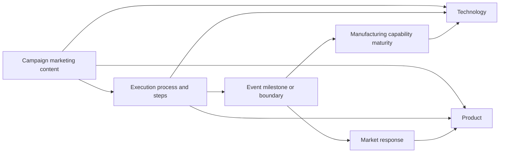

# Current model guide — version 0.9.0

This guide explains the accepted model. [Principles](../../DATA_MODEL_PRINCIPLES.md) govern editing; [JSON Schemas](../../schemas/) and the [generated specification](FOUNDATION_SPECIFICATION.md) define exact fields, allowed values and references. Earlier proposals in the archive are historical rationale, not additional requirements.

## Story and editorial state

Each foundation file has a named list, such as `{ "actor": [...] }`. Records have stable IDs prefixed by dataset name. Owned structures stay nested; independently identified or independently authorized content belongs in a separate record connected by a typed reference.

Foundation data describes the fictional world. It contains no authorization status, provenance or migration metadata. Storytelling data holds those concerns. Authorization covers the exact hash of the **entire record**, including nested values. References never propagate authorization. If a record is too complex to approve in one step, decompose it. Pending confirmation and speculation have one current meaning: pending authorization. Do not introduce separate intended/achieved flags.

## Time and activity

Only events and processes carry structured story dates. An event has a single year/month/day date. A process has start and end boundaries; each is a calendar date, an event reference (`value: "event.id", precision: "event"`), or explicitly unknown (`value: null, precision: "unknown"`). Preserve precision; never invent a day to fill a missing date. The timeline cannot infer a duration from unknown boundaries.

Events and processes have numbered typed inputs and outcomes. Team actions belong in process `steps`; a step can reference a dated event or sub-process. Inputs can describe resources, requirements or acceptance criteria. Outcomes describe the candidate historical account, including deliverables and results. Authorization is the only acceptance distinction. An elapsed date does not establish that an outcome has been accepted.

Programmes have become processes. Coordinating relationships do not automatically imply parent/child ownership. Narrative periods were retired because the former groups mixed simultaneous activity without a sufficient common theme.

## Campaigns and subjects

Campaigns describe marketing objectives, audiences, messages, presentations and booths. Each references an execution process; its activities and timing live there. Campaign subjects reference products or technologies instead of duplicating their definitions.

Products include offerings, devices, software, services and families, without BOM/composition. Technology records describe interfaces, architectures, software methods and fabrication technology. Manufacturing capabilities describe scoped production capability and qualification requirements; maturity transitions are outcomes on dated carriers. A licence alone does not prove qualified production capability.

Qualitative market responses have their own records and reference subjects and triggers. They do not establish quantitative sales forecasts. Agreements own a required `clauses[]` array (empty when no terms are recorded). Each new clause contains exactly `id`, `kind`, `statement`, `value`, and `unit`; the containing agreement supplies ownership, so clauses do not repeat `agreement_id`. Clauses are reviewed and authorized with the whole agreement, not independently. Events and processes use an optional singular `agreement_id`; the plural field is invalid. Generic references resolve to whole foundation records, not embedded clauses. Legacy clauses remain accepted during individual agreement approvals, including validated legacy supersession links. New statements preserve conditions, timing, beneficiaries and equity basis without nested payloads. Use `target_` kinds for targets and null/null for non-quantitative clauses. Financial commitments and ownership retain their meaning; a budget is not actual expenditure.

## Application and validation

The application joins story records to external authorization by ID and content hash. The shared dataset registry is `code/model-contract.js`; the backend checks it against the manifest. Schema validation also checks references, calendar values, process ranges and numbered items. The current application does not manage a complete dependency workflow for proposals: prepare coherent groups and review their dependencies explicitly.

The backend authorizes exact current content or applies an explicitly reviewed before/after group. It validates the resulting graph, writes all affected files in one commit and rejects stale or concurrent updates. Schema changes require a separate reviewed deployment. See [editing](../EDITING_GUIDE.md), [review](../review/README.md) and [deployment](../RENDER_SETUP.md).

## Model versus presentation

The timeline may display a campaign and its execution process in one box, but they remain two independently identified and authorized records. “Mixed authorization” summarizes their different acceptance states; it is not a new stored status.

Visual nesting selects from existing parent/step/event references; it does not create ownership or change relationships. Work that cannot fit a stated date range remains separate, and details retain the underlying references. Non-proportional calendar spacing and clipped display ranges do not alter stored dates or their precision.

Table widths, autofit weights, pane sizes and full-screen mode are presentation choices. Do not add them to foundation or storytelling JSON. Reference labels combine an existing ID and name for display; they are not a new compound key. See the [application guide](../APPLICATION_GUIDE.md) for behaviour and controls. The data contract remains version 0.9.0.

## Timeline categories and swim lanes

Events and processes support an optional `category` string. The permitted non-empty values are `Adam's personal`, `Logix/AION investment`, `Product dev & launch`, `Ecosystem & Partners`, and `Competition`. An omitted field or `""` is empty; `null` and other spellings are invalid.

Assign a category only to a top-level event or process. Children must leave it empty and inherit their root's category. Ownership comes from process steps, event-based period boundaries, `parent_process_id`, or event `process_ids`. Inputs, outcomes, subjects and related-process references do not establish ownership. The model validator rejects a non-empty category on an owned child. When reparenting a root, clear its category in the same approval batch. Campaigns use their execution process's category; they have no separate category field.

The timeline displays five lightly colored vertical lanes, with an additional grey Uncategorised lane when matching records have no category. Each lane has a labeled collapse/expand button above the workspace. Collapse hides the lane and its cards, including undated entries, while leaving its button available. Controls work by keyboard and remain available in full screen. Lane visibility lasts until page reload; filter reset does not change it.

All lanes share the global calendar. Collapsing a lane does not move date anchors. Overlapping root groups occupy parallel columns within their lane; nested work retains compact duration tracks. Horizontal scrolling accommodates wider lanes. Filtering retains inherited categories from the complete ownership tree even when an ancestor falls outside the selected date range. Unknown dates remain in the separate undated section and follow the same lane visibility controls.

Categories describe the root programme's primary purpose. Semiconductor work under stepper installation remains Investment, and competitor events inside ecosystem programmes remain Ecosystem & Partners. Moving individual children into a different lane requires changing ownership, not assigning an override.

Category assignments are story changes: submit one Changes confirm proposal per affected record. The UI and schema can be deployed before those proposals are approved; records remain Uncategorised until their root assignment is authorized.

## Product definitions and composition (0.9.0)

The phase-1B identity-only boundary is superseded for product definitions. Base parts are physical leaves; devices own construction; software editions own executable contracts and delivery; commercial products own supplied configurations. Complete composition versions pin child versions and carry their own technical definitions. Temporal boundaries reference events/processes or remain explicitly unknown; no old calendar dates are copied from a legacy product source. See [import details](../PRODUCT_DEFINITION_IMPORT.md) and the generated specification for the strict attribute contracts.

## Product catalogue transition

Contract 0.9.0 adds `external_product` in `external_products.json`, with `id`, `name`, `description` and `specification` entries containing exactly `no`, `description`, `ref_id`, `ref_role`. Product `launch_campaign_id` and `launch_event_id` are optional together during migration and validated for campaign ownership and temporal containment when supplied. The external registry is initially empty; existing products and their authorizations are unchanged. See the [complete phase-2 contract](../PRODUCT_CATALOGUE_PHASE2.md).
