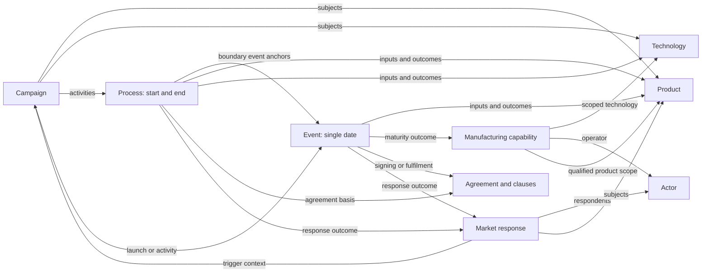

# Phase 1B (1.5) — narrative subjects and temporal discipline

**Design proposal, 29 October 2026.** The author has requested the phase and its direction. The specific fields, migration mappings and safeguards below are recommendations for review, not installed schemas or newly authorized story facts.

Evidence: `venwry/vs_edu1` **main**, fetched and verified at [`dac733770d8e622d5619bd84bc9d21db6c7ec7ab`](https://github.com/venwry/vs_edu1/tree/dac733770d8e622d5619bd84bc9d21db6c7ec7ab); current `aion_logix` baseline `6c33b7b`. Analysis covered the legacy JSON collections and current foundation records. No legacy financial models were rerun, and no external historical verification is claimed.

## Recommendation

**Introduce phase 1B, also called phase 1.5.** It supplies the subjects and consequences needed to make phase-one history coherent: identifiable products and technologies, manufacturing capability and maturity, and qualitative market responses. It brings these concepts forward from phases 2–4 without bringing forward product composition, detailed yield/cost calculations or sales forecasts.

The dependency problem is concrete: all **11 current campaigns lack `subject_ids` values**, even though their prose names products. Current reference schemas cannot target a `product` or `technology` dataset because neither exists in the foundation. Programmes likewise describe outputs such as AutoCAD, Team Edition and Athena largely in prose.

The proposed temporal discipline also makes sense: **events own points in time; processes own intervals; other entities reference those temporal carriers**. It requires a coordinated schema migration, not just renaming fields. The author has clarified that **authorization is the only distinguisher for results**: pending outcomes are proposed story results; authorized outcomes are accepted story content. No additional intended/achieved status is proposed. An interval ending does not itself authorize any outcome.

## 1. Revised phase boundaries

| Work stage | Responsibility after this change |
| --- | --- |
| Phase 1 | People, premises, agreements/clauses, campaigns and historical activity. |
| **Phase 1B / 1.5** | Product and technology identities and narrative-level specifications; fabrication technology and scoped maturity milestones; qualitative market responses; connections completing phase-one history. Also implement the approved event/process restructuring. |
| Phase 2 | Deepen specifications where needed; design composition, BOMs and underlying parts. Reuse phase-1B identities. |
| Phase 3 | Quantitative chip engineering, yield models, capacity and cost qualification. Reuse phase-1B manufacturing technology and capability identities. |
| Phase 4 | Deepen third-party hardware/software ecosystem detail and further responses. Do not remigrate or duplicate responses already established in phase 1B. |
| Phase 5 | Overall manufacturing costs, investments and retail prices. |
| Recurring assessment | Potential sales, market coverage and ROI; reassess whenever the accepted foundation changes. |

This is an iterative completion of phase-one dependencies, not a prerequisite that phase 1 must already be finished. Accepting a qualitative market response does not accept its forecast sales effect.

## 2. What the legacy data actually provides

Source paths below are relative to `vs_edu1/data/`.

| Source | Observed material | Phase-1B use | Leave for later / avoid |
| --- | --- | --- | --- |
| `product-catalog.json` | 63 products: 15 computers, 11 expansion kits, 15 computer/software bundles, 3 computer systems, 19 software offerings | Identity, vendor, positioning, named offering, campaign link and narrative-level requirements | `composition_history`, quantities, pricing and BOM policies. Do not read first composition validity as a universally valid shipment date. |
| `software-editions.json` | 32 technical editions with mixed `software.*` and `edition.*` IDs; interfaces, features and platform support | Distinguish software identity/version/edition where necessary to explain campaigns, compatibility or agreements | Physical media, licence-document kits, packaging and detailed composition. Do not count each commercial offer and its technical edition as unrelated products. |
| `services.json` | 15 services, including training/support | Named services used by campaigns or agreements can be product-kind `service` | Detailed pricing and fulfilment costing. |
| `standards.json` | 33 technologies, including four semiconductor node definitions | Preserve technology identity; typed specifications and technology relationships | Editorial `status`, free-text owner names and duplicate dates must not be copied as current foundation fields. |
| `devices.json`, `components.json` | 60 device definitions and 452 components | Select only independently referenced subjects missing from the commercial catalogue: controllers, monitors, processor families, memory chips, etc. | Do not import all components or their composition just to provide narrative references. |
| `manufacturing-processes.json` | Six memory recipes and 17 quarterly process-envelope rows | Technology/recipe identity, scoped qualification requirements and maturity history | Yield-budget calculations, defect-density curves, repair formulas, costs and estimated transistor budgets are phase 3 material, not automatically verified capability. |
| `demand-inputs.json` | 32 `market_reactions.events` references plus numerical forecast adjustments | Link already existing events to qualitative responses and reconcile date meaning | Monthly displacement/deferral/gain arrays, scenario multipliers and volume assumptions remain assessment inputs. |
| `ecosystem-inputs.json` | 1 external platform, 1 external partner device; 6 readiness entries, 8 OEM prospects, 12 application candidates, 7 hardware categories | Identify concrete partner subjects and candidate response narratives | A prospect is not a signed partner; a likely compatible application is not a qualified port. Pool counts and attach rates remain forecasts. |
| `events.json`, `contracts.json`, `campaigns.json`, `programmes.json`, `timeline-structure.json` | Launches, agreements, dependencies and narrative links scattered across sections | Recover links and reconcile with current accepted foundation content | Do not overwrite author-approved corrections with older source wording. |

The counts overlap in meaning and **must not be added to obtain a target product count**. A commercial bundle, a software edition, a platform and a physical device are distinct concepts, sometimes describing different aspects of the same named offering.

### Specific manufacturing evidence

The legacy technology roadmap has **3.0, 2.75, 2.0 and 1.5 µm** nodes. The 3 µm entry uses Micralign projection lithography; smaller nodes use a reduction stepper with node-specific qualification. The source explicitly separates qualification for logic, SRAM, DRAM and analogue recipes.

Keep these distinctions:

- Installing a stepper does not qualify every process recipe.
- General process release is not the same as a particular memory chip's release. Current events place the 2 µm general process review in **June 1982** and the 2 µm DRAM release target in **July 1982**; the corresponding 1.5 µm milestones are **September** and **October 1983**. These can be consistent scoped milestones, not date contradictions to merge.
- The 2.75 µm general process review is **June 1980**, whereas the memory recipe's availability is **June 1981**.
- The source retains ERA1 6/8 MHz on the original **3 µm** process. A newer memory node must not silently imply an ERA1 shrink. ERA² is a separately defined architecture and development subject.
- SMC's author-approved licence scope covers custom chips except the ERA processor family. SGS has its own arrangement; do not generalize the SMC exclusion to every partner or copy the legacy four-chip restriction back into the story.
- The quarterly envelope changes its newest node over time; older qualified recipes remain available. A single global “current node” would lose that fact.

## 3. Proposed phase-1B datasets

Keep the existing envelope convention: `{ "dataset": [...] }`, IDs prefixed by that dataset name, and no authorization/provenance fields inside foundation records. The following are **proposed contracts**, not approved executable JSON Schemas.

### product.json — a named narrative subject, without composition

```text
product[]
  id: product.*
  name: string
  kind: computer | hardware | software | software_edition | bundle | service | chip
  description: string
  provider_actor_ids[]: actor IDs
  family_product_id?: product ID
  version?: string
  technology_ids[]: technology IDs
  specification[]
    number: integer
    type: controlled characteristic category
    description: string
    value?: string | number | boolean
    unit?: string
  lifecycle[]
    type: announced | demonstrated | released | withdrawn
    event_id: event ID
```

`family_product_id` expresses family/variant identity, not a bill of materials. `specification` holds the capabilities necessary to understand the story: for example a display mode, an interface, or a software feature. It must not become a generic place to hide component counts or arbitrary nested JSON.

Bundles can have identity and positioning before their composition is designed. Do not invent contents. Likewise, only create family records that have an actual narrative role; do not confuse family identifiers with orderable SKUs.

A chip can receive a narrative product identity without importing its wafer/package BOM. Keep legacy `part.*`, `device.*`, `software.*`, `edition.*` and `computer_system.*` mappings outside the foundation. Preserve compatible `product.*` IDs where semantics match; explicitly reconcile collisions and editions instead of blindly renaming every prefix.

The lifecycle list gives semantic roles to event references. It contains **no dates**. The event owns the assertion that an announcement, release or withdrawal occurred; its subject reference and the product link must agree. A demonstration must never populate `released` automatically. If maintaining both directions proves unnecessarily repetitive, derive the product's lifecycle display from event outcomes instead; choose one canonical fact owner before implementing.

### technology.json — reusable technical concepts and specifications

```text
technology[]
  id: technology.*
  name: string
  kind: protocol | interface | architecture | software_method | fabrication
  description: string
  owner_actor_ids[]: actor IDs
  related_technology_ids[]: technology IDs
  specification[]: numbered typed characteristics
  fabrication?:
    feature_size_um: number
    wafer_diameter_mm?: number
    lithography_method: string
    recipe_scope[]: logic | SRAM | DRAM | analogue
```

Preserve the existing 33 technology identities where appropriate. Resolve free-text ownership to actors. Remove duplicate `introduced` dates; introduction, publication, qualification and revision are events or process outcomes.

Feature size is a technical parameter, not a universal capability score. Optical resolution, design-rule feature size and a qualified product process must not be treated as interchangeable measurements. Additional technical metrics need agreed names and definitions before schema extension.

### manufacturing_capability.json — whose capability, for what scope

```text
manufacturing_capability[]
  id: manufacturing_capability.*
  name: string
  actor_id: actor ID
  location_id?: location ID
  technology_id: technology ID
  recipe_kind: logic | SRAM | DRAM | analogue
  product_ids[]: product IDs, where the capability is product-specific
  description: string
  qualification_requirements[]: numbered typed descriptions
```

This distinguishes AION's DRAM capability from a partner's controller capability at the same nominal node. It describes a stable scope, **not a timeless current maturity value**.

Represent maturity changes in dated **event outcomes** referencing the capability. Proposed stages: `pilot`, `qualified`, `production_released`, `repeatable_production`, `suspended`. Store the stage once in the outcome's typed payload, not simultaneously in a second dated capability history. Technology-development processes connect the milestones.

A stage requires a defined scope and narrative evidence. “Mature” is not a substitute for measured yield, and installation of equipment is not a capability release. Numerical yield/cost curves remain phase 3. Review events can occur without granting qualification; their outcomes determine what was established.

### market_response.json — qualitative response identity

```text
market_response[]
  id: market_response.*
  title: string
  kind: adoption | partnership | competing_offer | compatibility_response |
        purchasing_response | channel_response | other
  respondent_actor_ids[]: actor IDs, when identifiable
  subject_ids[]: product / technology / campaign / agreement IDs
  trigger_ids[]: event / process / campaign / agreement IDs
  description: string
```

No independent dates or forecast volumes. Events and processes reference a response as an outcome and establish its timing. External authorization determines whether that proposed response occurrence is accepted story content. A response shared across several agreements/campaigns has one identity rather than repeated prose.

A trigger link records the proposed relationship; it does not prove exclusive causation. For example, a competitor's product launch is not necessarily caused solely by Logix. Collective customer responses may have no named actor; do not invent companies or named people to fill a mandatory field.

An agreement may be linked to proposed commercial responses, but authorizing its signing must not automatically authorize market adoption. Prefer agreement → implementation/release event or process → response outcome. Keep each proposed result pending until authorized; do not introduce `intended_response_ids` or a separate result-mode flag.

**Lean alternative:** represent every response only as a typed event/process outcome, without a new dataset. This is viable if responses never need independent cross-references or independent authorization. I recommend the separate dataset because your agreements/campaigns will reuse them, while keeping dates in their event/process carriers. Authorization of a response definition must not automatically authorize every event/process outcome that references it.

## 4. Event and process restructuring

### 4.1 Events: one temporal point, with preserved precision

Recommended shape:

```text
event[]
  id: event.*
  title, kind
  time: { value: calendar value, precision: year | month | day }
  participant[]: actor_id, role
  subject_ids[]: typed foundation references
  inputs[]: numbered input objects
  outcomes[]: numbered outcome objects
```

Remove `event.period`. A month-only or year-only event is a point with uncertain precision, **not an activity lasting that entire month or year**. The current 145 point events comprise 117 day, 27 month and 1 year values. Do not fabricate a day for the latter 28.

The current data has **78 occurred and 70 planned events**. Under the revised proposal, candidate events and results remain pending authorization rather than receiving a separate planned/achieved classification. Propose retiring `occurrence` alongside `completion_state`, subject to the schema migration review. Preserve a genuinely established commitment as agreement/clause content or a requirement input; its proposed fulfilment is a separate pending outcome. An authorized cancellation is an event/result assertion, not an editorial rejection.

Exactly three current events have real intervals and should become processes, with explicit ID/reference remapping:

| Current event | Interval | Recommended treatment |
| --- | --- | --- |
| `event.aurelia_campaign_preparation` | May–June 1978 | Preparation process; retain month precision. |
| `event.ncc78_sessions_media` | 5–8 June 1978 | Sessions/media activity process; reconcile overlap with `process.ncc1978_broadcast` rather than duplicating its work. |
| `event.ncc82_case_studies` | August–September 1982 | Customer-results/beta preparation process. |

Other date-stamped event titles may describe continuing activity. Review their meaning individually: an event can mean “roadshows began” or “programme approved”; the ongoing work belongs to a process. The 32 legacy market-reaction references largely point to existing events, so enrich/reclassify those records instead of importing 32 duplicate occurrences.

### 4.2 Processes: intervals and event anchors

Recommended shape:

```text
process[]
  id: process.*
  title, kind, description
  participant[]: actor_id, role
  period:
    start: boundary
    end: boundary
  parent_process_id?: process ID
  agreement_ids[]: agreement IDs
  subject_ids[]: product / technology / capability / response / other typed IDs
  inputs[]: numbered input objects
  outcomes[]: numbered outcome objects
```

Support the author's boundary notation:

```json
{
  "period": {
    "start": { "value": "event.autodesk_agreement", "precision": "event" },
    "end": { "value": "event.autodesk_comdex", "precision": "event" }
  }
}
```

This is an **illustration**, not an approved assertion that every Autodesk activity ended at COMDEX. A presentation is not automatically the end of support or commercial fulfilment.

Boundary variants should be a strict schema union:

- Calendar boundary: `value` is a calendar value; `precision` is `year`, `month` or `day`.
- Event anchor: `value` is an `event.*` ID; `precision` is `event`. Resolve the calendar value and its precision from the target event.
- Unknown boundary, proposed for incomplete drafts: `{ "value": null, "precision": "unknown" }`. Keep both boundary keys present without inventing a date. Whether a scoped record can be finalized with an explicitly unknown boundary is an author decision.

`precision: event` is really a reference discriminator, not calendar precision. This is acceptable as your chosen compact notation if validators and documentation state the distinction. Restrict it to process boundaries; event dates must remain literal points, preventing temporal reference cycles.

Five current processes lack structured periods: `apple_compatibility`, `artemis_engineering`, `ncc1980_preparation`, `ncc1978_broadcast`, `aionix_relocation`. “After NCC” or “before NCC” is a bound, not equality with the NCC event. Preserve those constraints in review evidence until boundaries are settled; do not turn them into falsely exact event anchors.

Validate interval ordering using precision-aware bounds. Overlapping month/year bounds can be indeterminate rather than demonstrably reversed. Do not silently substitute 1 January or the first of a month. Equality may represent a same-day process, but it should be reviewed rather than automatically turned into a point event.

### 4.3 Remove completion_state; authorization determines accepted results

Remove `completion_state` as requested. The author subsequently clarified that pending authorization is the sole distinction for proposed results: **do not add `mode`, intended/achieved flags or a replacement process-status enum**.

There are currently **24 planned and 8 completed processes**. Preserve these old labels in migration evidence while reviewing their proposed results; do not use them to grant or remove authorization automatically. A candidate delivery belongs in `outcomes` and remains pending until accepted. An approved outcome asserts that result as part of the story. A process may have several outcomes, some accepted and others pending.

An elapsed end date does not authorize delivery. An accepted process definition, its inputs or its parent coordinating process must not implicitly authorize all its results. If the story says a project stopped or a result was abandoned, record that as a proposed cancellation/termination event or outcome for review. Rejecting a proposal editorially does not create a cancellation in the fictional world.

The distinction between a promise and its fulfilment is expressed by **separate assertions**, not result statuses: an authorized clause can establish the promise, while the proposed delivery outcome remains pending.

### 4.4 Only events/processes own story dates

Remove temporal fields from other foundation schemas and replace them with typed references where needed:

| Existing owner | Proposed temporal link |
| --- | --- |
| Agreement `valid_time` | Effective/termination events or a validity process; signing is not automatically effectiveness. |
| Clause `effective_time` | `effective_event_id`, or another explicitly scoped temporal carrier. |
| Actor relationship `period` | Referenced relationship/tenure process. |
| Assumption `valid_time` | A relevant applicability process or activation/withdrawal events. |
| Product/technology introduction and availability | Lifecycle events and development/qualification processes. |
| Capability maturity / market response | Event/process outcomes; no duplicate date history. |
| Campaign | Launch event and activity event/process references; displayed duration is derived. |

Only five current clauses actually contain `effective_time`; all concern the **12 October 1978 Logix share transfer** and can reference `event.logix_share_transfer_1978`. The other listed temporal fields are currently empty in their datasets, but must be removed from schemas if this discipline is adopted.

Apply the rule to structured **story timestamps**, not every occurrence of a number or date-like phrase. A 2 µm specification, a two-day course duration, a six-month credit validity or a monetary reference year is not itself a dated story occurrence. Editorial review timestamps and source publication dates remain in `data_storytelling`. Human-readable prose may mention dates; it must not become an independent date authority.

## 5. Inputs and outcomes: numbered, typed, linked

Every event and process should contain `inputs` and `outcomes` arrays. Empty arrays are valid while the story is under review; do not invent a prerequisite or result solely to satisfy the schema.

Minimum requested fields are `number`, `type` and `description`. For useful relations and safe migration I recommend:

```text
input / outcome value object
  number: positive integer, unique within that owning list
  type: controlled category
  description: string
  subject_ids[]: typed foundation IDs
  evidence_event_ids[]?: event IDs
  source_outcome?: { record_id: event or process ID, number: integer }
  maturity?: { capability_id: manufacturing_capability ID, stage: controlled value }
```

`number` is a local item identifier/display number, **not a quantity**. Preserve it when reordering; otherwise `source_outcome` links would break. Inputs and outcomes may both contain item 1 because they are separate lists. They remain parent-owned value objects, not a new general dataset.

Example input types: `resource`, `prerequisite`, `requirement`, `acceptance_criterion`, `agreement_basis`. Example outcome types: `deliverable`, `decision`, `qualification`, `maturity_transition`, `market_response`, `milestone`. Final enums should be tested against actual migration examples before approval.

Do not introduce an intended/achieved distinction in `mode`, `type` or any other foundation field. Types describe **what** the item asserts (`deliverable`, `qualification`, etc.); external authorization determines whether the assertion is accepted. A pending outcome is written as a concrete candidate result, with editorial explanations outside the foundation.

`source_outcome` avoids copying a predecessor's result into every dependent process. It points to a specific outcome number; graph validation checks existence and forbids circular prerequisite chains. Not every descriptive cross-reference implies a prerequisite, so do not reject all cycles in the general reference graph.

### Acceptance gates as inputs

This is sound **when an input means a requirement to be satisfied**. Autodesk's “drawing load/save and DXF exchange tests” can be an `acceptance_criterion` input to development or its release review. Successful completion of the tests is a separate qualification outcome, supported by a dated event and accepted only when authorized.

Authorizing that criterion establishes the requirement, not that it has passed. It would be misleading to translate it into a resource already provided or a prerequisite already satisfied before development began. Also, a gate can depend on a result produced by the same work: model it as a criterion, not a circular resource dependency.

### Authorization granularity required by the clarification

The existing application authorizes whole records. It cannot yet authorize the process definition while leaving particular outcomes pending, or authorize one numbered outcome without accepting the others.

**Recommended extension, for schema/UI review:** identify each review target externally by its owner record ID, target scope (`record`, `input` or `outcome`) and, for an item, its stable `number`. Store authorization and content hashes in `data_storytelling` only. The generic `record` scope for these new event/process records covers their core fields; inputs/outcomes have their own authorization targets. Use explicit batch selection if the author wants to approve them together.

An outcome fingerprint must bind its owner, list identity, item number and full item content. The process/event core fingerprint excludes independently reviewed input/outcome lists; this must be a **versioned change** from today's whole-record hash contract, not a silent reinterpretation of old approvals. Non-event/process records can retain whole-record authorization. Current evidence hashes and original snapshots remain intact.

The browser should show the core's authorization plus counts of pending inputs/outcomes, and offer item checkboxes. A parent checkbox must not silently authorize all its children. The accepted baseline includes the authorized core and authorized assertions whose required entity/core dependencies are also accepted. It must not include pending results merely because their owner was approved.

For example: the Autodesk development process and its resource commitments can be accepted, while its proposed AutoCAD release outcome remains pending. Authorizing that release outcome establishes it as story content. No `intended` or `achieved` field is needed.

This additional granularity is a proposal needed to support the requested semantics, **not functionality already implemented**. An alternative is to promote each independently reviewable result into a separate record; that is less consistent with the requested owned input/outcome lists. Avoid approving an entire mixed record while representing its outcomes as independently pending without an explicit contract.

### Existing actions and terms still need homes

Do not mechanically recast all `event.action` or `process.step` descriptions as inputs. A start announcement or decision can become an outcome; sustained work can become a child process; useful narrative belongs in a description. Real material resources, constraints and acceptance requirements become typed inputs. Editorial notes go to `data_storytelling`.

Contract clauses remain independently identified records. Reference their obligations from process inputs instead of copying their legal meaning into every activity.

## 6. Programme migration: merge by meaning, not by filename

There are **13 programmes**, containing **63 deliverable rows** and **24 acceptance-gate rows**. Many rows are flattened migration fragments. For example, Academy “deliverables” include course durations, a promotional-credit policy and establishment dates; Athena “acceptance gates” include open pricing decisions. These cannot be mechanically relabelled.

| Programme | Recommended target |
| --- | --- |
| `organisation_buildout` | A bounded organization-buildout process only after its scope/boundaries are established; reuse actual founding/recruitment events. |
| `academy` | Academy launch/operation process as appropriate; course/service definitions become products, credit policy remains a policy or contractual term, actual launch dates reference events. |
| `open_compatibility` | A coordinating compatibility process with existing workshops/roadshows as children where appropriate. Separate a permanent published standard from finite activity. |
| `aionix` | Merge relevant content into `process.aionix_development`; preserve relocation as distinct work, not automatically a development subtask. |
| `smc_transfer` | Merge into existing `process.smc_transfer`; retain SMC rights in its agreement/clauses. |
| `sgs_transfer` | Merge into existing `process.sgs_transfer`. |
| `clone_partnerships` | Coordinating process for product preparation, localization, channel readiness and launch; keep individual partner agreements separate. |
| `team_development` | Merge into `process.team_development`. |
| `autodesk_development` | Merge into `process.autodesk_development`; distinguish equipment/support inputs from the AutoCAD deliverable and acceptance criteria. |
| `athena_1983` | Coordinating process for `era2_development` and `athena_integration`, with their distinct deliverables. Move open decisions to authoring review records. |
| `aurelia_memory` | Memory integration/qualification process; separate engineering work from its later cost assumptions. Do not invent a completion day from “1979-Q3”. |
| `bpi_launch` | Merge overlapping qualification scope into `process.bpi_qualification`; preserve training/channel work as separate linked activity where its scope differs. |
| `tandy_cooperation` | A bounded integration/cooperation process linked to existing contact, agreement, design review, demonstration and release events. |

Keep sponsor actors as process participants with an explicit sponsor role. Preserve agreement references. Replace `programme_id` links with the chosen process relationships. A single `parent_process_id` is ownership/containment; if one activity supports several coordinating processes, use separately defined contribution/dependency links rather than duplicating the activity or silently selecting one parent.

Remove the programme dataset only after every reference is remapped. Preserve the old-to-new mapping in authoring data. It is not a 13-record append: several programmes overlap existing processes.

## 7. All nine narrative periods assessed

I compared the original `timeline-structure.phases[].event_refs` with the current events' `narrative_period_ids`. Current memberships below exclude the legacy `event.power` item absent from the current first period. Period boundaries often follow successive trade shows; they are not automatically process start/end evidence.

| Period suffix | Current linked events | Thematic assessment and recommendation |
| --- | ---: | --- |
| `foundations` | 5 | Identity arrival, lottery, relocation/investing, office and DRI founding. Some fit financial preparation; none is a Harvard study event, and the study process extends to 1976 while the period ends in 1974. **Do not convert the group wholesale.** An investment activity process is possible only from its actual scope; reuse the existing studies process. |
| `prepare_aurelia` | 16 | Strongest thematic candidate: company formation, CP/M/BPI/MPI arrangements, recruitment, retail/training and campaign preparation. A bounded **Aurelia launch-readiness** coordinating process is plausible, but AIONix preliminary work is partly a later-platform stream. Select real contributions and establish boundaries; do not copy the whole period mechanically. |
| `ncc78` | 26 | Aurelia launch plus Apple reactions, Tandy talks, SMC transfer, AIONix ownership, stepper procurement and DRI portability. **Mixed chronological bucket.** Retain launch/campaign processes and separate partner/manufacturing streams. |
| `ncc79` | 14 | Apple/S-100 products and open-compatibility work mixed with IBM investigation, stepper acceptance, SMC sales and 2.75 µm pilots. **Extract an open-compatibility campaign/process subset**, not a single process for all members. |
| `comdex79` | 7 | Aurelia+/Pulse/Abacus launch plus IBM project/OS review, Apple–Peachtree and Tandy responses. **Retire the grouping.** Existing launch/campaign work and separate response records cover its themes. |
| `ncc80` | 7 | Artemis launch/adoption plus manufacturing releases, IBM OS funding and third-party adapters. **Extract Artemis launch/adoption activity where appropriate**, keep manufacturing and competitor responses independent. |
| `comdex80` | 15 | Software32/Team work plus financial review, DRAM release, capacity orders, clone agreements and SGS transfer. **Mixed bucket**, not an Abacus/Pulse development process. |
| `ncc81` | 13 | Network launch/pilots plus recession response, IBM qualification, process pilots, Team training, Unix competition and clone/SGS activity. **Select network launch/customer qualification subsets**, not a whole-period process. |
| `manufacturing_1981_1983` | 41 | Manufacturing milestones coexist with Team Edition, Autodesk, international clones, graphics/CAD campaigns, IBM and financial reviews. **The title misrepresents the full membership.** Reuse existing manufacturing-development processes for the relevant subset; retire the bucket. |

**Conclusion:** remove `narrative_period` from the live foundation as requested, but do not promote any of these nine records one-for-one. Themes are clues for a process proposal, not proof of common ownership, causality or completion. Preserve historical grouping in authoring snapshots if useful; remove event `narrative_period_ids` and update all allowed reference lists, loaders, filters and diagrams.

## 8. Relationship diagram



Only event/process nodes own structured story dates. Inputs/outcomes keep numbered descriptions and typed links; arrows do not imply that a linked outcome is authorized.

## 9. Risks, challenges and required safeguards

| Risk | Concrete consequence | Safeguard |
| --- | --- | --- |
| Phase 1B expands into full engineering | Importing 452 components and quarterly yield curves blocks campaign completion again | Start with referenced narrative subjects; explicitly exclude composition and quantitative costing. |
| Duplicate product identities | Commercial offer, software edition and platform counted as separate unrelated products | Identity reconciliation table before migration; preserve family/edition distinctions and legacy mappings. |
| Dates lose semantics | Signing, demonstration, production release and shipment collapse into one date | Typed lifecycle/milestone assertions and external authorization; preserve partial dates and unknown boundaries. |
| Removing completion loses truth | A planned process appears accomplished merely because its end date is in the past | Separately authorized outcomes and evidence events; never infer acceptance from elapsed time. |
| Acceptance gates become circular prerequisites | Development requires its own already-finished deliverable | Distinguish an acceptance criterion from an available input resource and from evidence that it passed. |
| Programme merge copies dirty prose | Equipment, dates and editorial notes become false deliverables | Semantic redistribution of all 63 deliverable and 24 gate fragments. |
| Technology maturity is overgeneralized | A qualified memory process implies qualified CPUs or partner production | Capability scoped by actor, site where known, recipe and product; date the specific maturity transition. |
| Market responses imply unjustified causation | An agreement “causes” adoption or competitor action without evidence | Keep proposed response outcomes pending until authorized; allow multiple triggers and independent actors' motives. |
| Forecast quantities become canon accidentally | OEM prospect volumes or compatibility pool estimates enter story facts | Keep numerical prediction inputs in the later assessment scope; proposals require explicit authorization. |
| ID conversion breaks the graph | Programme and duration-event references no longer resolve | Complete mapping across all datasets, nested outcomes, frontend links and editorial issue targets. |
| Authorization hashes become stale | Changing field structures invalidates accepted records even when meaning is unchanged | Versioned target/hash contract, old/new snapshots and explicit review of authorization preservation; no blanket reauthorization. |
| Application assumes old temporal structure | Timeline sorting, derived campaign ranges and browser detail/filter behavior fail | Update resolver, API registries, schema validators, browser/timeline and tests as one migration. |
| Unknown timing creates false precision | Five undated processes or broad programmes acquire invented boundaries | Explicit unknown representation and targeted author decisions; do not substitute trade-show boundaries. |
| Future schemas duplicate phase 1B facts | Phases 2–4 create fresh product/technology/response identities | Extend the same identities with approved domain structures; keep one owner for each fact. |

The present manifest/schema version is 0.3.0. These are breaking changes: stage a new version and archive the old contract. Historical decisions/snapshots should retain their original content and hashes, even when their old IDs require an external migration mapping to current records.

## 10. Proposed implementation sequence and review decisions

1. Approve the phase-1B boundaries and settle the model decisions below. Update the process roadmap while labelling these schemas as proposed.
2. Build a reference inventory and legacy-to-current identity mapping, starting with subjects of the 11 campaigns and the Autodesk, SMC, SGS, Tandy and Athena work streams.
3. Review linked examples before mass migration: **Autodesk/AutoCAD**, **SMC custom-chip transfer**, and **2 µm logic versus DRAM maturity**. These expose product identity, independently authorized requirements/results, partner scope and distinct milestone dates.
4. Design strict schemas and validators for the chosen subjects, input/outcome types and temporal union. Approve each extension before installation.
5. Stage new datasets and converted records in an isolated migration output. Resolve programmes, the three duration events, the five clause dates and narrative-period removal together.
6. Produce explicit before/after proposals and an authorization impact report. Preserve prior evidence; obtain decisions for new inferred facts and changed meanings.
7. Update the backend/frontend temporal resolver, dataset registries, references and views; test unresolved anchors, partial dates, stale authorization, maturity scope and atomic saves.
8. Publish the new version only once every surviving reference resolves and no story fact was lost. Reassess affected baseline-dependent predictions; do not pretend an automated forecast engine already exists.

**Design choices still requiring review before implementation:**

- Adopt the four proposed datasets, or keep market responses as inline outcomes only?
- Permit explicit unknown process boundaries while timing is unresolved?
- Approve authorization targets for each event/process core and numbered input/outcome, with a versioned hash contract and item-level UI, so authorization remains the only result distinguisher?
- Use acceptance criteria as required inputs and passing results as outcomes, rather than treating all gates as already-available prerequisites?
- Choose canonical event-owned lifecycle facts with derived reverse views, or enforce synchronized product-to-event lifecycle references?

My recommendation is **yes to phase 1B and the event/process discipline**, with the scoped capability model, explicit unknown boundaries and independently authorized numbered results. Per the author's clarification, no intended/achieved modes are proposed. Remove programme and narrative-period datasets through reviewed semantic mappings, not bulk renaming. This makes phase 1 more coherent without pretending the engineering, commercial outcomes or later quantitative models are already complete.
