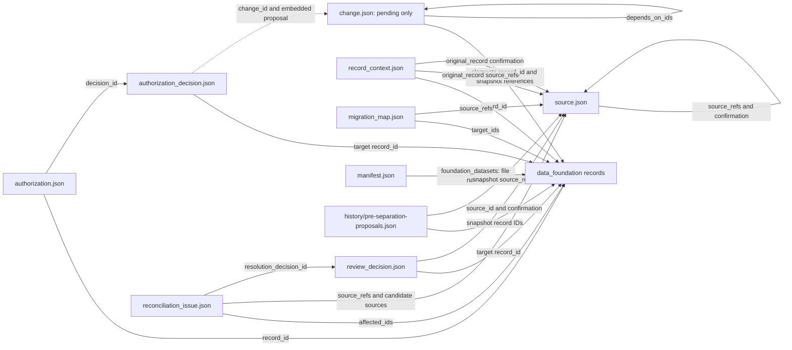

# Storytelling data — file reference

Snapshot: **29 October 2026**, repository baseline `b3a9abe`. This reference covers all **10 JSON files**, including the `history/` subdirectory, in `data_storytelling/`. Counts describe this snapshot and will change as the author reviews records.

## Overall purpose

`data_foundation/` describes the alternative world. `data_storytelling/` describes how that world was researched, migrated, reviewed and authorized. It contains both **active application state** and **preserved historical evidence**. These should not be interpreted interchangeably.

The browser and timeline join foundation records with `authorization.json` by record ID and verify their content hashes. They do not derive current authorization from legacy `status` fields. The browser calls unauthorized records **Pending authorization**. Approval of a proposed change updates the foundation and authoring files in one GitHub commit; authorizing existing content updates the authoring files without changing the story.

## File inventory

| File | Records | Overall purpose | Role today |
| --- | ---: | --- | --- |
| [authorization.json](../../data_storytelling/authorization.json) | 440 | Content-specific authorization state for foundation records | Active; 61 authorized, 379 unauthorized |
| [authorization_decision.json](../../data_storytelling/authorization_decision.json) | 1 | Audit history of direct application saves | Active history; one applied change involving three records |
| [change.json](../../data_storytelling/change.json) | 0 | Proposed changes awaiting approval | Active queue; currently empty |
| [manifest.json](../../data_storytelling/manifest.json) | 1 | Model version, foundation dataset inventory and former metadata | Active version contract plus historical metadata |
| [record_context.json](../../data_storytelling/record_context.json) | 439 | Original records from before editorial/story separation | Historical snapshots, not live copies |
| [source.json](../../data_storytelling/source.json) | 36 | Bibliography and author-decision evidence | Preserved source catalogue |
| [migration_map.json](../../data_storytelling/migration_map.json) | 2,273 | Mapping of legacy material to migrated records or explicit exclusions | Preserved migration coverage |
| [reconciliation_issue.json](../../data_storytelling/reconciliation_issue.json) | 23 | Conflicts, missing information and reconciliation outcomes | Editorial issue register; 18 open, 5 resolved |
| [review_decision.json](../../data_storytelling/review_decision.json) | 93 | Decisions imported through the earlier review-log workflow | Historical decisions: 35 revisions, 58 confirmations |
| [history/pre-separation-proposals.json](../../data_storytelling/history/pre-separation-proposals.json) | 1 | Original proposal with its old statuses and sourcing | Immutable historical snapshot, not a pending queue |

## Reference map

Arrows indicate logical references or lookups, not automatic cascading updates. A historical snapshot may contain references to the world as it existed at that time.



An applied proposal disappears from the active queue. Therefore a decision's `change_id` is a historical identifier: the preserved `proposal` inside that decision supplies the evidence even when no matching record remains in `change.json`.

## Structure notation and shared references

The structures below describe observed fields and, where stated, supported runtime fields. `[]` denotes an array; `?` marks a field absent from some records or conditional on the action. These outlines summarize the files rather than replace JSON Schema. Embedded foundation snapshots retain their dataset-specific nested structures.

The four legacy editorial datasets (`source`, `migration_map`, `reconciliation_issue`, `review_decision`) retain envelope `metadata` containing:

```text
metadata
  description: string
  schema_version: string
  used_by_pages[]: string
  used_by_calculations[]: string
```

Page/calculation identifiers are consumer metadata, not foreign keys to story records. Their values describe the earlier model and do not necessarily identify current application pages.

Repeated historical evidence structures are:

```text
source_refs[]
  source_id: string → source.id
  path?: string
  pointer?: string
  note?: string
confirmation?
  source_id: string → source.id
  record_sha256: string
```

`path` locates a file within the cited source repository; `pointer` identifies a JSON location within that file. An empty pointer denotes the document root. Neither is a reference to a current foundation record. A hash is a fingerprint, not an ID or a link. Citation text may also mention document paths without constituting a machine-validated relation.

## authorization.json

**Purpose:** record whether the author authorized the exact current content of each foundation record.

```text
{ authorization: [
  id: string
  record_id: string
  state: "authorized" | "unauthorized"
  content_sha256: string
  decision_id?: string
] }
```

**References:** `record_id` resolves to `data_foundation/<ID prefix>.json`, matching the record's `id`. `decision_id`, when present in current data, identifies an entry in `authorization_decision.json`. Three entries currently reference the one direct-save decision; older authorizations do not have this field. Their supporting history remains in `review_decision.json` and pre-separation context.

**Behavior:** the content hash covers the pure foundation record using stable JSON serialization. Authorized state alone is insufficient: a missing entry or mismatching hash displays as pending authorization. This file stores both states; it is not only a list of unresolved items. A grouped approval can update several entries with the same decision ID.

Current schema: [authorization.schema.json](../../schemas/storytelling/authorization.schema.json).

## authorization_decision.json

**Purpose:** preserve what the author authorized through the authenticated application, including exact before/after content.

```text
{ authorization_decision: [
  id: string
  action: "authorize_record" | "authorize_records" | "approve_change"
  actor: string
  decided_at: date-time string
  change_id?: string
  proposal_sha256?: string
  proposal?: object
  target[]
    record_id: string
    before: object | null
    after: object | null
    content_sha256: string | null
] }
```

**References:** `target[].record_id` identifies the affected foundation record. `before` and `after` contain complete snapshots, whose internal actor, agreement, event and other references retain the meanings of their foundation schemas. `change_id` identifies the approved proposal; `proposal` embeds that proposal, including its elements and dependency IDs. `proposal_sha256` fingerprints the proposal reviewed by the author. `actor` is the reviewer label (currently `author`), **not** a reference to a fictional `actor` record.

**Behavior:** authorizing existing content uses equal before/after snapshots. Additions have `before: null`; removals can have `after: null` and a null hash. One batch authorization creates one decision with multiple targets and one GitHub commit. The current single stored decision is `approve_change`; the two authorization action types are supported by the schema/runtime but are not yet represented in this snapshot.

Current schema: [authorization_decision.schema.json](../../schemas/storytelling/authorization_decision.schema.json).

## change.json

**Purpose:** hold proposals awaiting review on Changes confirm. The current `change` array is empty.

Supported proposal shape, established by the backend and preserved proposals:

```text
change[]
  id: string
  category: string (story or schema review)
  title: string
  reason: string
  depends_on_ids[]: string
  elements[]
    record_type: string
    record_id: string
    before: object | null
    after: object | null
metadata
  description: string
  schema_version: string
  used_by_pages[]: string
  used_by_calculations[]: string
  repository: string
  baseline_commit: string
  created_at: date string
  questions[]: empty in current file
  applied_summary: string
```

**References:** `elements[].record_id` selects a foundation record; `record_type` selects its dataset. Snapshot fields can reference other foundation records. `depends_on_ids[]` identifies related change proposals; the preserved example has no dependencies. `repository` and `baseline_commit` identify historical GitHub context, not a story entity. The current application checks before snapshots and resulting graph validity; it does not separately enforce `depends_on_ids` as a dependency graph. Schema proposals require a separately reviewed schema deployment.

**Behavior:** an applied proposal is removed from this queue and retained inside its new authorization decision. Proposal snapshots in this active workflow are story-only; legacy statuses and sourcing remain outside them.

**Observed stale metadata:** `description` and `applied_summary` still say John Walker remains proposed. That wording contradicts the empty queue and the applied authorization decision. Treat the queue and decision history as current state; these metadata strings need a separate cleanup. The historical `baseline_commit` is not the current repository head.

There is no dedicated current JSON Schema for this complete proposal envelope. The backend validates proposal identity/hash, before snapshots, dataset identities and the resulting foundation graph.

## manifest.json

**Purpose:** identify the current foundation contract while preserving metadata removed from foundation envelopes.

```text
{ manifest: [
  id: "manifest.foundation"
  schema_version: "0.3.0"
  foundation_datasets[]: dataset name
  previous_metadata
    <dataset name>
      description: string
      schema_version: string
      used_by_pages[]: string
      used_by_calculations[]: string
] }
```

**References:** the 11 `foundation_datasets` values map to `data_foundation/<name>.json` and the corresponding schema files. Keys under `previous_metadata` use the same dataset names. Consumer identifiers inside that metadata are historical application/calculation labels, not story references.

**Behavior:** the GitHub backend rejects an unsupported manifest schema version. The application/backend also have dataset registries in code; editing this manifest alone does not dynamically install a new dataset. `previous_metadata` is archival and retains old version `0.2.0` wording intentionally.

## record_context.json

**Purpose:** preserve complete original records as they stood before the foundation/editorial split, including sources, statuses, date annotations and earlier confirmation evidence.

```text
{ record_context: [
  id: string
  record_id: string
  original_record
    id: string
    status: legacy status
    source_refs[]: source reference
    confirmation?: confirmation evidence
    <original dataset fields and nested structures>
  note: string
] }
```

**References:** `record_id` associates the snapshot with its foundation identity. `original_record.id` repeats that historical identity. Source and confirmation IDs resolve to `source.json`; dataset-specific references inside the original record point to story identities. Date `basis` and `qualifier` fields are preserved editorial annotations, not current foundation date fields.

**Behavior:** this file is not refreshed whenever a story record changes. Its 439 entries describe the separation snapshot, whereas the foundation now contains 440 records. John Walker was added afterward; his addition is documented in `authorization_decision.json`, so the differing counts do not by themselves indicate lost provenance.

Current schema: [record_context.schema.json](../../schemas/storytelling/record_context.schema.json). The embedded original record is historical payload, not a record to validate against the current foundation schema.

## source.json

**Purpose:** catalogue where information came from: 1 repository snapshot, 33 historical documents and 2 author-decision sources.

```text
source[]
  id: string
  status: legacy status
  kind: string
  title: string
  url?: string
  commit?: Git commit hash
  citation: string
  source_refs[]?: source reference
  confirmation?: confirmation evidence
metadata: legacy dataset metadata
```

**References:** `source_refs[].source_id` and `confirmation.source_id` link to other source entries or source evidence within this catalogue. `url` points outside the dataset, usually to a repository or historical document. For a repository snapshot, `url` plus `commit` fixes the historical version against which citation paths and JSON pointers should be read. Author-decision citations mention review documents under `docs/review/history/`.

**Interpretation:** being listed as a source does not make a claim authorized canon. Its legacy `status` (34 pending, 2 confirmed) is preserved provenance information and does not control the browser's foundation authorization badges.

Historical schema: [source.schema.json](../../schemas/archive/0.2.0/source.schema.json).

## migration_map.json

**Purpose:** account for how legacy input material was handled during migration, including material deliberately left out or deferred.

```text
migration_map[]
  id: string
  status: legacy status
  source_refs[]: source reference
  legacy_id?: string
  target_ids[]: foundation record ID
  disposition: string
  rationale: string
metadata: legacy dataset metadata
```

**References:** `source_refs` identifies the source catalogue entry and its legacy file/JSON location. `legacy_id` is an identifier in that original system, not necessarily a valid current ID. `target_ids[]` identifies resulting foundation records. Empty target lists are meaningful for excluded or deferred material.

Current dispositions: **1,287 mapped**, **646 merged**, **29 split**, **241 deferred**, **70 excluded**. These are mapping-record counts, not counts of distinct source files or foundation records. Several mappings can lead to the same target. All mapping entries retain the old pending-confirmation status; that does not revoke authorization of their target records.

Historical schema: [migration_map.schema.json](../../schemas/archive/0.2.0/migration_map.schema.json).

## reconciliation_issue.json

**Purpose:** track uncertainty or contradictions discovered during migration and subsequent editorial review, with recorded resolutions where available.

```text
reconciliation_issue[]
  id: string
  status: legacy status
  source_refs[]: source reference
  title: string
  kind: string
  description: string
  affected_ids[]: foundation record ID
  state: string
  candidate[]?
    statement: string
    source_refs[]: source reference
  resolution?: string
  resolution_decision_id?: string
metadata: legacy dataset metadata
```

**References:** `affected_ids[]` locates the story elements involved. Issue-level and candidate-level `source_refs` point to the source catalogue and original evidence locations. `resolution_decision_id` links to `review_decision.json` in current records; it is not a pointer to the newer authorization-decision log.

Current states: **18 open, 5 resolved**. Kinds: **13 classification**, **5 indirect mention**, **4 conflict**, **1 missing source**. The archived schema requires a resolution and decision ID when resolved, and at least two candidates for a conflict. All 23 records retain the old pending-confirmation `status`, including resolved issues: issue lifecycle and the old authorization label are separate concepts.

Historical schema: [reconciliation_issue.schema.json](../../schemas/archive/0.2.0/reconciliation_issue.schema.json).

## review_decision.json

**Purpose:** preserve decisions applied from the earlier uploaded approval/confirmation logs, before direct backend saving was introduced.

```text
review_decision[]
  id: string
  status: legacy status
  source_refs[]: source reference
  source_id: string
  decision: string
  target[]
    record_id: string
    record_sha256: string
  rationale: string
  confirmation
    source_id: string
    record_sha256: string
metadata: legacy dataset metadata
```

**References:** top-level `source_id`, `source_refs[].source_id` and `confirmation.source_id` identify author-decision evidence in `source.json`. `target[].record_id` identifies the historical target story record. Its `record_sha256` fingerprints the reviewed target version; the confirmation hash covers the review record's own historical evidence representation. Neither should be substituted for today's clean-foundation `content_sha256`.

**Interpretation:** the file contains **35 revise** and **58 confirm** decisions, all with legacy status `confirmed`. A confirmed decision to revise is not automatically a confirmation of the resulting story record. Current authorization is determined by `authorization.json`. New direct-save and batch decisions go into `authorization_decision.json`, not this older log.

Historical schema: [review_decision.schema.json](../../schemas/archive/0.2.0/review_decision.schema.json).

## history/pre-separation-proposals.json

**Purpose:** preserve the original John Walker founder-representation proposal exactly as it existed before the split, including evidence removed from active story snapshots.

```text
change[]
  id: string
  status: legacy status
  category: string
  title: string
  reason: string
  depends_on_ids[]: change ID
  elements[]
    record_type: string
    record_id: string
    before: original record | null
    after: proposed original-format record | null
metadata: original proposal-envelope metadata
```

**References:** proposal `elements[].record_id` values identify the actor, event and agreement under review. Before/after snapshots contain both normal foundation references and old `source_refs`/confirmation evidence. Those source IDs refer to `source.json`. `depends_on_ids` has the same proposal-identity meaning as in the active queue. Metadata preserves the old repository, baseline commit and consumer identifiers.

**Interpretation:** the stored pending label and “John Walker remains proposed” text describe the archive date. They are not current pending work. The applied version is preserved by `authorization_decision.json`; this historical file should not be rewritten merely to make its wording match today's queue.

## Maintenance and validation boundaries

- Keep current foundation authorization in `authorization.json`; do not infer it from any archived `status`, migration mapping or issue state.
- Preserve historical snapshots and their hashes. A changed foundation record can legitimately differ from its `record_context` or earlier review target.
- The backend currently validates foundation content/references and the current authorization/authorization-decision schemas. `record_context` has its own schema, but the save transaction does not load or validate that archive. The remaining historical datasets have archived schemas; they are not all revalidated by each save.
- Some links are conventions rather than enforced foreign keys. For example, the current authorization schema types `decision_id` as a string; proposal dependency IDs are not an enforced execution order. A structurally valid file does not prove that every editorial reference resolves.
- The stale metadata in the active `change.json` can be corrected separately. Leave matching historical text in the archived proposal unchanged.

This documentation summarizes the existing files and behavior. No story records, authorization states, source evidence or proposal contents were changed to produce it.
