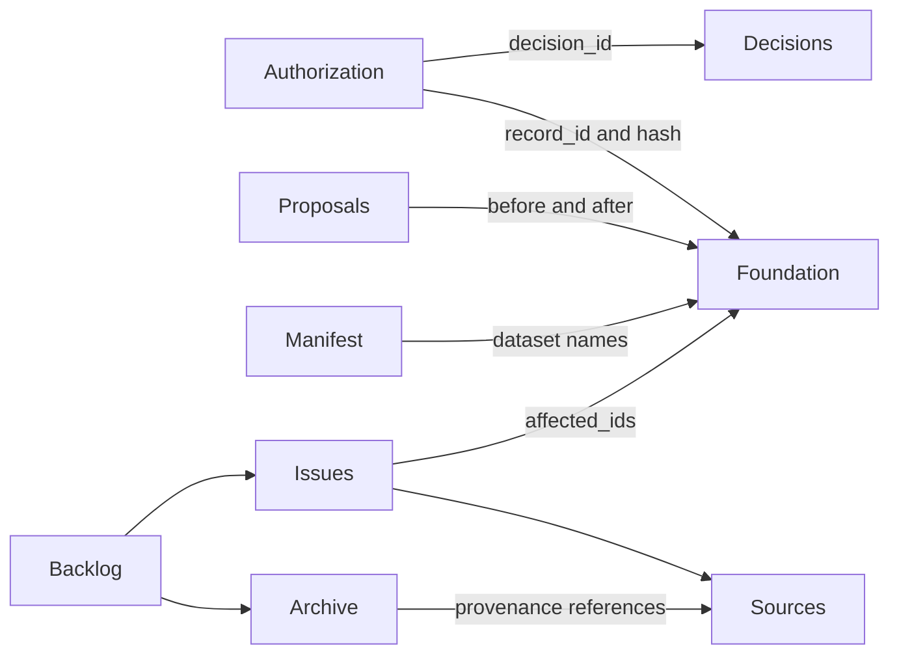

# Storytelling data — current file reference

Current contract **0.8.0**. `data_storytelling/` contains eight active JSON files. The counts in the original handover rows below are historical; consult the files for current counts. Historical material is inventoried in [the archive](../../archived_no_longer_valid/README.md); unresolved work is indexed in [the backlog](../REVIEW_BACKLOG.md). The former reference is retained as a historical snapshot.

Foundation records describe the fictional world. Storytelling files describe author authorization, proposals, sources and editorial questions. The GitHub saving backend loads authorization, authorization decisions, proposals, the manifest, annotations and change reviews. The documentation viewer also exposes sources and open issues; they do not control authorization badges.

| File | Purpose | Handover contents |
| --- | --- | --- |
| [authorization.json](../../data_storytelling/authorization.json) | Exact-content, whole-record authorization state | 653 entries: 54 authorized, 599 unauthorized |
| [authorization_decision.json](../../data_storytelling/authorization_decision.json) | Append-only direct-save audit evidence | One applied change decision; grows with subsequent saves |
| [change.json](../../data_storytelling/change.json) | Active proposals awaiting review | Empty queue; not evidence that the story is complete |
| [manifest.json](../../data_storytelling/manifest.json) | Current model version and dataset inventory | Version 0.8.0; 15 foundation datasets |
| [annotation.json](../../data_storytelling/annotation.json) | Append-only revisions of record feedback | Initially empty |
| [change_review.json](../../data_storytelling/change_review.json) | Append-only refinement feedback on exact proposal revisions | Initially empty |
| [source.json](../../data_storytelling/source.json) | Source bibliography and author-evidence catalogue | 36 sources; inherited provenance format |
| [reconciliation_issue.json](../../data_storytelling/reconciliation_issue.json) | Unresolved editorial questions | 17 open issues; references rebased to current identities |

## Authorization

`authorization.json` has envelope `{ authorization: [...] }`. Each entry contains `id`, `record_id`, `state` (`authorized` or `unauthorized`), `content_sha256`, and optional `decision_id`. `record_id` references a foundation record; `decision_id` references a direct-save decision where present. Older authorizations can lack a direct-save decision ID; their evidence remains in archived review decisions and context snapshots.

The hash covers the complete foundation record using recursively sorted object keys and preserved array order. The application compares that hash with current content. A missing or mismatched authorization is pending; references never propagate authorization. See [authorization schema](../../schemas/storytelling/authorization.schema.json). Runtime validation checks shape and identity; content matching is also enforced by the UI and authorization transaction.

## Authorization decisions

`authorization_decision.json` has envelope `{ authorization_decision: [...] }`. Entries contain `id`, `action`, `actor`, `decided_at`, and `target[]`. Actions are `authorize_record`, `authorize_records` and `approve_change`. Targets contain `record_id`, complete `before`/`after` snapshots and `content_sha256`; nullable snapshots represent creation/removal. Change decisions also preserve `change_id`, `proposal_sha256` and the embedded `proposal`.

`actor` is the reviewer label, not a fictional actor ID. Targets identify story records; their snapshots preserve the exact version reviewed. An applied proposal is removed from the active queue, so its historical `change_id` need not resolve there. The embedded proposal is the evidence. New decisions must not rewrite old snapshots to follow later model changes. See [decision schema](../../schemas/storytelling/authorization_decision.schema.json).

## Proposed changes

`change.json` contains `change[]` and `metadata`. A proposal has `id`, `category`, `title`, `reason`, optional `depends_on_ids[]`, and `elements[]`. Each element identifies `record_type`, `record_id`, `before` and `after`. References within the resulting story snapshots must resolve in the complete resulting foundation graph. New elements have `before: null`.

The backend verifies proposal hashes and before snapshots, validates the resulting graph, and applies the selected proposals atomically. Changes confirm sends `approve_changes` with a `changes[]` list of `change_id` / `proposal_sha256` pairs. The legacy `approve_change` request remains supported. A batch saves once in one Git commit, while recording one existing-format `approve_change` audit decision per proposal; no editorial schema change is needed. Conflicting edits to the same record are rejected, and references between new records in the same batch are checked against the complete resulting graph. Retrying already-applied proposal hashes is idempotent. It rejects schema-category proposals: schema deployment is a separate reviewed change. Dependency IDs describe related proposals but are not an automatically executed dependency graph. There is no dedicated current schema for the complete proposal envelope; runtime validation is supplemented by proposal tests.

Current metadata holds description, transport format version, page/calculation consumers, repository and questions. Historical baseline date/commit and retrospective summary were archived; they do not describe a future proposal. The empty queue does not mean all records or issues are authorized/resolved.

## Manifest

`manifest.json` contains one `manifest` entry with `id: "manifest.foundation"`, `schema_version: "0.6.0"` and `foundation_datasets[]`. Dataset names resolve to foundation files and corresponding schemas. The saving backend rejects an unsupported version. Keep this list consistent with `code/model-contract.js` and the schemas; editing the manifest alone cannot install a new model.

`previous_metadata` was moved into the preserved pre-cleanup manifest because it described earlier foundation envelopes rather than the current contract.

## Sources

`source.json` retains `source[]` and legacy `metadata`. Source entries contain `id`, `kind`, `title`, `citation`, optional `url`, `commit`, `source_refs[]`, `confirmation`, and inherited `status`. There are one pinned repository snapshot, 33 historical documents and two author-decision sources.

`source_refs[].source_id` and `confirmation.source_id` reference this catalogue. Source paths and JSON pointers identify material in the cited repository at its pinned commit. Citations referring to former `docs/review/history/` locations resolve through the [archive inventory](../../archived_no_longer_valid/inventory.json). Phase 1B source references now live in its archived migration report and continue to use this catalogue.

Legacy source status/confirmation fields are historical evidence, **not current foundation authorization**. They are retained unchanged to preserve original hashes. The historical [source schema](../../archived_no_longer_valid/schemas/archive/0.2.0/source.schema.json) describes the inherited format; the save transaction does not validate or modify this catalogue. A future source-format migration requires an explicit model review.

## Open reconciliation issues

`reconciliation_issue.json` retains `reconciliation_issue[]` and legacy `metadata`. Entries contain `id`, `title`, `kind`, `description`, `affected_ids[]`, `state`, `source_refs[]`, inherited `status`, and optional `candidate[]` with statements/source references. The original format also supports `resolution` and `resolution_decision_id`.

`affected_ids[]` references current foundation identities; source references resolve to `source.json`. In historical resolved entries, `resolution_decision_id` references the archived `review_decision.json`, not the direct-save decision log. Legacy pending status is distinct from issue lifecycle and does not alter story authorization.

The full original 23-entry register is preserved in the archive. Five already-resolved entries and the settled Autodesk signatory question were removed from the active register. The other 17 remain open. This cleanup does not settle their wording or authorize any story records. See [backlog and rationale](../REVIEW_BACKLOG.md). The inherited [issue schema](../../archived_no_longer_valid/schemas/archive/0.2.0/reconciliation_issue.schema.json) is historical; current tests check active issue references. These files are not part of the live save transaction.

## Historical lineage

The archive preserves record contexts, old review decisions, source mappings, complete 0.3 foundation snapshots, approval logs and the phase 1B report. Its inventory provides exact original paths and checksums. Historical IDs resolve against their snapshot; use phase 1B `id_mapping` and `product_mapping` to connect retired identities to current records. Historical hashes must never replace current authorization hashes.

The 0.5.0 migration removes current clause authorization entries because clauses are now owned by agreements. The removed entries and pre-migration clause data/schema are preserved under `archived_no_longer_valid/model_0.4.0_agreement_migration/`. Historical decision snapshots remain unchanged. Changed whole records are pending renewed authorization.

## Product-definition import

Contract 0.7.0 registers 15 datasets. The definition-only import creates fresh external Unauthorized entries for base parts, devices and software editions, with exact content hashes and no inherited decision IDs. Existing product/capability changes are queued for individual whole-record review. Import coverage lives in `docs/product-definition-import-audit.json`, not in foundation records or the append-only authorization decision history.

## Editorial feedback (0.8.0)

`annotation.json` has envelope `{ "annotation": [] }`, validated by `schemas/storytelling/annotation.schema.json`. A revision contains `id`, `record_id`, `content_sha256` (the reviewed foundation content), `text`, `state` (`open`, `resolved`, `dismissed`), nullable `supersedes_id`, `actor`, `created_at`, and `change_ids`. The first revision has a null predecessor; each later revision names the current tip for that record. Prior text remains immutable. The server derives actor/time; this deployment uses the shared author identity, not individual-user attribution. Deleted foundation records do not invalidate historical annotations.

`change_review.json` has envelope `{ "change_review": [] }`, validated by `schemas/storytelling/change_review.schema.json`. Revisions contain `id`, `change_id`, `proposal_sha256`, `text`, `state: "needs_refinement"`, nullable `supersedes_id`, `actor`, and `created_at`. Chains are scoped to change ID plus exact proposal hash. A changed proposal hash starts a new review context. Old feedback never silently rejects or authorizes a replacement revision.

`POST /api/feedback` accepts `save_annotations` or `save_review_feedback` with `entries[]`. Every entry carries a client-generated immutable revision ID and expected `supersedes_id`; retries are idempotent. Annotation requests additionally carry `record_id`, `content_sha256`, `text`, and `state` (`open` or `dismissed`). Review requests carry `change_id`, `proposal_sha256`, and `text`. Text must be non-empty and at most 20,000 characters. The request body limit is 256,000 bytes. All entries validate and save together or none save. Saving feedback never touches authorization or foundation content.

Proposals may declare `annotation_ids[]`, linking exact committed source revisions, and `depends_on_change_ids[]`. Required pending proposals must be selected together, or their approval must already exist in the decision log. Combine inseparable changes inside one proposal's `elements[]`. On approval, a linked annotation is automatically resolved only if it is still the current open revision. If the author has since edited it, the newer annotation remains open. Merely preparing a proposal does not resolve its annotation.
