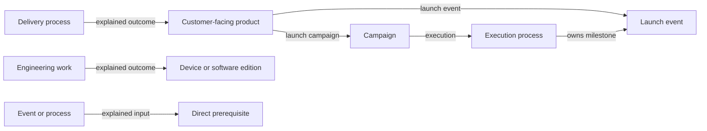

# Current model guide — version 0.9.2

The model separates fictional-world records, editorial review and later calculations. [Principles](../../DATA_MODEL_PRINCIPLES.md), [reference rules](REFERENCE_RULES.md) and [JSON Schemas](../../schemas/) govern editing. The [generated specification](FOUNDATION_SPECIFICATION.md) describes exact attributes; historical reports do not extend the contract.

## Entities and ownership

Foundation datasets have singular envelope keys and stable typed IDs. The shared registry is `code/model-contract.js`. Most filenames match the type; `external_product` uses `external_products.json`. Owned value objects remain nested and are authorized with their containing record.

Actors describe people and organisations. Actor relationships describe meaningful relationships between them. Agreements own `clauses[]`; new clauses contain exactly `id`, `kind`, `statement`, `value`, `unit`. Clause IDs preserve traceability but are not independently authorizable records. Use null value/unit for a non-quantitative term and meaningful units for quantities. Legacy clause forms remain schema-compatible during review. Rights, responsibilities, commitments and ownership stay distinct; a budget is not actual expenditure.

Events and processes describe activity. Events have one year/month/day date; processes have start/end boundaries represented by calendar dates, event references or explicit unknowns. Team actions belong in process steps, which can reference events or subprocesses. Preserve precision. Do not infer dates, ownership or prerequisites from visual proximity.

Inputs explain direct prerequisites; outcomes explain deliveries, decisions, changes or qualification. Top-level subjects are exceptional. Follow the [reference rules](REFERENCE_RULES.md), including stage-specific inputs and the distinction between a commitment and a finished deliverable.

## Marketing and products

Campaigns own marketing objectives, audiences, messages, presentations and booth content. `process_id` identifies their execution process and supplies timing. Product launch campaign/event links are authoritative when populated. Repeated reverse launch lists and inherited product lists should be removed through reviewed migrations; later promotion and external participation are distinct relationships that must survive.

`product` means a Logix/AION customer-facing offering. `base_part` defines a physical part; `device` owns hardware construction; `software_edition` defines a software implementation. Third-party commercial offerings use descriptive `external_product` records with `id`, `name`, `description` and `specification` entries containing exactly `no`, `description`, one `ref_id` and `ref_role`. Direct relationships distinguish publishers, licensors, hosts, implementations and agreements. External descriptions do not replace technical BOMs.

A physical cartridge can be a Logix offering while its software is licensed from another company. Keep the commercial product, cartridge device, software edition and governing rights distinct. Software platform support can reference an external computer host; that does not permit external descriptions as physical composition targets.

Commercial product specifications describe package contents, entitlements, duration, eligibility, service scope and delivery terms. The current model does not support pricing information: exclude prices, fees, discounts, price histories and pricing placeholders from every field of products, events, processes and campaigns. Do not relocate them into technical records or another existing dataset; a future pricing model requires separate design. Hardware features, implementation limits and technology references belong to the canonical device/computer or software-edition record. Keep the required product `technology_ids` array empty in revised offerings; check that removed technical facts are already represented at their proper destination or move them in the same reviewed change. A cartridge offering points to its device, which owns the physical BOM and includes the software edition. Do not put that cartridge inside the edition it contains.

Specification items use repeatable semantic types such as `feature`, `duration` or `exclusion`. `number` identifies the item; type labels need not be unique. Write a short plain-English explanation in `description` and the substantive term in `value` (for example, `1 year`). Do not expose import paths such as `features[1]` as types or duplicate the entire explanation in the value. Service duration is an entitlement, not a new historical date. A course's delivery location is a feature of the concrete course, not an additional course product.

Legacy chip/device/software aliases and product families remain accepted by the compatibility schema pending individual migrations. Their acceptance by the schema does not redefine the intended product model. No OEM sales structure is inferred from the existence of a base part.

## Composition and manufacturing

Products, devices and software editions support complete `composition_history` versions. Each version owns its technical definition, composition lines and assembly requirements. Versioned child targets are pinned explicitly. Physical quantities, unknown quantities, conditional supply and service/licence entitlements retain their meanings; support services are not physical part leaves.

Composition boundaries reference dated events/processes, remain explicitly unknown or use allowed open ends. They do not import legacy launch dates. Product composition supplies the package; device composition supplies physical construction; software editions retain their executable contracts. Do not duplicate a software edition as a second physical cartridge merely to record licensing.

Technology records describe architectures, interfaces, methods and fabrication technology. Manufacturing capabilities describe scoped recipes and qualification. Dated maturity transitions belong in event outcomes. A licence, pilot or historical elapsed time does not prove production readiness. Costs, yields, sales forecasts and ROI calculations require separately designed calculation models.

## Timeline ownership and categories

Ownership is expressed through process steps, event boundaries, `parent_process_id` or event `process_ids`. Inputs, outcomes and general references do not establish it. Keep one owner; preserve dates and empty the child's category when reparenting. Root categories are `Adam's personal`, `Logix/AION investment`, `Product dev & launch`, `Ecosystem & Partners` and `Competition`. Omitted or empty-string categories are empty; null is invalid. Campaigns inherit their execution process's category.

Product launch references must be supplied as a pair when used. The launch event must belong directly or through subprocesses to the campaign execution process and fit its period. Multiple products may share a campaign/event, and a campaign can contain several launch events. Mandatory links for every legacy product remain deferred until the migration is reviewed.

## Validation and authorization

Foundation has no authorization, provenance or application state. Storytelling JSON carries proposals, feedback and exact-content authorization. Approval covers the whole record; references never authorize their targets. A missing or mismatched hash is Pending authorization.

The schema rejects undeclared properties and invalid reference types. Graph checks cover reference existence, dates, composition constraints, category inheritance and populated product launch relationships. They do not prove that a dependency is necessary, that a claimed relationship is direct, or that an engineering test passed. Those are review responsibilities.

The application joins records and authorization by ID/hash. UI layout, filtering, table widths, annotations and selection history are separate from foundation semantics. Consult the [application guide](../APPLICATION_GUIDE.md) and [storytelling reference](STORYTELLING_FILE_REFERENCE.md) for current behavior and transport formats.
