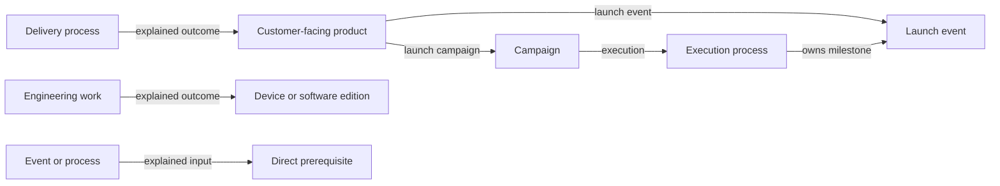

# Current model guide — version 0.14.0

The model separates fictional-world records, editorial review and later calculations. [Principles](../../DATA_MODEL_PRINCIPLES.md), [reference rules](REFERENCE_RULES.md) and [JSON Schemas](../../schemas/) govern editing. The [generated specification](FOUNDATION_SPECIFICATION.md) describes exact attributes; historical reports do not extend the contract.

## Entities and ownership

Foundation datasets have singular envelope keys and stable typed IDs. The shared registry is `code/model-contract.js`. Most filenames match the type; `external_product` uses `external_products.json`. Owned value objects remain nested and are authorized with their containing record.

Actors describe people and organisations. Actor relationships describe meaningful relationships between them. Agreements own `clauses[]`; new clauses contain exactly `id`, `kind`, `statement`, `value`, `unit`. Clause IDs preserve traceability but are not independently authorizable records. Use null value/unit for a non-quantitative term and meaningful units for quantities. All current agreement clauses use this simplified form; the schema still accepts the legacy representation for compatibility. Rights, responsibilities, commitments and ownership stay distinct; a budget is not actual expenditure.

Assumptions use a short `topic` as their displayed heading and an ordered, non-empty `statements` array of non-empty strings. Split long prose into coherent statements without changing its meaning. Scope, equipment and exceptions keep their existing roles. The schema accepts either this form or the legacy single `statement`, never a mixture; legacy support keeps existing and historical records valid while the migration is reviewed.

Events and processes describe activity. Events have one year/month/day date; processes have start/end boundaries represented by calendar dates, event references or explicit unknowns. Team actions belong in process steps, which can reference events or subprocesses. Preserve precision. Do not infer dates, ownership or prerequisites from visual proximity.

Inputs explain direct prerequisites; outcomes explain deliveries, decisions, changes or qualification. Process inputs may reference prerequisite events, processes or subjects. Process outcomes retain explained subjects; steps retain event or subprocess membership links. Unused process input maturity fields, outcome event/process/maturity fields, and step subject/maturity fields are removed. The legacy event item maturity payload is transitional, as described below. Top-level subjects are exceptional. Follow the [reference rules](REFERENCE_RULES.md), including stage-specific inputs and the distinction between a commitment and a finished deliverable.

## Marketing and products

Campaigns own marketing objectives, audiences, messages, presentations and booth content. `process_id` identifies their execution process and supplies timing. Every current offering has authoritative product-owned launch campaign/event links. Repeated reverse launch lists and inherited product lists should be removed through reviewed migrations; later promotion and external participation are distinct relationships that must survive.

`product` means a Logix/AION customer-facing offering. `base_part` defines a physical part; `device` owns hardware construction; `software_edition` defines a software implementation. Third-party commercial offerings use descriptive `external_product` records with `id`, `name`, `description` and `specification` entries containing exactly `no`, `description`, one `ref_id` and `ref_role`. Direct relationships distinguish publishers, licensors, hosts, implementations and agreements. External descriptions do not replace technical BOMs.

A physical cartridge can be a Logix offering while its software is licensed from another company. Keep the commercial product, cartridge device, software edition and governing rights distinct. Software platform support can reference an external computer host; that does not permit external descriptions as physical composition targets.

Commercial product specifications describe package contents, entitlements, duration, eligibility, service scope and delivery terms. The current model does not support pricing information: exclude prices, fees, discounts, price histories and pricing placeholders from every field of products, events, processes and campaigns. Do not relocate them into technical records or another existing dataset; a future pricing model requires separate design. Preserve the specifically author-retained 10% depot-repair discount in Regular Support; this exception does not establish a general pricing model. Hardware features, implementation limits and technology references belong to the canonical device/computer or software-edition record. The unused product `technology_ids` field is retained only as an optional empty array until its cleanup proposal is approved; omit it from new offerings; check that removed technical facts are already represented at their proper destination or move them in the same reviewed change. A cartridge offering points to its device, which owns the physical BOM and includes the software edition. Do not put that cartridge inside the edition it contains.

Product specification items use repeatable semantic types such as `feature`, `duration` or `exclusion`. `number` identifies the item; type labels need not be unique. Write a short plain-English explanation in `description` and the substantive term in `value` (for example, `1 year`). Do not expose import paths such as `features[1]` as types or duplicate the entire explanation in the value. Service duration is an entitlement, not a new historical date. A course's delivery location is a feature of the concrete course, not an additional course product.

The accepted catalogue has no chip/software-edition aliases or artificial families as products. Those old kinds remain schema-compatible, but are not valid authoring choices under the current product principles. The stricter optional profile checks this distinction. No OEM sales structure is inferred from the existence of a base part.

## Composition and manufacturing

Products, devices and software editions support complete `composition_history` versions. Device and software versions own their technical definitions; all versions own composition lines. Product technical-definition objects and software assembly-requirement arrays are currently empty transitional fields awaiting approved removal. Versioned child targets are pinned explicitly. Physical quantities and recorded unknown quantities retain their meanings; service definitions belong to their product specifications, and services are not physical part leaves. Customer-facing product compositions should describe fixed supplied contents: separate platform alternatives into distinct offerings, and leave independently purchased options outside the package. Current product compositions have fixed contents. New and revised composition lines omit `unit` and `supply_condition`: every listed item is required, and `quantity` counts complete units of the referenced item. Describe the contents of a kit, assembly or documentation set in that referenced definition. Known counts must be positive integers; explicit unknown quantities remain null. The active schema temporarily accepts the old fields so current records stay valid while removal proposals await approval. The resolver preserves explicit legacy conditions until approval; omission means always supplied.

For the five reviewed OEM assemblies, the proposed supply boundary excludes the formerly conditional part from the OEM purchase and includes it explicitly as a mandatory device BOM item. Update the OEM part and device requirements together. Color Monitor I retains the HV and deflection circuitry included in its Sony kit; only its separate RGB DAC/amplifier assembly is excluded from that purchase. Exact procurement identities and electrical/raster qualification remain engineering requirements, not assertions of completed qualification.

Composition lines use optional descriptive `element_type` text. Preserve existing classifications such as `main_product`, `connected_device` and `attached_product`; enrich them with useful former `role` text, separated by an em dash. If only a role exists, use its text as `element_type`. If both were empty or absent, do not invent a classification. The retired `role` attribute is rejected by the active schema. Historical snapshots retain their original form. Connectivity comes from `connection`/`placements`, never by parsing `element_type`. Roles elsewhere in the model are unaffected.

For Regular Support inclusions, keep the duration and service scope in `product.service_regular_support`. Each composition line records the number of service units in `quantity`; one unit covers one computer for the defined one-year term. Do not duplicate that definition in an `entitlement` block. Keep quantities of two or four where a package covers multiple computers. Regular Support can be bundled with a computer or purchased independently as an extension. The former composition `entitlement` and product `service_definition` structures are removed from the active schema. Describe service duration and scope in the referenced product specification.

For new and revised compositions, start the initial product version at the product-owned launch event. Start a device or software edition at its earliest supported use, following explicitly pinned composition versions through containing products/devices; a later product revision contributes its own effective date, not the product's original launch. External editions can use their partner launch. A documented earlier engineering handover takes precedence over commercial release; preserve its date precision. A compatible host alone does not prove use. If no dated use exists, keep the start unknown and open a discussion.

Use contiguous half-open intervals `[effective_from, effective_until)`: the date that ends one revision starts its successor, with no overlap or gap. Connect each revision to the event that makes that specific composition effective. Process-boundary composition references are no longer supported in new records; historical snapshots remain readable. Do not stamp every revision with the initial launch. When a precise revision assignment is inferred, explain it in the proposal for author review.

The final version defaults to `{"kind":"simulation_end"}`, resolved centrally by `code/model-contract.js` to **1995-01-01**, exclusive. This boundary is allowed only as the last version's end. It is an arbitrary simulation horizon, not a historical event, product withdrawal, guaranteed continued availability or cancellation of commitments beyond 1995. Do not invent a story event or add an arbitrary date field for it. A real earlier end remains meaningful when explicitly established. Existing unknown/open boundaries remain schema-compatible; the default applies through reviewed changes, never a silent rewrite. Base parts have no composition histories; this rule does not add temporal fields to them.

For missing software version labels, use an evidenced or explicitly approved extrapolation; otherwise use the author's scenario default `1.0`. The 1979 Model II CP/M edition is proposed as `1.6`; the Aurelia CP/M core and Platform Extensions retain their distinct version identities. Preserve known labels. Record the basis for defaults in editorial review evidence, not as historical release claims in foundation metadata.

For diskette composition quantities, the author's scenario defaults are: Abacus one; AION C IDE two; full BPI suite three; other diskette media groups one. Separate BPI network client/server distributions use the other-case default; each separately listed SDK media group is one diskette. These interpretations remain reviewable in the proposals. Count physical diskettes on the edition's composition lines, with each referenced base-part unit representing one physical diskette. These counts do not prove that released images fit; retain image/format and installation qualification. Do not extend diskette defaults to site-dependent cables, optional hardware or service entitlements. Legacy unknowns remain valid where these defaults do not apply. Product composition supplies the package; device composition supplies physical construction; software editions retain their executable contracts. Do not duplicate a software edition as a second physical cartridge merely to record licensing.

Technology records describe architectures, interfaces, methods and fabrication technology. Manufacturing capabilities describe scoped recipes and qualification. Dated maturity transitions belong in event outcomes. Use `type: "maturity_transition"`, reference the manufacturing capability in `subject_ids`, and state its stage in the outcome description. Do not duplicate that reference in a `maturity` object. The stage labels currently being preserved are pilot, qualified, production released and repeatable production; the former schema also admitted suspended. Descriptions must distinguish a target or review from an achieved transition; this format change does not resolve that historical question. A licence, pilot or historical elapsed time does not prove production readiness. Costs, yields, sales forecasts and ROI calculations require separately designed calculation models.

## Technology specification chapters

Technology `specification[]` uses `{number, chapter_name, description, parameters}`. Each parameter is exactly `{key, value}`, both text. `number` is a positive integer and is unique within the record. Keys are unique within their chapter, case-sensitive, nonblank and cannot contain braces. Other entity types retain their existing specification schemas; technology chapters do not change product or external-product specifications.

Write a short chapter name and plain-English explanatory paragraphs. Store named technical parameters in `parameters[]`, and insert them in the description using `{key}`. For example:

```json
{
  "number": 12,
  "chapter_name": "Electrical link and operating rates",
  "description": "The port starts at {Startup rate (bps)} bps before negotiating a supported rate.",
  "parameters": [{"key": "Startup rate (bps)", "value": "125000"}]
}
```

Parameter tables hold named data, not abbreviated prose. Express Boolean capability flags as natural English statements; do not interpolate `true` or `false` into a sentence. Move policies, commitments, requirements and other sentence-valued entries into the description, retaining their limits and qualifications. Every retained parameter must be used in the description through its `{key}` placeholder; remove redundant or irrelevant keys rather than leaving unexplained table rows.

Consolidate numbered members of the same list into one key with an ordered textual value. Preserve repeated values when order matters, such as a `3, 2, 2, 2` clock sequence. Distinct memory layouts, address maps and platform profiles need meaningful names and preserved relationships, not a flattened list that loses which values belong together. A long enumeration may remain a parameter; a long statement belongs in prose. Keyboard bindings may remain short parameters while command scope and conditions belong in explanatory sentences.

Substitutions are local to the chapter and nonrecursive. An unknown key fails model validation. Descriptions and values are plain text, never HTML or executable templates. Parameter values can retain existing record IDs as descriptive links; they do not create a new structured reference relationship. Keep the existing typed ownership and related-technology fields meaningful.

The author-directed format migration preserves every original item number, renames `type` to `chapter_name` and keeps `description` unchanged. It adds a parameter named `value` only when the former value converted to text differs from the description, otherwise uses an empty list. Conversion is case-sensitive; numeric and Boolean values become text. Existing source records have no item-level units to migrate. Historical snapshots remain unchanged and readable, but the active technology schema accepts only the new chapter format.

Editorial regrouping is a separate reviewed change. Each proposed chapter retains the number of its first contributing item; gaps after grouping are intentional. Preserve a coverage map in review evidence so every former entry is traceable. Keep technical values, command identities, platform limitations, uncertainties and qualification gates; clearer wording cannot turn a target into measured performance. Existing typed fabrication attributes remain in place.

## Timeline ownership and categories

Ownership is expressed through process steps, event boundaries or event `process_ids`. The unused `parent_process_id` field has been removed. Inputs, outcomes and general references do not establish it. Keep one owner; preserve dates and empty the child's category when reparenting. Root categories are `Adam's personal`, `Logix/AION investment`, `Product dev & launch`, `Ecosystem & Partners` and `Competition`. Omitted or empty-string categories are empty; null is invalid. Campaigns inherit their execution process's category.

Product launch references must be supplied as a pair when used. The launch event must belong directly or through subprocesses to the campaign execution process and fit its period. Multiple products may share a campaign/event, and a campaign can contain several launch events. All current offerings have both links. The active schema still permits omission of both; mandatory enforcement is provided only by the optional catalogue profile until it is promoted into the runtime contract.



## Validation and authorization

Foundation has no authorization, provenance or application state. Storytelling JSON carries proposals, feedback and exact-content authorization. Approval covers the whole record; references never authorize their targets. A missing or mismatched hash is Pending authorization.

The schema rejects undeclared properties and invalid reference types. Graph checks cover reference existence, dates, composition constraints, category inheritance and populated product launch relationships. They do not prove that a dependency is necessary, that a claimed relationship is direct, or that an engineering test passed. Those are review responsibilities.

The application joins records and authorization by ID/hash. UI layout, filtering, table widths, annotations and selection history are separate from foundation semantics. Consult the [application guide](../APPLICATION_GUIDE.md) and [storytelling reference](STORYTELLING_FILE_REFERENCE.md) for current behavior and transport formats.

## Unused-field cleanup and review boundary

Absent fields were removed from contract 0.12.0. Four empty containers remain optional pending author approval: product `technology_ids`, product-version `technical_definition`, composition-line `requirements`, and software-version `assembly_requirements`. Their three Changes confirm proposals originally removed only existing empty instances. The revised proposals also remove composition `unit` and `supply_condition` and clarify the five device OEM boundaries; original before snapshots and proposal IDs are preserved. Remove their schema declarations only after approval. Explicit null engineering values remain meaningful unresolved specifications; shared fields used by other entity types and unknown-date representations remain supported. The complete audit is recorded under `data_storytelling/review_evidence/unused-field-cleanup/`.

Contract 0.13.0 supports composition lines without `unit` or `supply_condition`. Both fields remain optional, deprecated compatibility declarations until their proposed removal from current records is approved. Retire those declarations after approval, together with the approved empty-container declarations. The revised review evidence is under `data_storytelling/review_evidence/fixed-required-compositions/`; earlier evidence remains immutable.

## Maturity descriptions and schema retirement

Contract 0.14.0 accepts maturity outcomes expressed through description and subject references. The 21 Changes confirm proposals remove all 25 legacy payloads while retaining their stages in prose. The legacy `maturity` declaration is deprecated and temporarily retained to keep the current foundation valid during review. The exact final schema with that declaration removed is in `data_storytelling/review_evidence/maturity-description/common.schema.after.json`.

After approval removes every live payload, run `node tools/retire-maturity-schema.js --apply` to retire the compatibility declaration and regenerate the contract documentation. The command refuses to proceed while a foundation record or pending proposal after-snapshot still contains maturity. It never applies or authorizes foundation changes. Historical decisions and before-snapshots remain immutable.
